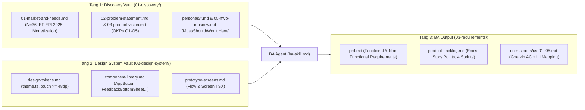

> **Liên kết ngữ cảnh:** [Skill Discovery (PO)](./skill.md) | [Skill UI/UX (React Native)](./ui-ux-skill.md) | [AI Harness Log](./prompts-and-reviews.md) | [PRD Chính thức](../03-requirements/prd.md) | [Product Backlog](../03-requirements/product-backlog.md) | [MVP MoSCoW](../01-discovery/05-mvp-moscow.md) | [Design Tokens](../02-design-system/design-tokens.md)

# SKILL: Business Analyst — PRD & User Story Agent (`ba-skill.md`)

## 1. Mục đích & Bài toán Ngữ cảnh (Skill Objective & Context Problem)
Trong quy trình Agile của đội **SBTC (VKU)**, khi bổ sung một thành viên hoặc AI Agent đóng vai **Business Analyst (BA)** để viết **PRD (Product Requirements Document)** và **User Stories**, người BA đó có kỹ năng phân tích nghiệp vụ nhưng **chưa có tri thức trước đó về sản phẩm** (Research Discovery, Personas, Design System).

File `ba-skill.md` giải quyết bài toán này bằng **2 cơ chế cốt lõi**:
1. **Knowledge Linking (Liên kết Kho tri thức):** Bắt buộc nạp toàn bộ tri thức đã khóa từ `01-discovery/` và `02-design-system/` làm đầu vào (*Single Source of Truth*) trước khi BA viết bất kỳ dòng yêu cầu nào.
2. **Standardized BA Output:** Chuẩn hóa cấu trúc **PRD (`write_prd`)** và **User Story (`write_user_story`)** bám sát 100% số liệu khảo sát $N = 36$, mục tiêu **OKRs**, phạm vi **MVP 4 tuần Vibe Code** và bộ **Component React Native** đã có.

---

## 2. Cơ chế Liên kết Tri thức (Knowledge Linking Architecture)

Trước khi thực thi lệnh viết PRD hoặc User Story, BA Agent **BẮT BUỘC** đọc theo đúng chuỗi liên kết 3 tầng sau:



### Quy tắc Truy xuất Tri thức cho BA (Mapping Rules)
* **Muốn viết Mục tiêu & Bối cảnh kinh doanh trong PRD:** Lấy từ `01-market-and-needs.md` (Freemium 6 tháng đầu, gói Pro `39.000đ–59.000đ/tháng`, Affiliate TOEIC/IELTS) và `03-product-vision.md` (5 OKRs `O1`–`O5`).
* **Muốn viết Phân khúc người dùng & Use Case:** Lấy từ `persona-01-student.md` (19t, 58,3% SV năm 1, KTX, học 5–10p) và `persona-02-working-pro.md` (23–28t, 10–15p nghỉ trưa/đi xe, nơi công cộng).
* **Muốn khóa Phạm vi tính năng (Scope):** Lấy từ `05-mvp-moscow.md` (chỉ đưa 5 Must-Have và 3 Should-Have vào MVP; đẩy toàn bộ *Won't Have* ra mục *Out of Scope*).
* **Muốn viết Đặc tả giao diện & Acceptance Criteria:** Phải gọi đúng tên Component trong `component-library.md` và ràng buộc Token trong `design-tokens.md` (ví dụ: `1 câu / 1 màn hình`, popup giải thích AI $\le 4$ dòng cỡ `15px`).

---

## 3. 4 Luật Cấm & Ghìm Cương BA Agent (Hard Constraints & Guardrails)

1. **LUẬT 1 — Không viết mò ngoài Kho tri thức (Strict Grounding Rule):**
   * BA tuyệt đối không tự bịa số liệu % hay tự nghĩ thêm tính năng mới chưa có trong `01-discovery/`. Mọi Functional Requirement (`FR`) phải truy vết ngược được về ít nhất 1 Pain Point ($N=36$) hoặc 1 mục tiêu OKR.
2. **LUẬT 2 — Chống Phình Phạm vi trong PRD (Anti-Scope Creep Rule):**
   * Mọi tính năng trong `prd.md` và `product-backlog.md` phải nằm gọn trong khung **4 tuần Vibe Code (4 Sprints)**. Bắt buộc có mục **Out of Scope (Won't Have)** liệt kê rõ: *Mạng xã hội diễn đàn mở, Livestream giáo viên bản ngữ, Học Offline 100%, AI 3D Metaverse*.
3. **LUẬT 3 — Bắt buộc Định lượng & Gherkin AC (`Testability Rule`):**
   * Không viết yêu cầu mơ hồ kiểu *"Hệ thống phải phản hồi nhanh, dễ dùng"*.
   * Yêu cầu phi chức năng (NFR) phải có con số cụ thể (ví dụ: crash $\le 2$ lỗi, phản hồi chấm phát âm $\le 3$ giây, touch target $\ge 48\text{dp}$).
   * Mọi User Story phải có tối thiểu 2–3 **Acceptance Criteria** viết theo chuẩn **Gherkin (`Given / When / Then`)**.
4. **LUẬT 4 — Khớp 100% Tên Component React Native (`Design-Code Alignment`):**
   * Trong phần đặc tả giao diện của User Story, BA phải dùng đúng định danh Component từ `02-design-system/component-library.md` (như `AppButton`, `AppTextInput`, `AppSelectDropdown`, `LessonProgressHeader`, `SingleTaskQuestionCard`, `FeedbackBottomSheet`, `PronunciationMicButton`, `StreakChallengeCard`) để UI/UX Agent và Developer đọc phát hiểu ngay.

---

## 4. Quy trình Thực thi 2 Lệnh Chuẩn của BA (`write_prd` & `write_user_story`)

### Quy trình 1: Viết PRD (`write_prd`)
1. Đọc `01-discovery/01-market-and-needs.md` $\rightarrow$ `05-mvp-moscow.md`.
2. Tổng hợp **8 phần chuẩn của `03-requirements/prd.md`**:
   * `1. Thông tin chung & Bối cảnh (Executive Summary)`
   * `2. Mục tiêu Sản phẩm & Chỉ số Thành công (OKRs & Key Metrics)`
   * `3. Chân dung Người dùng & Ngữ cảnh Sử dụng (Target Personas)`
   * `4. Phạm vi Sản phẩm (In-Scope MVP vs. Out-of-Scope)`
   * `5. Yêu cầu Chức năng (Functional Requirements FR-01..FR-08)`
   * `6. Yêu cầu Phi chức năng (Non-Functional Requirements)`
   * `7. Quy tắc Nghiệp vụ & Kiếm tiền (Business & Monetization Rules)`
   * `8. Ràng buộc Giao diện & Kiến trúc (Design System & Tech Constraints)`

### Quy trình 2: Viết User Story (`write_user_story`)
1. Chọn 1 hạng mục trong `prd.md` (`FR-01`..`FR-08`) và `03-requirements/product-backlog.md`.
2. Viết theo **5 khối chuẩn** trong `03-requirements/user-stories/us-*.md`:
   * `Liên kết ngữ cảnh` (link tới PRD, Backlog, Personas, Design System)
   * `Tuyên bố User Story (As a / I want to / So that)` gắn số liệu $N=36$
   * `Đặc tả Giao diện cho AI Generator` (liệt kê đúng Component & Token)
   * `Sơ đồ Luồng Tương tác (Mermaid flowchart / sequenceDiagram)`
   * `Tiêu chí Nghiệm thu (Acceptance Criteria — Gherkin Given/When/Then)`

---

## 5. Cách Gọi BA Skill Trong IDE / AI Agent (Usage Commands)

```text
@workspace Đọc kỹ luật và chuỗi Knowledge Linking trong #ba-skill.md.
Hãy nạp toàn bộ ngữ cảnh từ thư mục 01-discovery/ và 02-design-system/, sau đó thực thi lệnh [write_prd / write_user_story] để cập nhật [prd.md / user-stories/us-XX.md], đảm bảo tuân thủ 4 Guardrails (không bịa số liệu N=36, chống Scope Creep 4 tuần, có Gherkin AC và khớp tên Component React Native).
```
