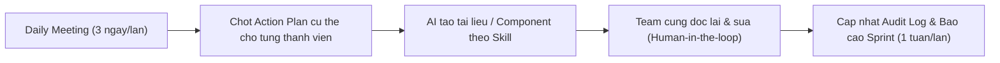

> **Liên kết ngữ cảnh:** [Skill Discovery (SSOT)](./skill.md) | [Skill UI/UX (React Native)](./ui-ux-skill.md) | [PO Kit](./po-kit.md) | [Market & Needs](../01-discovery/01-market-and-needs.md) | [Product Backlog](../03-requirements/product-backlog.md) | [Design Tokens](../02-design-system/design-tokens.md)

# 🐎 Nhật ký Điều phối & Kiểm soát AI (AI Harness Log)

Tài liệu này ghi lại cách nhóm **SBTC (VKU)** sử dụng các bộ Kit/Skill, câu lệnh đầu vào (Prompt) và quá trình con người kiểm duyệt, chỉnh sửa (**Human-in-the-loop**) qua từng giai đoạn của dự án **LingoCraft AI**.

---

## 1. Giai đoạn 1: Research & Discovery

| Tài liệu đầu ra | Công cụ / Kit sử dụng | Prompt / Input đầu vào của nhóm | Điểm AI làm chưa tốt (Hallucination / Lệch ngữ cảnh) | Cách nhóm đã ghìm cương & sửa lại (Human Review) |
| :--- | :--- | :--- | :--- | :--- |
| [Market & Needs](../01-discovery/01-market-and-needs.md) | PO Kit + [skill.md](./skill.md) | Yêu cầu phân tích nhu cầu người học tiếng Anh Việt Nam, đối thủ (Duolingo, ELSA Speak, Quizlet) và mô hình kiếm tiền từ dữ liệu khảo sát $N=36$. | Bản nháp đầu AI tự viết đối thủ dàn trải (Cambly, BBC, Memrise) và đề xuất giá gói Pro `149.000đ – 249.000đ/tháng` không khớp ngân sách sinh viên. | Nhóm đối chiếu với [skill.md](./skill.md), khóa lại 3 đối thủ trực diện (Duolingo, ELSA Speak, Quizlet), chuẩn hóa 3 Market Gaps, số liệu **EF EPI 2025** ($500/800$, Nói $461$, Nghe $470$) và giá Pro **`39.000đ – 59.000đ/tháng`**. |
| [Problem Statement](../01-discovery/02-problem-statement.md) | PO Kit + [skill.md](./skill.md) | Tổng hợp Tuyên bố vấn đề từ kết quả khảo sát Google Forms ($N = 36$ sinh viên) theo công thức 4 thành phần. | AI ban đầu lồng ghép giải pháp ("cần ứng dụng AI Gamification") ngay vào câu Problem Statement và chưa tách rõ tỷ lệ churn $66,7\%$ trong nhóm từng dùng app Streak. | Nhóm áp dụng **Luật 4** trong `skill.md`, khóa đúng mệnh đề vấn đề chuẩn (không chứa giải pháp) và trích dẫn chính xác $69,4\%$, $66,7\%$, $63,9\%$ và $50,0\%$ tổng mẫu bỏ sau vài ngày. |
| [Persona 01 (Sinh viên)](../01-discovery/personas/persona-01-student.md) & [Persona 02 (Đi làm)](../01-discovery/personas/persona-02-working-pro.md) | PO Kit + Survey Data ($N=36$) | Xây dựng 2 Persona đại diện cho sinh viên (nhóm trọng tâm) và người đi làm trẻ bận rộn, kèm mục ánh xạ sang UI/UX. | Bản đầu AI tự bịa Persona 1 là *"Sinh viên năm 3 Kinh tế"* và sai tổng mẫu khảo sát ($34$ thay vì $36$); Persona 2 ghi tuổi $23\text{–}30$ và thiếu tính năng đặc thù nơi công cộng. | Nhóm sửa lại Persona 1 thành **19 tuổi (58,3% SV năm 1, ở KTX/trọ, ngân sách thấp)**; Persona 2 thành **23–28 tuổi** có **Streak Freeze** và nút **'Tạm ẩn Nghe/Nói 15 phút'**, bổ sung ánh xạ UI/UX chi tiết. |
| [Product Vision](../01-discovery/03-product-vision.md), [Product Canvas](../01-discovery/04-product-canvas.md) & [MVP MoSCoW](../01-discovery/05-mvp-moscow.md) | PO Kit + [skill.md](./skill.md) | Viết Vision khung Geoffrey Moore, 5 OKRs, Lean Canvas 9 ô và lọc phạm vi MVP 4 tuần Vibe Code. | Bản nháp cũ còn đặt tên sản phẩm là *EnglishGo* hoặc *AI English Coach Vietnam (working title)*, thiếu file `05-mvp-moscow.md` và có xu hướng đưa thêm mạng xã hội/roleplay 3D vào MVP. | Nhóm thống nhất tên chính thức **LingoCraft AI**, bổ sung đủ 5 OKRs (T3–T6), 9 ô Lean Canvas đúng thứ tự, tạo mới `05-mvp-moscow.md` và khóa cứng 5 tính năng Must-Have trong 4 tuần. |

---

## 2. Giai đoạn 2 & 3: Requirements, Design System & React Native Prototype

| Tài liệu đầu ra | Công cụ / Kit sử dụng | Prompt / Input đầu vào của nhóm | Điểm AI dễ mắc lỗi (Cần ghìm cương) | Cách nhóm đã ghìm cương & sửa lại (Human Review) |
| :--- | :--- | :--- | :--- | :--- |
| [UI/UX Skill](./ui-ux-skill.md) | Agile Mentor Feedback + Discovery Vault | Chuyển đổi từ quy trình vẽ Figma sang quy trình AI đọc thẳng từ **PRD & User Stories + Design System** để sinh màn hình **React Native**. | AI có xu hướng hiểu nhầm mỗi Persona cần 1 giao diện tách biệt hoàn toàn, hoặc tự sáng tạo thêm tính năng ngoài 5 Must-Have khi sinh UI. | Nhóm ban hành `ui-ux-skill.md` với **Unified Design System** (1 hệ giao diện thống nhất có chế độ thích ứng) và 4 Guardrails chống hardcode token, chống quá tải nhận thức (1 câu/màn hình). |
| [Product Backlog](../03-requirements/product-backlog.md) & `user-stories/*.md` | [skill.md](./skill.md) + [ui-ux-skill.md](./ui-ux-skill.md) | Phân rã 5 tính năng Must-Have và 3 Should-Have thành Product Backlog, User Stories chi tiết và Gherkin Acceptance Criteria. | Nếu không gắn ràng buộc, AI dễ viết User Story chung chung không chỉ rõ Component nào cần dựng hoặc để sót luồng xử lý khi hết Tim / ở nơi công cộng. | Mỗi User Story (`US-01` đến `US-05`) đều gắn chặt với số liệu $N=36$, liệt kê danh sách Component ánh xạ trực tiếp sang `component-library.md` và có sơ đồ Mermaid + AC Gherkin cụ thể. |
| [Design Tokens](../02-design-system/design-tokens.md), [Component Library](../02-design-system/component-library.md) & [Prototype Screens](../02-design-system/prototype-screens.md) | [ui-ux-skill.md](./ui-ux-skill.md) + `03-requirements/` | Sinh hệ thống Design Tokens (`theme.ts`), bộ Component React Native cơ bản/composite và 3 màn hình Prototype trọng tâm. | AI dễ hardcode mã hex, làm chữ giải thích AI quá nhỏ hoặc quá dài (> 8 dòng), thiếu vùng chạm $\ge 48\text{dp}$ cho thao tác 1 tay. | Khóa toàn bộ token trong `theme.ts` (câu hỏi `18–22px`, giải thích AI `15–16px`, touch target $\ge 48\text{dp}$), chuẩn hóa đủ Button/Input/Dropdown/BottomSheet/MicButton rồi mới lắp ghép màn hình Prototype. |

---

## 3. Quy trình Rà soát Định kỳ của Nhóm (Scrum Cadence)

