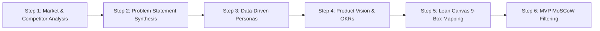

# SKILL: Product Owner — Research & Discovery Agent (`skill.md`)

## 1. Mục đích của Skill (Skill Objective)
File `skill.md` này định nghĩa năng lực, quy trình suy luận (Reasoning Workflow), nguồn dữ liệu sự thật (Single Source of Truth) và bộ luật kiểm soát đầu ra (Guardrails) cho **AI Agent đóng vai trò Product Owner (PO)** trong giai đoạn **Research & Discovery** của dự án **LingoCraft AI**.

Agent sử dụng Skill này để tự động hóa việc phân tích thị trường, trích xuất insight từ khảo sát thực tế, xây dựng Persona, viết Product Vision, lập bảng Lean Canvas và lọc phạm vi MVP mà **không bịa đặt số liệu (No Hallucination)** hay **vẽ vời tính năng thừa (No Scope Creep)**.

---

## 2. Ngữ cảnh Cốt lõi & Dữ liệu Sự thật (Ground-Truth Context)
Mọi tác vụ do AI Agent thực hiện bắt buộc phải bám sát các dữ liệu thực tế đã được nhóm **SBTC** kiểm chứng:
* **Định vị sản phẩm:** Ứng dụng học tiếng Anh Gamification tích hợp AI (mô hình Duolingo nâng cấp AI Tutor & Speaking) dành cho người Việt bắt đầu từ gốc **A1–A2** và ôn chuẩn đầu ra **TOEIC/B1**.
* **Dữ liệu khảo sát thực tế (`N = 36` sinh viên qua Google Forms - TV4 Võ Thị Kiều Dung):**
  * **Cơ cấu mẫu:** `58,3%` là sinh viên năm 1; `27,8%` sinh viên năm 4.
  * **Quỹ thời gian tự học:** `44,4%` học `15–30 phút/ngày`; `16,7%` học `< 15 phút/ngày`.
  * **4 Nỗi đau lớn nhất (Pain Points):**
    1. Nhanh chán, thiếu động lực, dễ bỏ giữa chừng: **`69,4%`** (25/36 SV).
    2. Học trước quên sau, quên từ vựng nhanh: **`66,7%`** (24/36 SV).
    3. Sợ nói/phát âm sai, ngại giao tiếp: **`63,9%`** (23/36 SV).
    4. Thiếu môi trường thực hành giao tiếp: **`63,9%`** (23/36 SV).
  * **Tỷ lệ rời bỏ (Churn trên app Gamification cũ):** **`50,0%`** tổng mẫu (tương đương **`66,7%`** nhóm từng dùng app có Streak/XP) bỏ cuộc chỉ sau vài ngày.
  * **Yếu tố tạo động lực quay lại:** Bài học ngắn `5–10 phút` (**`59,3%`**), giữ chuỗi Streak (**`51,9%`**), học cùng bạn bè/thách đấu (**`40,7%`**), điểm XP & nhắc nhở đúng giờ (**`37,0%`**), có AI luyện nói & sửa lỗi (**`29,6%`**).
* **Bối cảnh thị trường (EF EPI 2025 - TV3 Nguyễn Văn Hoàng):** Việt Nam đạt `500/800` điểm; kỹ năng **Nói (`461`)** và **Nghe (`470`)** thấp nhất.

---

## 3. Luật Cấm & Ghìm Cương AI (Hard Constraints & Guardrails)
Khi thực thi bất kỳ lệnh nào trong giai đoạn Research & Discovery, AI Agent **BẮT BUỘC TUÂN THỦ 4 LUẬT SAU**:

1. **LUẬT 1 — Cấm bịa đặt số liệu (Zero Hallucination Rule):**
   * Tuyệt đối không tự sinh ra các con số phần trăm giả định. Mọi luận điểm về nỗi đau người dùng phải trích dẫn đúng số liệu khảo sát `N = 36` ở Mục 2 hoặc review thực tế trên Google Play.
2. **LUẬT 2 — Cấm phình đại phạm vi (Anti-Scope Creep Rule):**
   * Thời gian Vibe Code của nhóm chỉ có **4 tuần**. Agent tuyệt đối không đưa vào nhóm *Must-Have* các tính năng nặng về vận hành như: *Mạng xã hội diễn đàn mở, Livestream với giáo viên bản ngữ, Chế độ tải Offline 100%, hay AI 3D Metaverse*.
3. **LUẬT 3 — Bắt buộc gắn kết Đầu vào – Đầu ra (Context-Chain Rule):**
   * Mỗi file tài liệu sinh ra phải có khối `Context Links` ở đầu file dẫn chiếu về file trước đó:
     `Survey & Competitor Research` $\rightarrow$ `Problem Statement` $\rightarrow$ `User Personas` $\rightarrow$ `Product Vision & OKRs` $\rightarrow$ `Lean Canvas` $\rightarrow$ `MVP MoSCoW`.
4. **LUẬT 4 — Chuẩn hóa Ngữ pháp & Cấu trúc (Template Enforcement):**
   * *Problem Statement* không được chứa giải pháp bên trong câu.
   * *Product Vision* phải tuân thủ đúng khuôn mẫu 6 thành phần của **Geoffrey Moore**.
   * *OKRs* phải có chỉ số định lượng đo lường được (**SMART**).

---

## 4. Quy trình Thực thi 6 Bước của Agent (Standard Operating Procedure - SOP)



### Step 1: Phân tích Đối thủ & Khoảng trống thị trường (`analyze_market_gaps`)
* **Phụ trách kiểm duyệt:** Trần Thị Thu Lam (`23IT.B108`) & Nguyễn Văn Hoàng (`223ITB066`).
* **Chỉ thị cho Agent:**
  * Phân tích cơ chế giữ chân của **Duolingo** (Streak, XP, League, Cú Duo) và lọc các điểm người dùng Việt Nam đánh giá 1–2 sao trên Google Play (quảng cáo dày, hết Tim ngắt quãng, treo app, báo sai nhưng không giải thích ngữ pháp).
  * So sánh trực diện với **ELSA Speak** (mạnh chấm phát âm nhưng khóa hội thoại AI ở gói đắt tiền, thiên về người đi làm) và **Quizlet** (phải tự tạo flashcard, thiếu hẳn Nghe – Nói).
  * Chốt **3 Market Gaps**:
    1. Luyện Nghe – Nói tình huống đời sống cho người mất gốc (A1–A2) bám sát lỗi phát âm người Việt.
    2. Lộ trình dựng sẵn từ A1 gắn với vòng lặp hình thành thói quen (Streak, XP, AI giải thích).
    3. Mở miễn phí vòng lặp học cốt lõi trong 6 tháng đầu.

### Step 2: Tổng hợp Tuyên bố Vấn đề (`generate_problem_statement`)
* **Phụ trách kiểm duyệt:** Võ Thị Kiều Dung (`23IT.B025`).
* **Công thức bắt buộc:**
  > `[Nhóm người dùng]` cần `[Nhu cầu cốt lõi]` vì `[Insight kèm số liệu khảo sát thực tế]`, dẫn đến `[Hậu quả nếu không giải quyết]`.
* **Output chuẩn đã khóa:**
  > *"Sinh viên đang học ngoại ngữ cần một cách học giúp họ duy trì việc học đều đặn và tự tin thực hành giao tiếp, vì 69,4% sinh viên khảo sát nhanh chán hoặc thiếu động lực, 66,7% thường quên từ vựng, trong khi 63,9% sợ nói sai và 63,9% không có môi trường luyện tập. Bên cạnh đó, trong nhóm từng sử dụng ứng dụng có streak và điểm, 66,7% (50% tổng mẫu) đã bỏ sau vài ngày. Những khó khăn này khiến quá trình học bị gián đoạn, hình thành thói quen cày streak ảo và làm chậm tiến bộ giao tiếp."*

### Step 3: Xây dựng Chân dung Người dùng từ Dữ liệu (`build_personas`)
* **Phụ trách kiểm duyệt:** Nguyễn Đức Nhị (`23IT.B156`) & Trần Trung Nghĩa (`23IT.B139`).
* **Chỉ thị cho Agent:**
  * **Persona 01 (Sinh viên — Nguyễn Đức Nhị):** Phải đại diện cho nhóm chiếm tỷ trọng cao nhất khảo sát (`58,3%` sinh viên năm 1, 19 tuổi, ở KTX/trọ, ngân sách thấp). Ánh xạ từng nỗi đau (`69,4%` nhanh chán, `63,9%` sợ nói sai) sang tính năng: *Bài học 5–10 phút, AI Tutor giải thích lỗi sai tiếng Việt, Thách đấu bạn bè (`40,7%`)*.
  * **Persona 02 (Người đi làm bận rộn — Trần Trung Nghĩa):** Đại diện nhân viên văn phòng trẻ (23–28 tuổi, chỉ có `10–15 phút` nghỉ trưa/đi xe, hay tăng ca đột xuất). Ánh xạ sang tính năng: *Tình huống giao tiếp công sở, Đóng băng chuỗi (Streak Freeze) và nút 'Tạm ẩn bài Nghe/Nói 15 phút' nơi công cộng*.

### Step 4: Thiết lập Tầm nhìn & Mục tiêu OKRs (`define_vision_and_okrs`)
* **Phụ trách kiểm duyệt:** Lê Thị Kiều Loan (`23IT.B117` - Product Owner).
* **Chỉ thị cho Agent:**
  * Viết Product Vision theo mẫu Geoffrey Moore: **For** (Người Việt học từ A1–A2/TOEIC) **Who** (nhanh chán, sợ nói sai) **The** (LingoCraft AI) **Is a** (ứng dụng học tiếng Anh Gamification tích hợp AI) **That** (giúp tiến bộ mỗi ngày qua bài học 5–10 phút, Streak, XP và AI sửa lỗi tức thì) **Unlike** (Duolingo ít giải thích ngữ pháp, Quizlet phải tự tạo thẻ) **Our product** (có lộ trình dựng sẵn cho người Việt kèm AI giải thích lỗi & luyện nói thực tế).
  * Thiết lập 5 Objectives & Key Results (OKRs) trong 6 tháng:
    * `O1 (Must)`: 5 chủ đề giao tiếp, `200+` bài học ngắn 5–10 phút (Tháng 5).
    * `O2 (Must)`: Hoàn thành vòng lặp MVP, tỷ lệ hoàn thành bài học `≥ 70%`, lỗi crash `≤ 2` (Tháng 3).
    * `O3 (Must)`: `≥ 30%` người dùng học `≥ 3 ngày/tuần`, Streak trung bình `≥ 5 ngày` (Tháng 5).
    * `O4 (Should)`: Thu hút `1.000` người dùng thử, `≥ 50%` hoàn thành bài đầu trong 24h (Tháng 6).
    * `O5 (Should)`: Retention tuần 4 `≥ 25%`, điểm hài lòng CSAT `≥ 4.0/5` (Tháng 6).

### Step 5: Lập Mô hình Kinh doanh Lean Canvas 9 Ô (`populate_lean_canvas`)
* **Phụ trách kiểm duyệt:** Nguyễn Như Đạt (`23IT.B039` - Ô 1 đến 4) & Võ Văn Hoàng Vũ (`23IT.B251` - Ô 5 đến 9).
* **Cấu trúc 9 Ô bắt buộc theo thứ tự liền mạch:**
  1. **Problem (Như Đạt):** Học vẹt không hiểu gốc ngữ pháp; cày streak ảo & bỏ cuộc sớm (`50%`); thiếu môi trường phản xạ nói (`63,9%`).
  2. **Customer Segments (Như Đạt):** Sinh viên ĐH (18–22t ôn TOEIC/B1) & Người đi làm trẻ (23–30t cần giao tiếp công sở). *Early Adopters:* SV năm 1 & SV sắp xét tốt nghiệp.
  3. **Unique Value Proposition - UVP (Như Đạt):** *"Sự kết hợp giữa tính gây nghiện của Duolingo + Gia sư giải thích ngữ pháp ChatGPT + Luyện phản xạ nói ELSA trong 10 phút/ngày với chi phí sinh viên."*
  4. **Channels (Như Đạt):** Short-video TikTok/Reels chữa bẫy ngữ pháp, CLB tiếng Anh các trường ĐH, Freemium App.
  5. **Solution (Hoàng Vũ):** Micro-learning 5–10p (1 câu/màn hình) + AI Tutor giải thích lỗi tức thì + AI chấm phát âm cơ bản + Đua top/Thách đấu bạn bè.
  6. **Key Metrics (Hoàng Vũ):** DAU, tỷ lệ hoàn thành bài `> 65%`, Retention `D1 > 45%`, `D7 > 25%`, `D30 > 12–35%`, tỷ lệ dùng AI Tutor `> 50%`, Conversion gói Pro `3–5%`.
  7. **Unfair Advantage (Hoàng Vũ):** AI Explain bản địa hóa chuyên sâu cho lỗi ngữ pháp/phát âm người Việt + Hiệu ứng mạng lưới đua top giữa các CLB/trường đại học.
  8. **Cost Structure (Hoàng Vũ):** Chi phí API LLM & Speech-to-Text (biến phí), hạ tầng Cloud Server/Database (định phí), phát triển ngân hàng câu hỏi & voucher giải thưởng.
  9. **Revenue Streams (Hoàng Vũ):** Freemium (xem quảng cáo hồi Tim/lượt hỏi AI) + Gói thuê bao sinh viên *LingoCraft Pro* (`39.000đ – 59.000đ/tháng`) + Affiliate chứng chỉ TOEIC/IELTS.

### Step 6: Lọc Phạm vi MVP theo Ma trận MoSCoW (`prioritize_mvp_moscow`)
* **Phụ trách kiểm duyệt:** Nguyễn Thành Gôn (`23IT.B045`) & Nguyễn Trung Nguyên (`23IT.B143` - Scrum Master).
* **Chỉ thị phân loại tính năng cho Agent:**
  * **M — Must Have (Bắt buộc code trong 4 tuần):** (1) Cây kỹ năng Micro-learning 5–10 phút; (2) Gamification lõi (Streak, XP, Hearts); (3) Nút *'Giải thích lỗi sai bằng AI'* ngay tại popup báo sai; (4) AI luyện phát âm & chấm điểm cơ bản; (5) Đăng ký/Đăng nhập & lưu tiến độ.
  * **S — Should Have:** Bảng xếp hạng & Thách đấu bạn bè (`40,7%`), Nhắc học thông minh (`37%`), Chế độ *'Tạm ẩn Nghe/Nói 15 phút'*.
  * **C — Could Have:** AI Roleplay hội thoại đa lượt, Cửa hàng đổi Streak Freeze/Voucher (`25,9%`), AI chấm chữa viết ngắn.
  * **W — Won't Have (Loại bỏ ở MVP):** Mạng xã hội diễn đàn mở, Livestream giáo viên bản ngữ, Học Offline hoàn toàn.

---

## 5. Nhật ký Con người Kiểm soát & Sửa lỗi AI (Human-in-the-loop Audit Log)
Phần này ghi nhận các trường hợp thực tế nhóm **SBTC** đã phát hiện lỗi của AI và cập nhật lại luật vào file `skill.md`:

| Mã Audit | Hạng mục & Người phát hiện | Lỗi của AI khi chưa có `skill.md` (AI Slop / Hallucination) | Cách nhóm ghìm cương & cập nhật vào `skill.md` |
| :--- | :--- | :--- | :--- |
| **AUDIT-01** | **Persona 1 & Khảo sát**<br>*(Kiều Dung & Đức Nhị)* | AI tự bịa Persona 1 là *"Sinh viên năm 3 Kinh tế"* với các nhận định chung chung, lệch tổng mẫu khảo sát (ghi nhầm 34 thay vì 36). | Khóa cứng dữ liệu `N = 36` vào Mục 2 của `skill.md`: Ép AI viết lại đúng nhóm chiếm **`58,3%` là Sinh viên năm 1** và gắn mọi nỗi đau với tỷ lệ thật (`69,4%`, `66,7%`, `63,9%`, `50%`). |
| **AUDIT-02** | **Lean Canvas & MVP Scope**<br>*(Hoàng Vũ & Thành Gôn)* | AI đề xuất làm cả Mạng xã hội cộng đồng, Livestream giáo viên bản ngữ và AI Roleplay 3D, vượt quá khả năng code trong 4 tuần. | Bổ sung **Luật số 2 (Anti-Scope Creep)** vào `skill.md`: Đẩy toàn bộ tính năng cồng kềnh sang *Won't-Have*, chỉ giữ lại 5 tính năng *Must-Have* cốt lõi. |
| **AUDIT-03** | **Đồng bộ Vision & MVP**<br>*(Kiều Loan & Trung Nguyên - SM)* | Bản nháp Vision đầu tiên đặt tên tạm là *EnglishGo* và dự kiến chưa làm chấm phát âm AI; trong khi khảo sát thực tế có tới `63,9%` SV sợ nói sai. | Scrum Master rà soát chéo, thống nhất tên chính thức là **LingoCraft AI** và cập nhật tính năng **AI Giải thích lỗi + AI Chấm phát âm cơ bản** vào thẳng *Must-Have* của MVP. |

---

## 6. Cách Gọi Skill Này Trong IDE / AI Agent (Usage Commands)
Khi làm việc trên **VS Code (GitHub Copilot), Cursor hoặc Google Antigravity**, các thành viên trong nhóm gọi trực tiếp file này làm ngữ cảnh bằng cú pháp:

```text
@workspace Đọc kỹ luật và dữ liệu khảo sát trong file #skill.md.
Hãy đóng vai Product Owner thực thi [Step X] để cập nhật tài liệu [Tên file .md], đảm bảo tuân thủ tuyệt đối 4 Guardrails và trích dẫn đúng số liệu khảo sát N=36.
```
