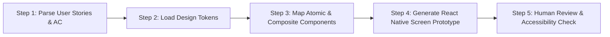

> **Liên kết ngữ cảnh:** [Skill Discovery (SSOT)](./skill.md) | [PO Kit](./po-kit.md) | [Persona Student](../01-discovery/personas/persona-01-student.md) | [Persona Working Pro](../01-discovery/personas/persona-02-working-pro.md) | [Design Tokens](../02-design-system/design-tokens.md) | [Component Library](../02-design-system/component-library.md) | [Prototype Screens](../02-design-system/prototype-screens.md) | [Product Backlog](../03-requirements/product-backlog.md)

# SKILL: Product Designer & React Native UI/UX Agent (`ui-ux-skill.md`)

## 1. Mục đích của Skill (Skill Objective)
File `ui-ux-skill.md` định nghĩa quy trình làm việc (Workflow), hệ thống ràng buộc giao diện (UI/UX Guardrails) và chuẩn mã nguồn **React Native (TypeScript)** để **AI Agent đóng vai trò Product Designer & UI/UX Engineer** trong dự án **LingoCraft AI** của đội **SBTC (VKU)**.

Thay vì vẽ giao diện thủ công trên Figma rồi nhìn theo đó lập trình lại, AI Agent sử dụng Skill này để **đọc trực tiếp PRD & User Stories** tại `03-requirements/` kết hợp cùng **Design System (Design Tokens & Component Library)** tại `02-design-system/` để **sinh thẳng mã nguồn màn hình Prototype (React Native / Expo TypeScript)** nhất quán, không bịa đặt tính năng ngoài phạm vi MVP và không sai lệch chân dung người dùng.

---

## 2. Ngữ cảnh Giao diện Cốt lõi (Ground-Truth UI/UX Context)

* **Nền tảng mục tiêu:** Ứng dụng di động (**Mobile App**) xây dựng bằng **React Native (Expo / TypeScript)**.
* **Nguyên tắc Hệ thống Thiết kế Thống nhất (Unified Design System):**
  * **Không tách ứng dụng hay tách giao diện riêng biệt cho từng Persona.** Toàn bộ sản phẩm sử dụng **01 Design System thống nhất** nhưng đủ linh hoạt về trạng thái và chế độ hỗ trợ để phục vụ tốt cả 2 chân dung người dùng:
    1. **Persona 01 — Sinh viên (19 tuổi, chiếm 58,3% sinh viên năm 1 trong khảo sát $N=36$, ở KTX/trọ, ngân sách thấp):** Học buổi tối/giờ rảnh ngắn **5–10 phút** (**59,3%**), dễ nhanh chán (**69,4%**), dễ quên kiến thức (**66,7%**), sợ nói sai (**63,9%**). Cần bố cục **1 câu / 1 màn hình**, thao tác 1 tay, màu sắc phản hồi thưởng rõ ràng (Streak **51,9%**, Thách đấu bạn bè **40,7%**, XP **37,0%**) và nút **AI Giải thích lỗi sai bằng tiếng Việt** dễ thấy ngay tại popup báo sai.
    2. **Persona 02 — Người đi làm trẻ (23–28 tuổi, bận rộn, hay tăng ca đột xuất):** Chỉ có **10–15 phút** nghỉ trưa hoặc lúc đi xe; cần truy cập nhanh (*Quick Resume* trong 1 chạm), giao diện sạch sẽ độ tương phản cao, có nút **"Tạm ẩn Nghe/Nói 15 phút"** khi học ở nơi công cộng và **Đóng băng chuỗi (Streak Freeze)** bảo vệ thói quen.

---

## 3. 4 Luật Cấm & Ghìm Cương AI UI/UX (Hard Constraints & Guardrails)

Khi sinh bất kỳ token, component hay màn hình Prototype nào, AI Agent **BẮT BUỘC TUÂN THỦ 4 LUẬT SAU**:

1. **LUẬT 1 — Không Hardcode Token (Zero Token Hardcoding):**
   * Tuyệt đối không viết cứng mã màu hex (như `#4F46E5`), cỡ chữ hay khoảng cách tùy tiện bên trong màn hình Prototype. Mọi giá trị màu sắc, typography, spacing, border radius đều phải tham chiếu từ `design-tokens.md` (`tokens` trong `theme.ts`).
2. **LUẬT 2 — Bắt buộc Tái sử dụng Component (Atomic Component Reuse):**
   * Màn hình Prototype bắt buộc lắp ghép từ bộ thành phần đã chuẩn hóa trong `02-design-system/component-library.md`, gồm Core Primitives (`AppButton`, `AppTextInput`, `AppSelectDropdown`, `ScreenLayout`) và Domain Composites (`LessonProgressHeader`, `SingleTaskQuestionCard`, `FeedbackBottomSheet`, `PronunciationMicButton`, `StreakChallengeCard`). Cấm tự sáng tạo widget ngoài hệ thống nếu chưa cập nhật vào `component-library.md`.
3. **LUẬT 3 — Giới hạn Tải Nhận thức (1 Câu / 1 Màn hình — Cognitive Load Limit):**
   * Trong màn hình làm bài học, chỉ hiển thị **01 câu hỏi / 01 nhiệm vụ duy nhất trên một màn hình** để phù hợp phiên học **5–10 phút**.
   * Văn bản trong popup **'Giải thích lỗi sai bằng AI'** viết bằng tiếng Việt súc tích, **tối đa 3–4 dòng** (tránh tường chữ gây ngợp trên smartphone).
   * Vùng chạm tối thiểu (Touch Target) của mọi nút bấm tương tác phải đạt **$\ge 48\text{dp}$** để hỗ trợ thao tác 1 tay.
4. **LUẬT 4 — Truy vết Nghiêm ngặt (Strict Traceability & Anti-Scope Creep):**
   * Mọi màn hình Prototype được sinh ra phải ghi rõ ánh xạ về mã User Story (`US-01` đến `US-05`) và tiêu chí nghiệm thu (`Acceptance Criteria`) tương ứng.
   * Tuyệt đối không sinh màn hình cho các tính năng thuộc nhóm **Won't Have** (*Mạng xã hội diễn đàn mở, Livestream giáo viên bản ngữ, Học Offline 100%, AI 3D Metaverse*) trong khung thời gian **4 tuần Vibe Code**.

---

## 4. Quy trình Thực thi 5 Bước của UI/UX Agent (Standard Operating Procedure - SOP)



### Step 1: Đọc & Phân tích User Stories và Acceptance Criteria (`parse_requirements`)
* Đọc `03-requirements/product-backlog.md` và các file trong `03-requirements/user-stories/`.
* Trích xuất danh sách màn hình cần thiết, các trạng thái tương tác (Default, Loading, Correct, Error, AI Explaining, Muted) và điều kiện nghiệm thu Gherkin (`Given / When / Then`).

### Step 2: Nạp Hệ thống Design Tokens (`load_design_tokens`)
* Đọc `02-design-system/design-tokens.md` để lấy `theme.ts` (Light Mode mặc định & Dark Mode dịu mắt buổi tối ở KTX).
* Kiểm tra tỷ lệ cỡ chữ đáp ứng đồng thời **Persona 01** (câu hỏi `18–22px`, giải thích AI `15–16px`) và **Persona 02** (rõ nét ngoài trời/văn phòng).

### Step 3: Ánh xạ Component Nguyên tử & Hợp thành (`map_components`)
* Đối chiếu các thành phần cần dùng trong `02-design-system/component-library.md`.
* Đảm bảo có đủ 3 nhóm thành phần cơ bản theo chuẩn React Native: nút bấm (`AppButton`), ô nhập liệu (`AppTextInput`), danh sách chọn (`AppSelectDropdown`) và các composite đặc thù học ngoại ngữ (`FeedbackBottomSheet`, `PronunciationMicButton`, `LessonProgressHeader`).

### Step 4: Sinh Mã nguồn Màn hình Prototype React Native (`generate_prototype_screens`)
* Lắp ghép `ScreenLayout` + Components + `tokens` thành mã nguồn `.tsx` hoàn chỉnh tại `02-design-system/prototype-screens.md` theo đúng luồng người dùng (`User Flow`).
* Giữ nguyên dữ liệu mẫu sát ngữ cảnh thực tế của người Việt mất gốc **A1–A2** và tình huống giao tiếp công sở.

### Step 5: Con người Kiểm duyệt & Kiểm tra Khả năng Tiếp cận (`human_review_and_a11y`)
* Cả nhóm cùng rà soát trong buổi họp (hoặc Daily 3 ngày/lần):
  * Kiểm tra độ tương phản màu sắc, vùng chạm $\ge 48\text{dp}$, độ dài giải thích AI $\le 4$ dòng.
  * Đối chiếu lại với 5 tính năng **Must-Have** trong `01-discovery/05-mvp-moscow.md` để chắc chắn không bị phình phạm vi.

---

## 5. Nhật ký Con người Kiểm soát & Sửa lỗi UI/UX AI (Human-in-the-loop Audit Log)

| Mã Audit | Hạng mục & Vai trò kiểm duyệt | Lỗi AI thường mắc khi thiếu `ui-ux-skill.md` | Cách nhóm SBTC ghìm cương bằng `ui-ux-skill.md` |
| :--- | :--- | :--- | :--- |
| **UI-AUDIT-01** | **Phân tách Giao diện theo Persona**<br>*(Product Designer)* | AI tự ý tách 2 bộ giao diện/theme hoàn toàn khác nhau cho Sinh viên và Người đi làm, gây gấp đôi khối lượng code trong 4 tuần. | Khóa nguyên tắc **Unified Design System**: chỉ dùng 01 hệ tokens & component chung, xử lý khác biệt bằng chế độ hỗ trợ (*Tạm ẩn Nghe/Nói 15 phút*, *Quick Resume*, *Dark Mode*). |
| **UI-AUDIT-02** | **Nhồi nhét Nội dung trên Màn hình**<br>*(React Native Lead)* | AI thiết kế màn hình bài học chứa 3–5 câu hỏi một lúc và popup AI giải thích dài 10–15 dòng chữ đặc. | Áp đặt **Luật 3 (Cognitive Load Limit)**: bắt buộc **1 câu / 1 màn hình**, giải thích tiếng Việt tối đa 3–4 dòng, ưu tiên thao tác ngón tay cái 1 tay. |
| **UI-AUDIT-03** | **Hardcode Style & Trượt Phạm vi**<br>*(Scrum Master)* | AI viết inline style với mã màu tự chế và tự thêm tab *Cộng đồng/Diễn đàn* vào thanh điều hướng dưới cùng. | Áp đặt **Luật 1, Luật 2 & Luật 4**: bắt buộc import `tokens` từ `design-tokens.md`, chỉ lắp từ `component-library.md` và loại bỏ toàn bộ màn hình thuộc nhóm *Won't Have*. |

---

## 6. Cách Gọi Skill Này Trong IDE / AI Agent (Usage Commands)

```text
@workspace Đọc kỹ luật trong #ui-ux-skill.md, bảng #design-tokens.md và #component-library.md.
Hãy đọc User Story [Tên file trong 03-requirements/user-stories/] và generate màn hình Prototype React Native (TypeScript) vào #prototype-screens.md, đảm bảo tuân thủ 4 Guardrails (không hardcode token, tái sử dụng component, 1 câu/màn hình, đúng phạm vi MVP).
```
