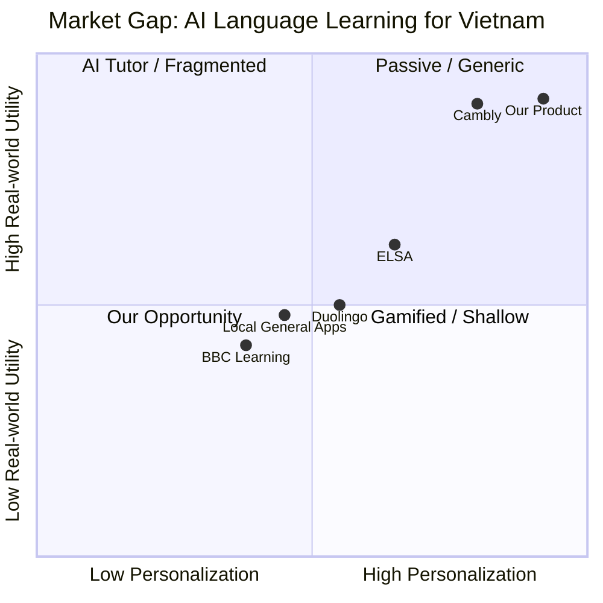

> **Liên kết ngữ cảnh:** [Problem Statement](./02-problem-statement.md) | [Product Vision](./03-product-vision.md) | [Product Canvas](./04-product-canvas.md) | [Persona Student](./personas/persona-01-student.md) | [Persona Working Pro](./personas/persona-02-working-pro.md)

# 01. Market & Needs

## 1. User Needs

### 1.1 Nhu cầu cốt lõi của người học tiếng Anh tại Việt Nam
Dự án hướng tới thị trường học tiếng Anh tích hợp gamification và AI, nhưng không đơn thuần là game hóa việc lặp lại từ vựng. Nhu cầu thực sự của người dùng nằm ở ba lớp: hiệu quả học tập, tính cá nhân hóa và khả năng áp dụng vào đời sống thực tế.

- Học viên cần hiểu rõ lỗi ngữ pháp, không chỉ biết câu đó sai ở đâu, mà còn biết vì sao sai và cách sửa theo logic ngôn ngữ.
- Học viên muốn học theo nhịp ngắn, dễ duy trì, có streak và phản hồi tức thì để tạo thói quen mỗi ngày.
- Người đi làm và sinh viên đều cần học ngắn gọn, đúng mục tiêu, tránh “học câu vô nghĩa” hoặc “học kiểu kiểm tra tự động nhưng không áp dụng được”.
- Học viên muốn luyện nói phản xạ theo tình huống thực tế, không chỉ đọc chép câu mẫu không tương tác.
- Học viên muốn AI giải thích lỗi một cách dễ hiểu, có mang tính cá nhân hóa theo tiến độ và lỗi lặp lại.

### 1.2 Need statements theo dạng người dùng
- Khi tôi làm sai câu tiếng Anh, tôi muốn AI giải thích bản chất lỗi (ví dụ: thiếu “to” sau động từ nguyên mẫu, sai mạo từ, nhầm thì, câu điều kiện) và cung cấp ví dụ theo ngữ cảnh của tôi.
- Khi tôi sắp bỏ cuộc vì cảm giác mệt mỏi hoặc mất tập trung, tôi muốn hệ thống thúc đẩy động lực bằng mục tiêu nhỏ, streak, lịch sử tiến bộ và thử thách dễ hoàn thành.
- Khi tôi bận học làm và chỉ có 10–15 phút mỗi ngày, tôi muốn bài học ngắn, có mục tiêu rõ ràng và phản hồi ngay lập tức.
- Khi tôi muốn luyện nói, tôi muốn phát âm, ngữ điệu và phản xạ theo tình huống đời sống như phỏng vấn, email công việc, nói chuyện với đồng nghiệp, mua hàng, xin nghỉ phép.

### 1.3 Nhu cầu theo từng phân khúc
#### a) Sinh viên 18–22 tuổi
- Mục tiêu: lấy chứng chỉ TOEIC/B1, cải thiện điểm số, thi chuẩn hóa.
- Vấn đề lớn: học theo dạng lặp lại, nhưng chưa hiểu rõ nguyên nhân sai cấu trúc.
- Mong muốn: feedback sâu, mini-drill, vòng lặp sửa lỗi nhanh, kiểm tra ngắn mỗi ngày.

#### b) Người đi làm 23–30 tuổi
- Mục tiêu: giao tiếp thực tế, đáp ứng công việc, tự tin khi đặt câu trong môi trường làm việc.
- Vấn đề lớn: không có thời gian học theo khóa dài, không muốn học các câu vô nghĩa.
- Mong muốn: bài học dựa trên tình huống công việc, học nói phản xạ, giao tiếp nhanh, hiệu quả.

## 2. Market Gap

### 2.1 Tổng quan thị trường hiện tại
Thị trường ứng dụng học ngoại ngữ Việt Nam hiện có hai cực rõ rệt:

1. Ứng dụng gamified phổ biến như Duolingo, Busuu, Memrise: mạnh ở tính thói quen, streak, micro-learning nhưng yếu ở giải thích lỗi chuyên sâu và luyện nói phản xạ.
2. Ứng dụng luyện nói hay lớp học 1-1 như Italki, Cambly, Preply: mạnh ở thực hành giao tiếp nhưng thiếu gamification, thiếu tính cá nhân hóa theo lỗi ngữ pháp; giá thành cao và khó duy trì với nhu cầu bản địa.

### 2.2 Khoảng trống thị trường (Market Gap)
Các nền tảng hiện tại chưa đáp ứng đồng bộ ba yếu tố mà người học Việt Nam thực sự cần:

- Chuyên sâu hơn: không chỉ chấm đúng/sai, mà giải thích ngữ pháp theo logic, ví dụ có thể liên hệ với tiếng Việt.
- Gamification có mục đích: thưởng dựa trên tiến bộ, phần thưởng nhóm, mini-challenge, streak, nhưng không làm mất đi chất lượng học.
- Luyện nói thực tế: phản xạ theo tình huống và hội thoại công việc, không chỉ nói câu mẫu khô.

Đây là khoảng trống mà sản phẩm của chúng ta đóng vai trò “AI Grammar Coach + Speaking Reflex Tutor + Daily Gamified Learning Loop”.

### 2.3 So sánh thị trường
| Nền tảng | Điểm mạnh | Điểm yếu | Cơ hội của sản phẩm |
|---|---|---|---|
| Duolingo | Gamification, dễ dùng, giữ thói quen | Giải thích lỗi sơ sài, ít luyện nói thực tế | Cung cấp giải thích logic & AI coach |
| ELSA | Luyện phát âm, công nghệ AI | Chưa bám sát lỗi ngữ pháp và mục tiêu cá nhân | Kết hợp grammar + pronunciation + speaking |
| Cambly/Italki | Tương tác thật, ngữ cảnh thực tế | Chi phí cao, thiếu tính lặp lại hàng ngày | Tạo micro-practice định kỳ, giá dễ tiếp cận |
| BBC / app học truyền thống | Nền tảng học chuẩn, bài bản | Ít gamification, thiếu cá nhân hóa | Kết hợp độ chuẩn và AI cá nhân hóa |
| Ứng dụng địa phương | Hiểu thị trường Việt Nam | Ít đầu tư vào AI, dễ dừng chân | Cung cấp giá trị cao, local context |

### 2.4 Sơ đồ khoảng trống thị trường

### 2.5 Tại sao thị trường Việt Nam phù hợp
- Nhu cầu học tiếng Anh rõ ràng: TOEIC, B1, du học, phỏng vấn, công việc số hóa.
- Đầu tư vào AI và mobile cao nhưng chất lượng không đồng đều; người dùng sẵn sàng trả phí nếu thấy hiệu quả thực tế.
- Người Việt có thói quen học ngắn ngày, cần “học xong thấy tiến bộ” thay vì học dài và tốn thời gian.
- Học tiếng Anh trong môi trường công việc và du học đang tăng mạnh, làm tăng nhu cầu luyện giao tiếp thực tế.

## 3. Monetization Model

### 3.1 Mô hình kiếm tiền đề xuất
#### a) Freemium + AI Coach Trial
- Người dùng đăng ký miễn phí để học 3–5 phút mỗi ngày.
- Bản miễn phí mở khóa các mini-lesson cơ bản, streak, review, một số câu hỏi thử.
- AI Grammar Explanation và Speaking Drill được giới hạn số lượng mỗi tháng để tăng conversion.

#### b) Subscription Pro (AI deep analysis + unlimited speaking)
- Gói Pro: học không giới hạn bài học cơ bản, AI phân tích lỗi sâu, giải thích theo từng lỗi lặp lại.
- Giá tham khảo: 149.000–249.000 VNĐ/tháng hoặc 1.199.000–1.999.000 VNĐ/năm.
- Chốt giá: tối ưu với lợi ích tiết kiệm thời gian, học hiệu quả hơn, luyện nói thực tế hơn.

#### c) Bundle 3-month / 6-month goal-based plan
- Gói theo mục tiêu: TOEIC, B1, giao tiếp công việc, interview.
- Tăng tỷ lệ giữ chân người dùng, vì mục tiêu rõ ràng và cảm giác “đã đầu tư để đạt kết quả”.

#### d) B2B / schools / training center
- Hợp tác với trung tâm Anh ngữ, trường cao đẳng, doanh nghiệp cần nâng cao kỹ năng tiếng Anh công việc.
- Một phần doanh thu từ gói team learning, có báo cáo tiến độ của học viên.

### 3.2 Giá trị được người dùng trả tiền cho
- Tiết kiệm thời gian vì AI cho biết lỗi đúng bản chất, không cần chờ gia sư.
- Tăng hiệu quả học tập vì kiến thức áp dụng vào ngữ cảnh thực tế.
- Giữ động lực vì gamification vừa đủ, không lạm dụng.
- Tăng tự tin trong giao tiếp vì luyện nói phản xạ theo tình huống.

### 3.3 Mức độ khả thi thương mại
Mô hình này phù hợp bởi: (1) thị trường Việt Nam lớn và đang cần giải pháp học ngắn gọn, (2) người dùng chấp nhận trả phí nếu có hiệu quả rõ ràng, (3) AI Coach có thể tạo cơ sở cho upsell với gói chuyên biệt theo mục tiêu.

## 4. Kết luận
Sản phẩm không chỉ là một ứng dụng học tiếng Anh nữa, mà là một “learning loop” giúp người dùng hiểu lỗi, sửa lỗi, nói đúng ngữ cảnh và duy trì động lực mọi ngày. Khoảng trống nằm ở chỗ hầu hết đối thủ đang tập trung vào 1 trong 3 trục: gamification, AI correction hoặc speaking practice; trong khi người học Việt Nam cần cả ba trục cùng lúc, cùng một trải nghiệm mượt và phù hợp với thói quen học hiện đại.

Để hiểu sâu hơn, hãy xem [Problem Statement](./02-problem-statement.md) và [Product Vision](./03-product-vision.md). 
