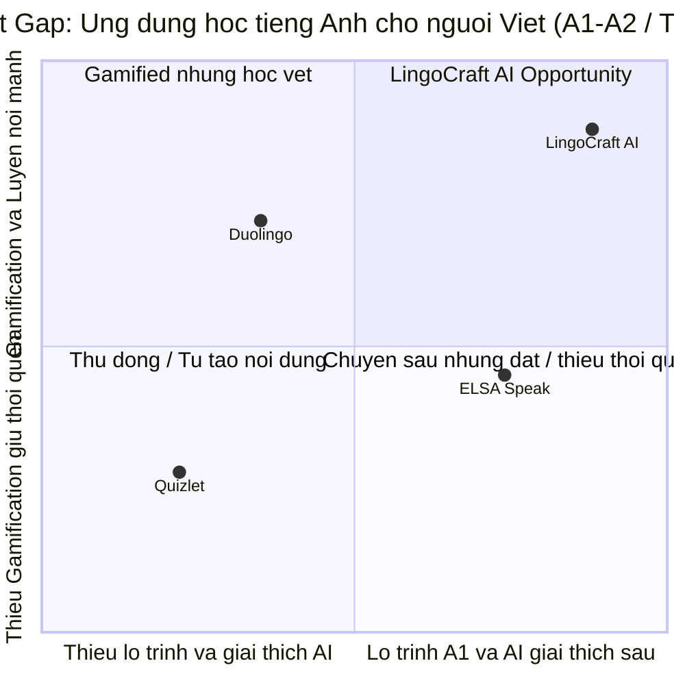

> **Liên kết ngữ cảnh:** [Skill Harness (SSOT)](../00-ai-harness/skill.md) | [PO Kit](../00-ai-harness/po-kit.md) | [Problem Statement](./02-problem-statement.md) | [Persona Student](./personas/persona-01-student.md) | [Persona Working Pro](./personas/persona-02-working-pro.md) | [Product Vision](./03-product-vision.md) | [Product Canvas](./04-product-canvas.md) | [MVP MoSCoW](./05-mvp-moscow.md)

# 01. Phân tích Thị trường & Nhu cầu Người dùng (Market & Needs)

## 1. Nhu cầu người dùng (User Needs)

### 1.1 Bối cảnh & Dữ liệu thực tế từ Khảo sát ($N = 36$)
Dự án **LingoCraft AI** (đội **SBTC - VKU**) hướng tới người Việt học tiếng Anh bắt đầu từ gốc **A1–A2** và ôn chuẩn đầu ra **TOEIC/B1**. Theo báo cáo **EF EPI 2025**, Việt Nam đạt **500/800** điểm; trong đó hai kỹ năng **Nói (461)** và **Nghe (470)** ở mức thấp nhất.

Kết quả khảo sát thực tế trên **$N = 36$ sinh viên** qua Google Forms cho thấy:
* **Cơ cấu mẫu:** **58,3%** là sinh viên năm 1; **27,8%** là sinh viên năm 4 (nhóm cần chuẩn đầu ra để xét tốt nghiệp).
* **Quỹ thời gian tự học:** **44,4%** chỉ học **15–30 phút/ngày**; **16,7%** học **< 15 phút/ngày**.
* **4 Nỗi đau lớn nhất (Pain Points):**
  1. Nhanh chán, thiếu động lực, dễ bỏ giữa chừng: **69,4%** ($25/36$ sinh viên).
  2. Học trước quên sau, quên từ vựng nhanh: **66,7%** ($24/36$ sinh viên).
  3. Sợ nói/phát âm sai, ngại giao tiếp: **63,9%** ($23/36$ sinh viên).
  4. Thiếu môi trường thực hành giao tiếp: **63,9%** ($23/36$ sinh viên).
* **Tỷ lệ rời bỏ (Churn) trên app Gamification cũ:** **50,0%** tổng mẫu (tương đương **66,7%** trong nhóm từng sử dụng ứng dụng có Streak/XP) bỏ cuộc chỉ sau vài ngày.
* **Yếu tố tạo động lực quay lại (Retention Drivers):**
  * Bài học ngắn **5–10 phút**: **59,3%**
  * Giữ chuỗi **Streak**: **51,9%**
  * Học cùng bạn bè / thách đấu: **40,7%**
  * Điểm **XP** & nhắc nhở đúng giờ: **37,0%**
  * Có **AI luyện nói & sửa lỗi**: **29,6%**
  * Cửa hàng đổi **Streak Freeze / Voucher**: **25,9%**

### 1.2 Nhu cầu cốt lõi theo phân khúc mục tiêu
#### a) Sinh viên đại học (18–22 tuổi — Nhóm trọng tâm / Early Adopters)
* **Mục tiêu:** Củng cố nền tảng A1–A2, đạt chuẩn đầu ra **TOEIC/B1** (đặc biệt sinh viên năm 1 chiếm **58,3%** và sinh viên năm 4 chiếm **27,8%**).
* **Nhu cầu:** Cần bài học ngắn gọn **5–10 phút** (**59,3%**), có giải thích lỗi ngữ pháp rõ ràng bằng tiếng Việt để không học vẹt, cùng cơ chế giữ thói quen (Streak **51,9%**, Thách đấu bạn bè **40,7%**) nhưng không gây áp lực "cày streak ảo".

#### b) Người đi làm trẻ (23–28 tuổi)
* **Mục tiêu:** Cải thiện giao tiếp thực tế nơi công sở (họp ngắn, phản hồi đồng nghiệp, phỏng vấn, tình huống đời sống).
* **Nhu cầu:** Chỉ có khoảng thời gian ngắn **10–15 phút** trong giờ nghỉ trưa hoặc lúc di chuyển; cần luyện nghe – nói phản xạ theo tình huống thực tế và cơ chế linh hoạt khi bận việc đột xuất (như Streak Freeze, tạm ẩn bài Nghe/Nói ở nơi công cộng).

---

## 2. Khoảng trống thị trường (Market Gap)

### 2.1 Phân tích đối thủ trực tiếp (Competitor Analysis)
Đối chiếu trực diện với các nền tảng phổ biến tại Việt Nam và phản hồi thực tế từ đánh giá 1–2 sao của người dùng Việt trên Google Play:

| Đối thủ | Điểm mạnh (Strengths) | Điểm yếu thực tế (Weaknesses / Google Play Reviews) | Cơ hội cho LingoCraft AI |
| :--- | :--- | :--- | :--- |
| **Duolingo** | Cơ chế giữ chân (Retention) mạnh nhờ Streak, XP, League, linh vật Cú Duo; micro-learning dễ tiếp cận. | Quảng cáo dày đặc; cơ chế hết Tim (Hearts) gây ngắt quãng việc học; hay treo app; **báo sai nhưng không giải thích ngữ pháp**, dễ dẫn đến cày streak ảo. | Kết hợp vòng lặp Gamification (Streak, XP) với nút **AI Giải thích lỗi sai bằng tiếng Việt** ngay khi làm sai, mở miễn phí vòng học cốt lõi trong 6 tháng đầu. |
| **ELSA Speak** | Công nghệ AI chấm phát âm chuyên sâu từng âm tiết. | Khóa các tính năng hội thoại AI ở gói trả phí đắt tiền; nội dung thiên về người đi làm, thiếu lộ trình ngữ pháp từ gốc A1–A2 cho sinh viên. | Luyện phát âm & tình huống đời sống bám sát lỗi phát âm đặc thù của người Việt từ mức **A1–A2** với mức giá sinh viên. |
| **Quizlet** | Mạnh về thẻ ghi nhớ (Flashcards) cho từ vựng tự chọn. | Người học phải **tự tạo flashcard** tốn thời gian; **thiếu hẳn kỹ năng Nghe – Nói** và phản xạ giao tiếp. | Cung cấp **lộ trình dựng sẵn từ A1** gắn với vòng lặp hình thành thói quen và luyện Nghe – Nói tích hợp. |

### 2.2 Chốt 3 Khoảng trống thị trường (3 Market Gaps)
1. **Luyện Nghe – Nói tình huống đời sống cho người mất gốc (A1–A2):** Thiết kế bám sát các lỗi phát âm và ngữ pháp đặc thù của người Việt, khắc phục tình trạng điểm Nói (**461**) và Nghe (**470**) thấp nhất trong khu vực theo EF EPI 2025.
2. **Lộ trình dựng sẵn từ A1 gắn với vòng lặp hình thành thói quen:** Kết hợp bài học ngắn **5–10 phút** với Streak, XP và **AI Tutor giải thích bản chất lỗi sai tức thì**, tránh tình trạng phải tự soạn thẻ như Quizlet hay học vẹt không hiểu gốc như Duolingo.
3. **Mở miễn phí vòng lặp học cốt lõi trong 6 tháng đầu:** Giảm rào cản chi phí cho sinh viên (nhóm nhạy cảm về giá) so với các gói hội thoại AI đắt tiền của đối thủ.

### 2.3 Sơ đồ Khoảng trống thị trường (Mermaid Quadrant Chart)

---

## 3. Mô hình kiếm tiền (Monetization Model)

Mô hình doanh thu được thiết kế phù hợp với khả năng chi trả của sinh viên Việt Nam nhưng vẫn đảm bảo bù đắp biến phí API LLM & Speech-to-Text:

1. **Freemium (Miễn phí vòng lặp cốt lõi 6 tháng đầu):**
   * Người dùng học miễn phí các bài học Micro-learning **5–10 phút**, giữ Streak, tích lũy XP và dùng AI Tutor cơ bản.
   * Tích hợp **xem quảng cáo để hồi Tim (Hearts) hoặc nhận thêm lượt hỏi AI**, giúp duy trì doanh thu từ tệp người dùng miễn phí.
2. **Gói thuê bao sinh viên *LingoCraft Pro* (`39.000đ – 59.000đ/tháng`):**
   * Mức giá tối ưu cho ngân sách sinh viên, mở khóa lượt giải thích lỗi AI không giới hạn, luyện nói không bị ngắt quãng bởi quảng cáo/Hearts và các tính năng phân tích lỗi chuyên sâu.
3. **Affiliate chứng chỉ TOEIC / IELTS:**
   * Liên kết giới thiệu các khóa ôn thi chuyên sâu, tài liệu hoặc lịch thi chứng chỉ **TOEIC / IELTS** cho nhóm sinh viên năm 1 và năm 4 đang hướng tới chuẩn đầu ra.

---

## 4. Bước tiếp theo trong Chuỗi ngữ cảnh (Context Chain)
* Tiếp theo: [02. Problem Statement](./02-problem-statement.md) — Tổng hợp Tuyên bố vấn đề chuẩn hóa từ số liệu khảo sát $N = 36$.
