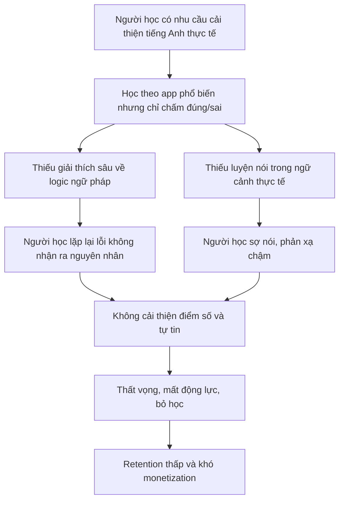

> **Liên kết ngữ cảnh:** [Market & Needs](./01-market-and-needs.md) | [Product Vision](./03-product-vision.md) | [Product Canvas](./04-product-canvas.md) | [Persona Student](./personas/persona-01-student.md) | [Persona Working Pro](./personas/persona-02-working-pro.md)

# 02. Problem Statement

## 1. Core Problem Statement

Người học tiếng Anh tại Việt Nam đang đối mặt với một vòng lặp học không hiệu quả: họ làm nhiều bài tập, lặp lại các câu mẫu, và thậm chí có thể đạt điểm ổn định trong các bài kiểm tra ngắn, nhưng không hiểu bản chất của lỗi ngữ pháp và không có cơ hội luyện phản xạ trong ngữ cảnh thực tế. Hệ thống học hiện tại thường chỉ chấm đúng/sai, không giải thích sâu vì sao câu sai, làm sao sửa, và khi nào nên dùng cấu trúc đó trong tình huống cụ thể.

Vấn đề không nằm ở việc học viên thiếu nỗ lực, mà nằm ở việc phần lớn nền tảng hiện có thiếu tính cá nhân hóa, thiếu logic giảng giải, và thiếu mô hình luyện nói dựa trên ngữ cảnh thực tế. Kết quả là học viên học máy móc, dễ bỏ học, mất động lực, và không hình thành phản xạ ngôn ngữ thật sự.

### Mệnh đề vấn đề chuẩn hóa
Người học tiếng Anh Việt Nam cần một giải pháp học ngắn, cá nhân hóa, có AI giải thích chuyên sâu và luyện nói phản xạ thực tế; hiện tại các ứng dụng phổ biến chỉ tập trung vào việc lặp lại hoặc kiểm tra vội nhưng không xây dựng được hệ thống hiểu lỗi và phản xạ đúng ngữ cảnh.

## 2. Impact (Hệ quả)

### 2.1 Hệ quả đối với người học
- Mất động lực: học viên cảm thấy trả lời đúng sai nhưng không biết vì sao, dễ chán nản và bỏ cuộc.
- Học máy móc: người dùng ghi nhớ câu mẫu từ hình thức, không hiểu ngữ pháp.
- Nản vì điểm số không cải thiện: họ làm nhiều nhưng không tiến bộ trong giao tiếp thực tế.
- Thiếu tự tin nói: lười nói vì sợ sai, không có môi trường luyện phản xạ theo tình huống đời sống.
- Dễ mắc lại lỗi: những lỗi lặp lại không được nhận diện và điều chỉnh theo mô hình học tập cá nhân.

### 2.2 Hệ quả đối với doanh nghiệp / sản phẩm
- Tỷ lệ retention thấp: người dùng bỏ app sau vài tuần vì không thấy tiến bộ rõ ràng.
- Tỷ lệ conversion giới hạn: người dùng không sẵn sàng trả phí khi chưa cảm nhận được hiệu quả thực tiễn.
- Thiếu sự khác biệt: sản phẩm bị trùng với ứng dụng học từ vựng/flashcard cơ bản.
- Mất cơ hội upsell: nếu không có AI feedback và luyện nói, không thể tạo gói Pro giá trị cao.

### 2.3 Hệ quả đối với xã hội và giáo dục
- Học sinh, sinh viên học theo kiểu “đúng sai” nhưng không phát triển kiến thức nền tảng vững chắc.
- Người đi làm không có thời gian học dài, dẫn đến kỷ luật học yếu và áp lực lớn khi cần giao tiếp.
- Thị trường học tiếng Anh bị phân mảnh: chia thành các app lặp lại và các lớp học kinh phí cao nhưng không phù hợp với nhu cầu người Việt.

## 3. Sơ đồ nguyên nhân – hệ quả

## 4. Nghiên cứu sâu hơn về các nguyên nhân gốc rễ

### 4.1 Cấu trúc học hiện tại quá “từng phần”
Học viên học từ vựng, ngữ pháp, phát âm, nói, nghe dưới dạng các đơn vị riêng rẽ, nhưng không được gắn vào một vòng lặp phản hồi khiến lỗi được sửa ngay tại thời điểm phát sinh.

### 4.2 Thiếu AI “nói câu chuyện” về lỗi
Nhiều hệ thống chỉ báo “There is a grammar mistake” mà không giải thích:
- lỗi nằm ở cấu trúc nào,
- vì sao cách nói khác đúng hơn,
- trong trường hợp nào có thể dùng khác,
- sự khác biệt giữa ngôn ngữ học thuật và giao tiếp thực tế.

### 4.3 Luyện nói chưa có tính tương tác
Học viên không thực sự nói vì:
- hệ thống thiếu AI đánh giá phản xạ,
- thiếu tình huống thực tế,
- chưa có luồng đúng sai ngay khi nói.

### 4.4 Gamification chưa được thiết kế đúng mục tiêu
Gamification nếu chỉ là điểm, xu, streak mà không dẫn tới hiểu sâu và luyện nói sẽ khiến learner cảm thấy “được tích điểm” nhưng không tiến bộ thực sự.

## 5. Tiêu chí thành công của giải pháp

- Giảm số lỗi lặp lại trong 30 ngày sau khi học.
- Tăng tỷ lệ hoàn bài học mỗi ngày và duy trì streak.
- Tăng cảm giác “hiểu vì sao” và “biết nói vào tình huống” thay vì chỉ “biết đúng/sai”.
- Tăng tỷ lệ thanh toán gói Pro nhờ nhận thấy giá trị rõ ràng.

## 6. Kết nối với các tài liệu khác
- Market gap và nhu cầu người dùng: [01-market-and-needs.md](./01-market-and-needs.md)
- Tầm nhìn sản phẩm: [03-product-vision.md](./03-product-vision.md)
- Product canvas: [04-product-canvas.md](./04-product-canvas.md)
- Persona chính: [persona-01-student.md](./personas/persona-01-student.md) và [persona-02-working-pro.md](./personas/persona-02-working-pro.md)

