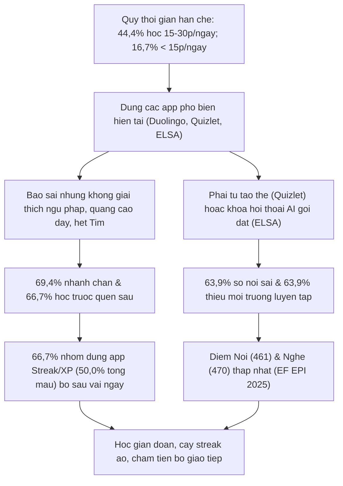

> **Liên kết ngữ cảnh:** [Skill Harness (SSOT)](../00-ai-harness/skill.md) | [PO Kit](../00-ai-harness/po-kit.md) | [Market & Needs](./01-market-and-needs.md) | [Persona Student](./personas/persona-01-student.md) | [Persona Working Pro](./personas/persona-02-working-pro.md) | [Product Vision](./03-product-vision.md) | [Product Canvas](./04-product-canvas.md) | [MVP MoSCoW](./05-mvp-moscow.md)

# 02. Tuyên bố Vấn đề (Problem Statement)

## 1. Tuyên bố Vấn đề Cốt lõi (Core Problem Statement)

Theo quy tắc chuẩn hóa trong [skill.md](../00-ai-harness/skill.md), tuyên bố vấn đề tập trung hoàn toàn vào **người dùng, nỗi đau có số liệu kiểm chứng ($N = 36$) và hệ quả** — tuyệt đối **không lồng ghép giải pháp kỹ thuật** vào bên trong mệnh đề vấn đề.

> **Tuyên bố Vấn đề (Problem Statement đã khóa):**
> *"Sinh viên đang học ngoại ngữ cần một cách học giúp họ duy trì việc học đều đặn và tự tin thực hành giao tiếp, vì **69,4%** sinh viên khảo sát nhanh chán hoặc thiếu động lực, **66,7%** thường quên từ vựng, trong khi **63,9%** sợ nói sai và **63,9%** không có môi trường luyện tập. Bên cạnh đó, trong nhóm từng sử dụng ứng dụng có streak và điểm, **66,7%** (**50,0%** tổng mẫu) đã bỏ sau vài ngày. Những khó khăn này khiến quá trình học bị gián đoạn, hình thành thói quen cày streak ảo và làm chậm tiến bộ giao tiếp."*

### Phân rã 4 thành phần theo công thức chuẩn
* **Nhóm người dùng (`[Nhóm người dùng]`):** Sinh viên Việt Nam đang học ngoại ngữ (đặc biệt **58,3%** sinh viên năm 1 bắt đầu từ gốc A1–A2 và **27,8%** sinh viên năm 4 ôn chuẩn đầu ra TOEIC/B1 trong mẫu $N = 36$).
* **Nhu cầu cốt lõi (`[Nhu cầu cốt lõi]`):** Một cách học giúp duy trì việc học đều đặn trong quỹ thời gian ngắn (**44,4%** chỉ có 15–30 phút/ngày; **16,7%** có < 15 phút/ngày) và tự tin thực hành giao tiếp.
* **Insight kèm số liệu thực tế (`[Insight]`):**
  * **69,4%** ($25/36$ SV) nhanh chán, thiếu động lực, dễ bỏ giữa chừng.
  * **66,7%** ($24/36$ SV) học trước quên sau, quên từ vựng nhanh.
  * **63,9%** ($23/36$ SV) sợ nói/phát âm sai, ngại giao tiếp.
  * **63,9%** ($23/36$ SV) thiếu môi trường thực hành giao tiếp.
  * **66,7%** nhóm từng dùng app có Streak/XP (tương đương **50,0%** tổng mẫu) đã bỏ cuộc chỉ sau vài ngày; đồng thời nhiều đánh giá 1–2 sao trên Google Play phản ánh tình trạng app hiện tại báo sai nhưng không giải thích ngữ pháp, quảng cáo dày và hết Tim gây ngắt quãng.
* **Hậu quả (`[Hậu quả]`):** Quá trình học bị gián đoạn, hình thành thói quen "cày streak ảo" để giữ chuỗi thay vì hiểu bài, và làm chậm tiến bộ giao tiếp thực tế (phản ánh qua điểm **EF EPI 2025** của Việt Nam là **500/800**, trong đó **Nói 461** và **Nghe 470** thấp nhất).

---

## 2. Hệ quả (Impact)

### 2.1 Hệ quả đối với người học
* **Học gián đoạn & tỷ lệ bỏ cuộc cao:** **50,0%** tổng mẫu (**66,7%** người từng dùng app có Streak/XP) bỏ học chỉ sau vài ngày vì cảm thấy bài học nhàm chán (**69,4%**) hoặc bị ngắt quãng bởi cơ chế hết Tim/quảng cáo dày.
* **Cày streak ảo, không hiểu bản chất:** Khi gặp câu sai mà không được giải thích quy tắc ngữ pháp hay liên hệ với tiếng Việt, người học chọn đại cho qua để giữ chuỗi, dẫn đến học trước quên sau (**66,7%**).
* **Tê liệt phản xạ giao tiếp:** Tâm lý sợ phát âm sai (**63,9%**) cộng với việc thiếu môi trường luyện tập (**63,9%**) khiến người học dù biết mặt chữ vẫn không dám mở miệng giao tiếp trong đời sống hay thi cử.

### 2.2 Hệ quả đối với Sản phẩm & Kinh doanh
* **Khó giữ chân người dùng (Low Retention):** Nếu sản phẩm chỉ sao chép Gamification bề mặt (Streak/XP) mà không giải quyết được gốc rễ hiểu lỗi và luyện nói, tỷ lệ rời bỏ sau vài ngày sẽ lặp lại ở mức cao như các app hiện hữu (**66,7%** churn trong nhóm từng dùng app Streak).
* **Khó chuyển đổi trả phí (Low Conversion):** Sinh viên là tệp nhạy cảm về giá; nếu họ không thấy tiến bộ thực sự ở các kỹ năng yếu nhất (Nghe **470**, Nói **461**) hoặc gặp rào cản giá quá cao ngay từ đầu, sản phẩm sẽ mất khả năng chuyển đổi sang gói thuê bao.

---

## 3. Sơ đồ Nguyên nhân – Hệ quả (Cause & Effect Flowchart)

---

## 4. Bước tiếp theo trong Chuỗi ngữ cảnh (Context Chain)
* Nguồn dữ liệu: [01. Market & Needs](./01-market-and-needs.md)
* Tiếp theo: [Persona 01: Sinh viên](./personas/persona-01-student.md) và [Persona 02: Người đi làm bận rộn](./personas/persona-02-working-pro.md)
