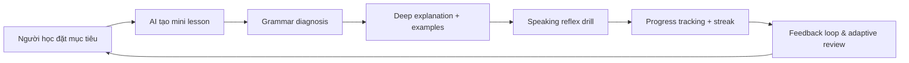

> **Liên kết ngữ cảnh:** [Market & Needs](./01-market-and-needs.md) | [Problem Statement](./02-problem-statement.md) | [Product Canvas](./04-product-canvas.md) | [Persona Student](./personas/persona-01-student.md) | [Persona Working Pro](./personas/persona-02-working-pro.md)

# 03. Product Vision

## 1. Tuyên ngôn tầm nhìn sản phẩm

### For
Những người học tiếng Anh ở Việt Nam, từ sinh viên cần chứng chỉ đến người đi làm cần giao tiếp thực tế, muốn học hiệu quả trong thời gian ngắn, có tính kỷ luật và thấy tiến bộ rõ ràng.

### Who
Những người đang gặp khó khăn khi học tiếng Anh theo cách truyền thống: học nhiều nhưng không hiểu rõ lỗi, không bảo thủ với thời gian, và muốn học theo lộ trình phù hợp với mục tiêu cá nhân.

### The Product
Một ứng dụng học ngoại ngữ gamified tích hợp AI, kết hợp AI Grammar Coach, AI Speaking Reflex Trainer và thực hành mini-game hàng ngày để giúp người học hiểu sâu, sửa sai và luyện phản xạ đúng ngữ cảnh.

### Unlike
Khác với các ứng dụng chỉ tập trung vào flashcard, lặp lại câu mẫu hoặc dạy ngữ pháp khô khan, hệ thống của chúng ta không dừng ở “đúng/sai” mà đi sâu vào câu chuyện lỗi, giải thích logic và tạo phản xạ thực hành ngay trong từng tình huống.

### Our Product
Là một nền tảng học tiếng Anh hướng tới hiệu quả, tính cá nhân hóa và sự tự tin trong giao tiếp thực tế. Người dùng không chỉ học đúng, mà còn học để hiểu và nói đúng trong thực tế.

## 2. 3 Product Goals

### Goal 1: Giúp người học hiểu bản chất lỗi ngữ pháp
- AI phân tích lỗi theo từng loại: thì, mạo từ, giới từ, cấu trúc câu, câu điều kiện, câu gián tiếp, động từ nguyên mẫu, v.v.
- Mỗi lỗi được giải thích bằng ngữ cảnh, ví dụ thực tế, và cách sửa nhanh.
- Mục tiêu: giảm lỗi lặp lại và tạo nền tảng kiến thức vững chắc.

### Goal 2: Tạo thói quen học dài hạn bằng gamification có giá trị
- Mỗi ngày người dùng hoàn thành 5–15 phút micro-learning với mục tiêu rõ ràng.
- Streak, level, rewards, challenge, và review dựa trên lỗi lặp lại giúp giữ động lực mà không tạo cảm giác học máy móc.
- Mục tiêu: duy trì tỷ lệ giữ chân cao hơn so với app học kiểu “nộp bài mà không hiểu”.

### Goal 3: Luyện nói phản xạ thực tế cho mọi mục tiêu
- Người dùng luyện thoại trong tình huống thực tế như xin nghỉ phép, đặt lịch, phỏng vấn, email công việc, thuyết trình, giao tiếp hàng ngày.
- AI đánh giá phát âm, tốc độ, từ vựng, độ tự nhiên và gợi ý sửa câu.
- Mục tiêu: tăng sự tự tin khi nói và giảm cảm giác ngại giao tiếp.

## 3. Value Flow trong sản phẩm

## 4. Mô tả giá trị cốt lõi

### 4.1 Dịch vụ mang lại
- Học ngắn nhưng đúng trọng tâm.
- Khắc phục lỗi lặp lại cá nhân hóa.
- Hướng dẫn ngữ pháp bằng logic dễ tiếp cận.
- Luyện nói thực tế không cần giáo viên 1-1 thường xuyên.
- Tạo cảm giác tiến bộ thường xuyên trong 2–4 tuần đầu.

### 4.2 Chỗ đứng trong tâm trí người dùng
Ứng dụng này phải trở thành “trợ lý học tiếng Anh cá nhân” thay vì “trang web luyện đề hay flashcard vô tận”.

### 4.3 Định hướng hình ảnh thương hiệu
- Tôn trọng tính khoa học nhưng dễ tiếp cận.
- Giao diện hơi năng động, tích cực, không “giảng dạy khô cứng”.
- Cảm giác “học mỗi ngày, tiến bộ từng ngày” là trung tâm.

## 5. Các giả định cốt lõi
- Người học sẵn sàng đầu tư nếu nhận thấy hiệu quả rõ rệt.
- Một AI coach cần phải có phản hồi tức thì để giữ người dùng.
- Tính cá nhân hóa là yếu tố quyết định giữa ứng dụng giữ chân và ứng dụng bỏ đi.
- Nói tốt và hiểu tốt phải đi cùng nhau; không nên tách rời học đọc/viết và nói.

## 6. Kết nối với các tài liệu khác
- Nhu cầu người dùng: [01-market-and-needs.md](./01-market-and-needs.md)
- Vấn đề trọng tâm: [02-problem-statement.md](./02-problem-statement.md)
- Product canvas: [04-product-canvas.md](./04-product-canvas.md)
- Persona: [persona-01-student.md](./personas/persona-01-student.md) và [persona-02-working-pro.md](./personas/persona-02-working-pro.md)

