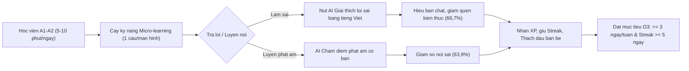

> **Liên kết ngữ cảnh:** [Skill Harness (SSOT)](../00-ai-harness/skill.md) | [PO Kit](../00-ai-harness/po-kit.md) | [Market & Needs](./01-market-and-needs.md) | [Problem Statement](./02-problem-statement.md) | [Persona Student](./personas/persona-01-student.md) | [Persona Working Pro](./personas/persona-02-working-pro.md) | [Product Canvas](./04-product-canvas.md) | [MVP MoSCoW](./05-mvp-moscow.md)

# 03. Tầm nhìn Sản phẩm & Mục tiêu OKRs (Product Vision & OKRs)

## 1. Tuyên ngôn Tầm nhìn Sản phẩm (Geoffrey Moore Framework)

Tuân thủ đúng khuôn mẫu 6 thành phần của **Geoffrey Moore** cho sản phẩm **LingoCraft AI** (đội **SBTC - VKU**):

* **For** *(Đối tượng mục tiêu)*: Người Việt học tiếng Anh bắt đầu từ gốc **A1–A2** và ôn chuẩn đầu ra **TOEIC/B1** (trọng tâm là sinh viên đại học và người đi làm trẻ).
* **Who** *(Nỗi đau cốt lõi)*: Nhanh chán và thiếu động lực (**69,4%**), hay quên từ vựng (**66,7%**), sợ nói sai và thiếu môi trường thực hành giao tiếp (**63,9%**).
* **The** *(Tên sản phẩm)*: **LingoCraft AI**
* **Is a** *(Danh mục sản phẩm)*: Ứng dụng học tiếng Anh Gamification tích hợp AI.
* **That** *(Giá trị mang lại)*: Giúp người học tiến bộ mỗi ngày qua bài học ngắn **5–10 phút**, giữ chuỗi **Streak**, tích điểm **XP** và được **AI sửa lỗi tức thì** (giải thích ngữ pháp bằng tiếng Việt & luyện phát âm cơ bản).
* **Unlike** *(Khác với đối thủ)*: **Duolingo** ít giải thích ngữ pháp (hết Tim ngắt quãng, quảng cáo dày), **ELSA Speak** khóa hội thoại AI ở gói đắt tiền, hay **Quizlet** phải tự tạo flashcard và thiếu Nghe – Nói.
* **Our product** *(Điểm khác biệt cốt lõi)*: Cung cấp **lộ trình dựng sẵn cho người Việt** kèm **AI giải thích lỗi sai bản địa hóa và luyện nói tình huống thực tế**, đồng thời mở miễn phí vòng lặp học cốt lõi trong 6 tháng đầu.

---

## 2. Ba Mục tiêu Sản phẩm Cốt lõi (3 Product Goals)

### Goal 1: Xây dựng vòng lặp học hiểu bản chất thay vì "cày streak ảo"
* Kết hợp bài học Micro-learning ngắn **5–10 phút** (1 câu/màn hình) với nút **'Giải thích lỗi sai bằng AI'** bằng tiếng Việt ngay tại popup báo sai.
* Giúp người học hiểu rõ nguyên nhân sai ngữ pháp để khắc phục tình trạng học trước quên sau (**66,7%**) và nhanh chán (**69,4%**).

### Goal 2: Tạo môi trường luyện nói an toàn cho người mất gốc (A1–A2)
* Tích hợp **AI luyện phát âm & chấm điểm cơ bản** bám sát lỗi phát âm thường gặp của người Việt, giúp người học vượt qua nỗi sợ nói sai (**63,9%**) và thiếu môi trường thực hành (**63,9%**).

### Goal 3: Duy trì thói quen học bền vững & kiểm soát phạm vi phát triển tinh gọn
* Giữ động lực quay lại bằng Gamification đúng mục đích (Streak, XP, Thách đấu bạn bè, nhắc học thông minh, chế độ tạm ẩn Nghe/Nói 15 phút).
* Đảm bảo hoàn thành vòng lặp MVP trong giới hạn **4 tuần Vibe Code** với chất lượng ổn định trước khi mở rộng tính năng.

---

## 3. Hệ thống Mục tiêu & Kết quả Then chốt trong 6 Tháng (SMART OKRs)

Được đồng bộ trực tiếp từ Bước 4 của [skill.md](../00-ai-harness/skill.md):

| Mã OKR | Mức ưu tiên | Mục tiêu (Objective) | Kết quả then chốt đo lường được (Key Results - SMART) | Mốc thời gian |
| :--- | :--- | :--- | :--- | :--- |
| **O1** | **Must** | Hoàn thiện kho nội dung học thực dụng cho người Việt mất gốc A1–A2 | Xây dựng hoàn chỉnh **5 chủ đề giao tiếp**, **200+ bài học ngắn 5–10 phút**. | **Tháng 5** |
| **O2** | **Must** | Ra mắt phiên bản MVP ổn định kỹ thuật trong khung thời gian Vibe Code | Hoàn thành vòng lặp MVP, đạt **tỷ lệ hoàn thành bài học $\ge 70\%$**, số **lỗi crash $\le 2$**. | **Tháng 3** |
| **O3** | **Must** | Hình thành thói quen học tập đều đặn (chống bỏ cuộc sớm) | Đạt **$\ge 30\%$ người dùng học $\ge 3$ ngày/tuần**, **Streak trung bình $\ge 5$ ngày**. | **Tháng 5** |
| **O4** | **Should** | Mở rộng tệp người dùng thử nghiệm ban đầu (Early Adopters) | Thu hút **1.000 người dùng thử**, đạt **$\ge 50\%$ hoàn thành bài học đầu tiên trong vòng 24 giờ**. | **Tháng 6** |
| **O5** | **Should** | Chứng minh khả năng giữ chân và mức độ hài lòng sản phẩm | Đạt **Retention tuần 4 $\ge 25\%$**, điểm hài lòng **CSAT $\ge 4.0/5$**. | **Tháng 6** |

---

## 4. Sơ đồ Luồng Giá trị Sản phẩm (Product Value Flow — Mermaid)

