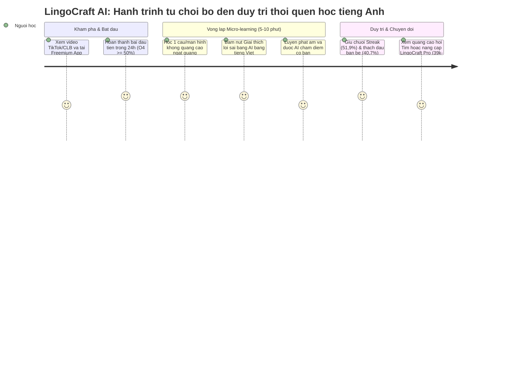

> **Liên kết ngữ cảnh:** [Skill Harness (SSOT)](../00-ai-harness/skill.md) | [PO Kit](../00-ai-harness/po-kit.md) | [Market & Needs](./01-market-and-needs.md) | [Problem Statement](./02-problem-statement.md) | [Persona Student](./personas/persona-01-student.md) | [Persona Working Pro](./personas/persona-02-working-pro.md) | [Product Vision](./03-product-vision.md) | [MVP MoSCoW](./05-mvp-moscow.md)

# 04. Product Canvas & Lean Canvas 9 Ô (`LingoCraft AI`)

## 1. Bảng Tóm tắt Product Canvas (Theo chuẩn `po-kit.md`)

| Trường thông tin | Nội dung chuẩn hóa theo `skill.md` |
| :--- | :--- |
| **Tên sản phẩm** | **LingoCraft AI** *(Đội SBTC - VKU)* |
| **Goals / KPIs** | **OKRs:** MVP hoàn thành tỷ lệ bài $\ge 70\%$ & crash $\le 2$ (T3); $5$ chủ đề / $200+$ bài ngắn & $\ge 30\%$ học $\ge 3$ ngày/tuần, Streak TB $\ge 5$ ngày (T5); $1.000$ user thử & Retention tuần 4 $\ge 25\%$, CSAT $\ge 4.0/5$ (T6). **Key Metrics:** DAU, tỷ lệ hoàn thành bài $> 65\%$, Retention $D1 > 45\%$, $D7 > 25\%$, $D30 > 12\text{–}35\%$, tỷ lệ dùng AI Tutor $> 50\%$, Conversion gói Pro $3\text{–}5\%$. |
| **Target Personas** | 1. **Sinh viên đại học (18–22 tuổi)** ôn TOEIC/B1 (trọng tâm năm 1 chiếm **58,3%** & năm 4 chiếm **27,8%**). 2. **Người đi làm trẻ (23–28 tuổi)** cần giao tiếp công sở trong 10–15 phút rảnh. |
| **Key Pain Points** | Nhanh chán/dễ bỏ (**69,4%**); học trước quên sau (**66,7%**); sợ nói/phát âm sai (**63,9%**); thiếu môi trường luyện tập (**63,9%**); **66,7%** người từng dùng app Streak/XP (**50,0%** tổng mẫu) bỏ sau vài ngày. |
| **Core Solutions** | Micro-learning **5–10 phút** (1 câu/màn hình) + **AI Tutor** giải thích lỗi sai tiếng Việt tức thì + **AI chấm phát âm cơ bản** + **Gamification** (Streak, XP, Hearts, Đua top/Thách đấu bạn bè). |

---

## 2. Mô hình Kinh doanh Lean Canvas 9 Ô (Theo thứ tự liền mạch Bước 5 `skill.md`)

| Ô Lean Canvas | Nội dung chi tiết (Single Source of Truth) |
| :--- | :--- |
| **1. Problem (Vấn đề)** | • Học vẹt, không hiểu gốc ngữ pháp. • Cày streak ảo & bỏ cuộc sớm (**50,0%** tổng mẫu / **66,7%** nhóm từng dùng app Streak bỏ sau vài ngày; **69,4%** nhanh chán; **66,7%** quên từ vựng). • Thiếu môi trường phản xạ nói & sợ nói sai (**63,9%**). |
| **2. Customer Segments (Phân khúc khách hàng)** | • **Sinh viên ĐH (18–22 tuổi):** bắt đầu từ gốc A1–A2, ôn chuẩn đầu ra TOEIC/B1. • **Người đi làm trẻ (23–28 tuổi):** cần giao tiếp công sở nhanh gọn. • **Early Adopters:** Sinh viên năm 1 (**58,3%**) & Sinh viên năm 4 sắp xét tốt nghiệp (**27,8%**). |
| **3. Unique Value Proposition (UVP)** | *"Sự kết hợp giữa tính gây nghiện của Duolingo + Gia sư giải thích ngữ pháp ChatGPT + Luyện phản xạ nói ELSA trong 10 phút/ngày với chi phí sinh viên."* |
| **4. Channels (Kênh tiếp cận)** | • Short-video **TikTok / Reels** chữa bẫy ngữ pháp & lỗi phát âm người Việt. • **Câu lạc bộ (CLB) tiếng Anh** tại các trường đại học. • Phát hành **Freemium App** (mở miễn phí vòng lặp cốt lõi 6 tháng đầu). |
| **5. Solution (Giải pháp)** | • **Micro-learning 5–10 phút** (1 câu/màn hình). • **AI Tutor** giải thích lỗi sai tức thì bằng tiếng Việt ngay tại popup báo sai. • **AI chấm phát âm cơ bản** cho người mất gốc. • **Đua top / Thách đấu bạn bè** giữ động lực (**40,7%**). |
| **6. Key Metrics (Chỉ số đo lường)** | • **DAU** (Daily Active Users). • Tỷ lệ hoàn thành bài học **$> 65\%$** (mục tiêu MVP $\ge 70\%$). • Retention: **$D1 > 45\%$**, **$D7 > 25\%$**, **$D30 > 12\text{–}35\%$**. • Tỷ lệ sử dụng **AI Tutor $> 50\%$**. • **Conversion** nâng cấp gói Pro **$3\text{–}5\%$**. |
| **7. Unfair Advantage (Lợi thế cạnh tranh độc quyền)** | • **AI Explain bản địa hóa chuyên sâu** cho lỗi ngữ pháp & phát âm đặc thù của người Việt. • **Hiệu ứng mạng lưới (Network Effect)** từ cơ chế đua top, thách đấu giữa các CLB và trường đại học. |
| **8. Cost Structure (Cấu trúc chi phí)** | • **Biến phí:** Chi phí API LLM (giải thích lỗi) & API Speech-to-Text (chấm phát âm). • **Định phí:** Hạ tầng Cloud Server / Database. • **Chi phí vận hành nội dung:** Phát triển ngân hàng câu hỏi (200+ bài) & voucher giải thưởng đổi điểm. |
| **9. Revenue Streams (Dòng doanh thu)** | • **Freemium:** Xem quảng cáo để hồi Tim (Hearts) / nhận thêm lượt hỏi AI. • **Gói thuê bao sinh viên *LingoCraft Pro*:** **`39.000đ – 59.000đ/tháng`**. • **Affiliate:** Liên kết giới thiệu khóa/lệ phí thi chứng chỉ **TOEIC / IELTS**. |

---

## 3. Hành trình Trải nghiệm Tổng thể (Mermaid User Journey)

