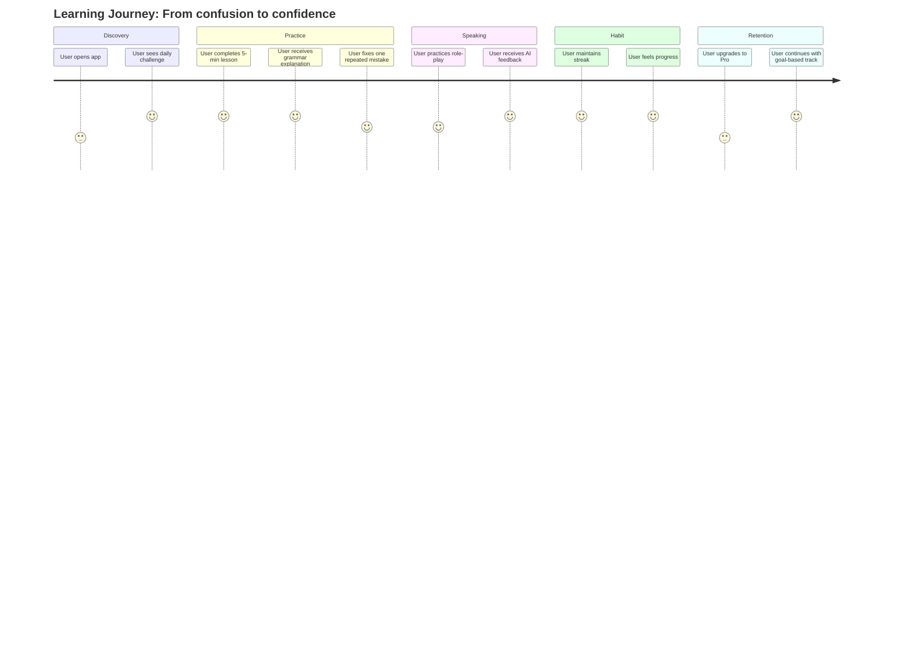

> **Liên kết ngữ cảnh:** [Market & Needs](./01-market-and-needs.md) | [Problem Statement](./02-problem-statement.md) | [Product Vision](./03-product-vision.md) | [Persona Student](./personas/persona-01-student.md) | [Persona Working Pro](./personas/persona-02-working-pro.md)

# 04. Product Canvas

## 1. Product Summary

| Trường | Mô tả |
|---|---|
| Tên sản phẩm | AI English Coach Vietnam (working title) |
| Goals / KPIs | Tỷ lệ giữ chân 30 ngày > 35%; tỷ lệ hoàn bài học hàng ngày > 60%; tăng chỉ số self-reported confidence > 25%; conversion Pro > 5% trong 90 ngày |
| Target Personas | Sinh viên 18–22 tuổi học TOEIC/B1; người đi làm 23–30 tuổi cần giao tiếp thực tế |
| Key Pain Points | Không hiểu sai ngữ pháp; quá nhiều app lặp lại câu mẫu; thiếu luyện nói phản xạ; mất động lực |
| Core Solutions | AI grammar diagnostic, deep explanation, speaking practice, adaptive review, gamified streaks |
| Monetization | Freemium + Pro subscription + goal-based bundle + B2B partnership |
| Differentiator | Kết hợp AI giải thích lỗi chuyên sâu + luyện nói phản xạ + gamification trong một vòng lặp hàng ngày |

## 2. Product Canvas Details

### 2.1 Product / Service
Ứng dụng học tiếng Anh gamified tích hợp AI, cho phép người dùng học mini-lessons, nhận feedback chi tiết về sai ngữ pháp, sửa lỗi theo logic và luyện nói phản xạ trong các tình huống cụ thể.

### 2.2 Goals / KPIs
- Mục tiêu người dùng: cải thiện hiểu biết ngữ pháp, nâng cao phản xạ giao tiếp, duy trì thói quen học đều đặn.
- Mục tiêu kinh doanh: tăng retention, tăng conversion và duy trì giá trị gói Pro.
- KPIs chính:
  - Daily Active Users (DAU) / Weekly Active Users (WAU)
  - Completion rate của lesson
  - Repeated error reduction rate
  - Speaking confidence score
  - Pro conversion rate

### 2.3 Target Personas
- Sinh viên định hướng TOEIC/B1 cho học tập, thi chứng chỉ và xin việc.
- Người đi làm đang cần giao tiếp trong công việc hoặc hội thoại cơ bản với đồng nghiệp và khách hàng.

### 2.4 Key Pain Points
- Không biết lỗi nằm ở đâu và vì sao.
- Học nhiều nhưng không hiểu bản chất.
- Mất tập trung trong các app học quá dài hoặc quá giống nhau.
- Không có môi trường luyện phản xạ, sợ nói sai.

### 2.5 Core Solutions
- AI Grammar Coach: phân tích chỗ sai, giải thích quy tắc và đưa ví dụ.
- AI Speaking Reflex: nhận diện phát âm, ngữ điệu và lời đáp tương ứng với tình huống.
- Adaptive Review: nhắc ôn lại lỗi lặp lại theo lịch lặp.
- Gamified Learning Loop: streak, level, achievement, challenge ngắn cùng phần thưởng.

## 3. User Journey

## 4. Value Proposition

### 4.1 Tại sao người dùng chọn sản phẩm?
- Họ muốn học biết “vì sao” chứ không chỉ “đúng hay sai”.
- Họ cần một AI hiểu thói quen, lỗi và mục tiêu học cá nhân.
- Họ cần tính hứng thú và đồng bộ giữa học và hành động.

### 4.2 Tại sao doanh nghiệp đầu tư?
- Học ngoại ngữ là thị trường lớn và ổn định.
- Sản phẩm có khả năng giữ chân thông qua AI + gamification + local market fit.
- Có thể mở rộng sang gói mục tiêu, B2B và nghiên cứu thị trường toàn Đông Nam Á sau này.

## 5. Risks and assumptions

- Rủi ro: người dùng không nhận thức được “giá trị sâu” nếu chưa thử trải nghiệm trực tiếp.
- Giả định: người học muốn hiệu quả nhanh trong 10–15 phút/ngày và chấp nhận trả phí nếu sản phẩm chứng minh được lợi ích.
- Yếu tố then chốt: độ chính xác của AI feedback và sự rõ ràng trong giải thích.

## 6. Kết nối với tài liệu khác
- Nhu cầu: [01-market-and-needs.md](./01-market-and-needs.md)
- Vấn đề: [02-problem-statement.md](./02-problem-statement.md)
- Tầm nhìn: [03-product-vision.md](./03-product-vision.md)
- Persona chính: [persona-01-student.md](./personas/persona-01-student.md) và [persona-02-working-pro.md](./personas/persona-02-working-pro.md)

