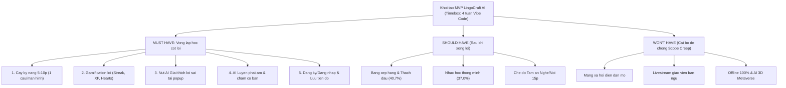

> **Liên kết ngữ cảnh:** [Skill Harness (SSOT)](../00-ai-harness/skill.md) | [PO Kit](../00-ai-harness/po-kit.md) | [Market & Needs](./01-market-and-needs.md) | [Problem Statement](./02-problem-statement.md) | [Persona Student](./personas/persona-01-student.md) | [Persona Working Pro](./personas/persona-02-working-pro.md) | [Product Vision](./03-product-vision.md) | [Product Canvas](./04-product-canvas.md)

# 05. Phạm vi MVP theo Ma trận MoSCoW (MVP MoSCoW Prioritization)

## 1. Nguyên tắc Khóa Phạm vi (Anti-Scope Creep Guardrail)
Theo **Luật số 2 (`Anti-Scope Creep Rule`)** trong [skill.md](../00-ai-harness/skill.md), quỹ thời gian **Vibe Code** của đội **SBTC** cho phiên bản **LingoCraft AI** chỉ có **4 tuần**. Mọi tính năng đưa vào nhóm **Must Have** bắt buộc phải phục vụ trực tiếp việc giải quyết 4 nỗi đau từ khảo sát $N = 36$ (**69,4%** nhanh chán; **66,7%** quên kiến thức; **63,9%** sợ nói sai & thiếu môi trường) và đạt mục tiêu **O2** (hoàn thành vòng lặp MVP, tỷ lệ hoàn thành bài $\ge 70\%$, lỗi crash $\le 2$).

---

## 2. Phân loại Tính năng theo Ma trận MoSCoW

| Nhóm ưu tiên | Danh sách Tính năng / Hạng mục | Cơ sở dữ liệu & Lý do quyết định |
| :--- | :--- | :--- |
| **M — Must Have** *(Bắt buộc code xong trong 4 tuần)* | 1. **Cây kỹ năng Micro-learning 5–10 phút** (thiết kế 1 câu/màn hình). 2. **Gamification lõi:** Streak, XP, Hearts (Tim). 3. **Nút *'Giải thích lỗi sai bằng AI'*** hiển thị ngay tại popup báo sai. 4. **AI luyện phát âm & chấm điểm cơ bản.** 5. **Đăng ký / Đăng nhập & lưu tiến độ học tập.** | Giải quyết trực diện 4 nỗi đau cốt lõi ($N=36$): bài ngắn **5–10 phút** (**59,3%**), giữ **Streak** (**51,9%**), **XP** (**37,0%**), **AI sửa lỗi** khắc phục quên kiến thức (**66,7%**) và **AI luyện phát âm** giảm nỗi sợ nói sai (**63,9%**). |
| **S — Should Have** *(Ưu tiên làm ngay sau vòng lặp lõi nếu kịp tiến độ)* | 1. **Bảng xếp hạng & Thách đấu bạn bè.** 2. **Nhắc học thông minh.** 3. **Chế độ *'Tạm ẩn Nghe/Nói 15 phút'*.** | Đáp ứng trực tiếp động lực cộng đồng (**40,7%**), nhắc nhở đúng giờ (**37,0%**) và nhu cầu học nơi công cộng của **Persona 02** (người đi làm). |
| **C — Could Have** *(Bổ sung ở các Sprint mở rộng sau MVP)* | 1. **AI Roleplay hội thoại đa lượt.** 2. **Cửa hàng đổi Streak Freeze / Voucher.** 3. **AI chấm chữa viết ngắn.** | Tối ưu trải nghiệm cho **25,9%** người dùng thích đổi thưởng / bảo vệ Streak khi bận đột xuất, nhưng chưa cần thiết để chứng minh vòng lặp lõi trong 4 tuần đầu. |
| **W — Won't Have** *(Loại bỏ hoàn toàn khỏi giai đoạn MVP)* | 1. **Mạng xã hội diễn đàn mở.** 2. **Livestream với giáo viên bản ngữ.** 3. **Chế độ học Offline hoàn toàn (100%).** 4. **AI 3D Metaverse.** | Vi phạm **Luật số 2 (Anti-Scope Creep)**: quá nặng về vận hành, kiểm duyệt nội dung, hạ tầng đồng bộ hoặc chi phí vượt quá sức của nhóm trong **4 tuần Vibe Code**. |

---

## 3. Sơ đồ Luồng Phạm vi MVP 4 Tuần (Mermaid Flowchart)

---

## 4. Kết nối sang Giai đoạn Tiếp theo
* Hoàn thành Bước 6/6 của Giai đoạn 1 (`Research & Discovery`) theo [skill.md](../00-ai-harness/skill.md).
* Tài liệu này là đầu vào trực tiếp để xây dựng `02-design-system/` (Design System & Prototype React Native) và `03-requirements/` (PRD & Product Backlog).
