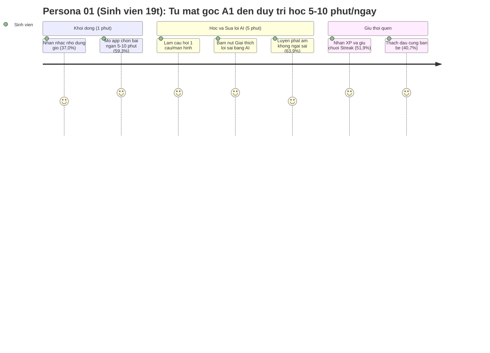

> **Liên kết ngữ cảnh:** [Skill Harness (SSOT)](../../00-ai-harness/skill.md) | [PO Kit](../../00-ai-harness/po-kit.md) | [Market & Needs](../01-market-and-needs.md) | [Problem Statement](../02-problem-statement.md) | [Persona Working Pro](./persona-02-working-pro.md) | [Product Vision](../03-product-vision.md) | [Product Canvas](../04-product-canvas.md)

# Persona 01: Sinh viên Năm 1–4 (Trọng tâm Sinh viên Năm 1 — Nhóm Khảo sát Chính)

> **Cơ sở dữ liệu:** Đại diện cho nhóm chiếm tỷ trọng cao nhất trong khảo sát thực tế $N = 36$ sinh viên (**58,3%** là sinh viên năm 1; **27,8%** là sinh viên năm 4).

## 1. Thông tin nhân khẩu học (Demographics)
* **Tuổi:** 19 tuổi (đại diện nhóm sinh viên năm 1 chiếm **58,3%** mẫu khảo sát; mở rộng tới 22 tuổi cho sinh viên năm 4 ôn chuẩn đầu ra chiếm **27,8%**).
* **Giới tính:** Nam/Nữ (sinh viên đại học tại Việt Nam).
* **Nơi ở & Ngân sách:** Sống tại ký túc xá (KTX) hoặc phòng trọ; **ngân sách thấp**, phụ thuộc gia đình hoặc làm thêm, rất nhạy cảm với chi phí thuê bao hàng tháng.
* **Trình độ tiếng Anh:** Mất gốc hoặc ở mức cơ bản (**A1–A2**), cần củng cố nền tảng để đáp ứng chuẩn đầu ra **TOEIC / B1**.
* **Thiết bị:** Chủ yếu sử dụng **Smartphone** (học mọi lúc tại KTX, giờ ra chơi, trên xe buýt); dùng laptop khi làm bài tập lớn hoặc tra cứu ở phòng.

## 2. Mục tiêu & Động lực (Goals & Motivations)
* Lấy lại gốc ngữ pháp và từ vựng từ mức **A1–A2** để đạt chuẩn đầu ra **TOEIC/B1** mà không phải đi học trung tâm tốn kém.
* Duy trì thói quen học tiếng Anh đều đặn mỗi ngày trong quỹ thời gian ngắn mà không bị quá tải.
* Tự tin mở miệng phát âm và giao tiếp các tình huống đời sống cơ bản thay vì chỉ khoanh trắc nghiệm.
* Được khích lệ trực tiếp qua **bài học ngắn 5–10 phút** (**59,3%**), **giữ chuỗi Streak** (**51,9%**), **thách đấu cùng bạn bè** (**40,7%**) và **điểm XP / nhắc học đúng giờ** (**37,0%**).

## 3. Thói quen học tập (Habits)
* **Quỹ thời gian tự học ngắn:** Theo khảo sát $N = 36$, **44,4%** chỉ học **15–30 phút/ngày** và **16,7%** học **< 15 phút/ngày**. Thường tranh thủ học trước khi đi ngủ ở KTX/trọ hoặc giữa các tiết học.
* **Ưa thích nhịp học chia nhỏ:** Cần hoàn thành nhanh một bài học trong **5–10 phút** (**59,3%** lựa chọn).
* **Từng thử qua app Gamification:** Từng tải các ứng dụng học phổ biến có Streak/XP nhưng dễ rơi vào trạng thái học lướt cho kịp giữ chuỗi rồi bỏ ngang sau vài ngày.
* **Học theo nhóm bạn:** Dễ có động lực hơn khi nhìn thấy bạn bè cùng phòng KTX hoặc cùng lớp đang giữ chuỗi hoặc đua bảng xếp hạng (**40,7%**).

## 4. Nỗi đau (Pain Points — Trích dẫn dữ liệu khảo sát $N = 36$)
* **Nhanh chán, thiếu động lực, dễ bỏ giữa chừng (69,4% — $25/36$ SV):** Tỷ lệ bỏ cuộc rất cao; **66,7%** nhóm từng dùng app có Streak/XP (tức **50,0%** tổng mẫu) đã bỏ cuộc chỉ sau vài ngày vì nội dung lặp lại máy móc hoặc bị ngắt quãng bởi quảng cáo/hết Tim.
* **Học trước quên sau, quên từ vựng nhanh (66,7% — $24/36$ SV):** Học thuộc vẹt từng câu mẫu nhưng không hiểu bản chất ngữ pháp tại sao đúng/sai nên không nhớ lâu.
* **Sợ nói, sợ phát âm sai, ngại giao tiếp (63,9% — $23/36$ SV):** Ngại nói tiếng Anh trước mặt bạn bè ở KTX/lớp học vì sợ bị cười khi phát âm sai.
* **Thiếu môi trường thực hành giao tiếp (63,9% — $23/36$ SV):** Không có người đối thoại thực tế; các app luyện nói có sẵn thường khóa hội thoại AI ở gói đắt tiền vượt quá ngân sách sinh viên.

## 5. Ánh xạ sang Giao diện & Trải nghiệm (UI/UX Implications cho Design System)

Từ đặc điểm **19 tuổi, ở KTX/trọ, ngân sách thấp, dễ chán (69,4%), sợ nói sai (63,9%) và quỹ thời gian ngắn (5–10 phút/bài)**, giao diện Mobile App (React Native) trong `02-design-system/` cần thiết kế như sau:

* **Ánh xạ tính năng cốt lõi:**
  * Nỗi đau nhanh chán (**69,4%**) & quỹ thời gian ngắn $\rightarrow$ **Bài học Micro-learning 5–10 phút** (**59,3%**), học theo mô hình **1 câu / 1 màn hình** để giảm áp lực nhận thức.
  * Nỗi đau quên kiến thức & không hiểu lỗi (**66,7%**) $\rightarrow$ Nút **"Giải thích lỗi sai bằng AI"** bằng tiếng Việt hiển thị ngay tại popup báo sai.
  * Nỗi đau sợ nói sai (**63,9%**) $\rightarrow$ **AI luyện phát âm & chấm điểm cơ bản** trong không gian riêng tư, phản hồi khích lệ thay vì phán xét.
  * Động lực cộng đồng (**40,7%**) & Streak (**51,9%**) $\rightarrow$ **Thách đấu bạn bè / Bảng xếp hạng**, **Streak**, **XP & nhắc học đúng giờ (37,0%)**.
* **Màu sắc (Color Palette):**
  * Nền sáng sạch sẽ hoặc chế độ tối dịu mắt (phù hợp học buổi tối ở KTX), kết hợp tông chủ đạo trẻ trung năng động (Xanh dương / Indigo hiện đại) và các màu nhấn (Accent) tạo cảm giác phần thưởng rõ rệt: Vàng/Cam cho **Streak & XP**, Xanh lá cho phản hồi đúng/khích lệ, Đỏ dịu (không gây nặng nề) kèm màu Tím/Cyan cho nút **AI Tutor giải thích**.
* **Bố cục (Layout):**
  * **Mobile-first, 1 màn hình = 1 nhiệm vụ (1 câu/màn hình):** Thanh tiến độ (Progress Bar) và bộ đếm Tim (Hearts) cố định trên cùng; vùng nội dung câu hỏi/luyện nói thoáng ở giữa; nút hành động chính (CTA) và popup phản hồi AI đặt ở vùng ngón tay cái phía dưới để thao tác 1 tay dễ dàng trên smartphone.
* **Cỡ chữ & Kiểu chữ (Typography):**
  * Chữ rõ ràng, dễ quét nhanh trong phiên học 5–10 phút: Nội dung câu hỏi/từ vựng **18–22px** (đậm nét), văn bản giải thích lỗi tiếng Việt của AI **15–16px** (dãn dòng thoáng `1.5`), nhãn phụ/nút bấm **14px** trở lên. Tránh nhồi nhét đoạn giải thích quá 3–4 dòng trên một popup.
* **Components cốt lõi cần chuẩn hóa trong Design System:**
  * `LessonProgressHeader` (Progress bar, Hearts, Streak counter)
  * `SingleTaskQuestionCard` (1 câu/màn hình)
  * `FeedbackBottomSheet` (Popup đúng/sai tích hợp nút **"Giải thích lỗi sai bằng AI"**)
  * `PronunciationMicButton` (Nút thu âm luyện nói phản hồi trực quan)
  * `StreakBadge` & `ChallengeCard` (Thách đấu bạn bè)

## 6. Hành trình người dùng (User Journey — Mermaid)

