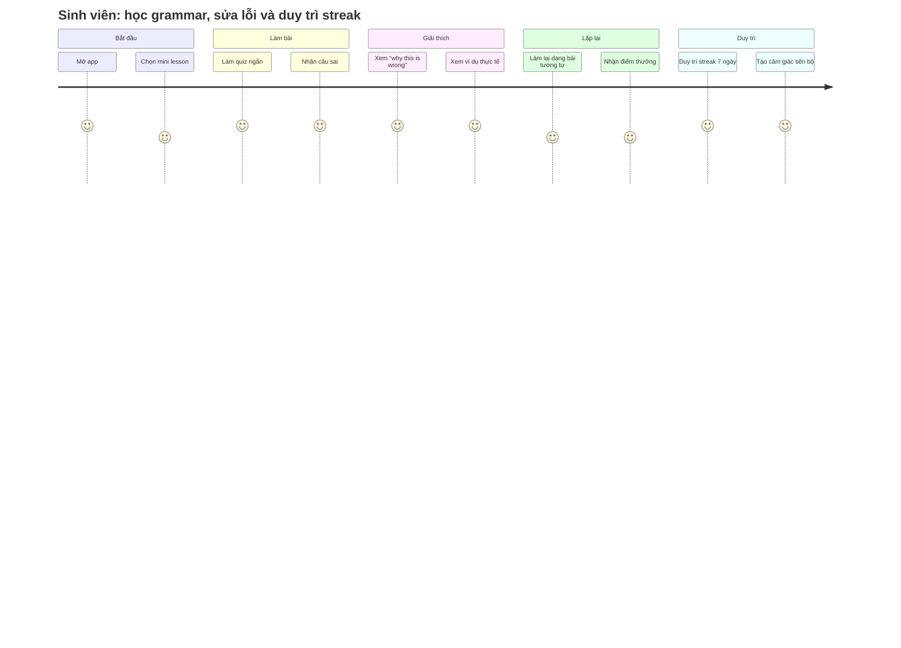

> **Liên kết ngữ cảnh:** [Market & Needs](../01-market-and-needs.md) | [Problem Statement](../02-problem-statement.md) | [Product Vision](../03-product-vision.md) | [Product Canvas](../04-product-canvas.md) | [Persona Working Pro](./persona-02-working-pro.md)

# Persona 01: Sinh viên 18–22 tuổi

## 1. Demographics
- Tuổi: 18–22
- Giới tính: Nam/Nữ, đa dạng
- Trình độ: Sinh viên năm 1–4, đang chuẩn bị chứng chỉ TOEIC/B1 hoặc thi đầu ra
- Thiết bị: Smartphone chủ yếu; laptop khi làm bài kiểm tra hoặc ở nhà
- Bối cảnh học: Học lúc rảnh giữa giờ, trước khi ngủ, trong lúc chờ xe buýt hoặc đi trên đường
- Mục tiêu ngắn hạn: tối ưu điểm TOEIC/B1, hiểu cấu trúc ngữ pháp, cải thiện bài làm sai

## 2. Goals & Motivations
- Muốn có điểm số rõ ràng trong bài kiểm tra hoặc thi chứng chỉ.
- Muốn cải thiện kỹ năng ngữ pháp thay vì chỉ học từ vựng.
- Muốn thấy “mình đang tiến bộ” qua các câu hỏi và bài luyện ngắn.
- Muốn học nhanh, dễ bắt đầu, có tính kiên trì nhưng không quá nặng nề.
- Muốn có phản hồi ngay để biết mình đang sai ở đâu và sửa sao cho đúng.

## 3. Habits
- Học 10–20 phút/ngày khi có thời gian rảnh.
- Coi YouTube, TikTok, app học tiếng Anh như một công cụ hỗ trợ nhưng không dành hàng giờ đồng hồ.
- Thường làm bài vào cuối tuần hoặc trước kì kiểm tra, nhưng lại bỏ dở khi không thấy tiến bộ.
- Có xu hướng làm câu nhanh để “xong” nhưng không đọc lời giải kỹ.
- Dễ bị xao nhãng bởi thông báo, mạng xã hội, video ngắn và cảm giác mệt mỏi.

## 4. Pain Points
- Mắc lỗi ngữ pháp nhưng không hiểu nguyên nhân gốc rễ.
- Không thể phân biệt giữa “đúng về mặt hình thức” và “đúng về logic ngữ pháp”.
- Học theo kiểu thuộc lòng câu mẫu nhưng không biết áp dụng ở ngữ cảnh khác.
- Những app hiện có thường khiến họ thấy nhàm chán và không có cảm giác kiểm soát tiến độ.
- Đặc biệt khó chịu khi sai liên tục mà không nhận được giải thích rõ hoặc ví dụ thực tế.

## 5. UI/UX Implications (Ánh xạ sang Design System)

### Từ Demographics, Personality và Pain Points, giao diện cần thiết kế như thế nào?
- Độ tuổi 18–22: giao diện được thiết kế trẻ trung, hiện đại, không quá nghiêm túc; nên có cảm giác năng động nhưng vẫn rõ ràng.
- Tính cách: hay mất tập trung, thích cảm giác kiếm được thứ gì đó nhanh, thích nhịp học ngắn và dễ “xử lý” trong vài phút.
- Pain points: thiếu hiểu biết logic, dễ chán, dễ bỏ dở.

=> Vì vậy, design system nên có:
- Màu sắc: tông xanh dương / xanh cyan / tím pastel làm cảm giác trẻ, hiện đại, dễ chịu và không nặng; kèm accent màu cam hoặc vàng nhẹ để tạo cảm giác “reward” và milestone.
- Bố cục: dạng mobile-first, 1 màn hình = 1 nhiệm vụ ngắn; tối ưu cho học 5–10 phút, dùng cards lớn, không làm người dùng bị choáng bởi text dày.
- Cỡ chữ: 14–16px cho body, 20–24px cho heading/quy tắc, đảm bảo đọc nhanh trên điện thoại; bullet ngắn, tiêu đề rõ, không tốn quá nhiều thao tác kéo màn hình.
- Không gian trắng: đủ rộng để tránh cảm giác đông, vì người dùng dễ rối khi bị quá nhiều thông tin cùng lúc.
- Components: streak badge, progress ring, mini-quiz card, “why this is wrong?” panel, “explain by example” block, and “smart review” chip.
- Tone giao diện: vui, sống động, khích lệ, nhưng phải giữ sự đáng tin cậy của giáo dục. Tránh mọi thứ quá trò chơi và thiếu trọng tâm.

## 6. User Journey – Từ sai lỗi đến hiểu lỗi

## 7. Insight cốt lõi
Sinh viên này không cần nhiều thông tin, nhưng cần một giải pháp biết “phân tích lỗi đúng ở chỗ nào” và “dạy theo logic”. Nếu app chỉ nhắc đúng/sai mà không giải thích, họ sẽ bỏ qua rất nhanh.

