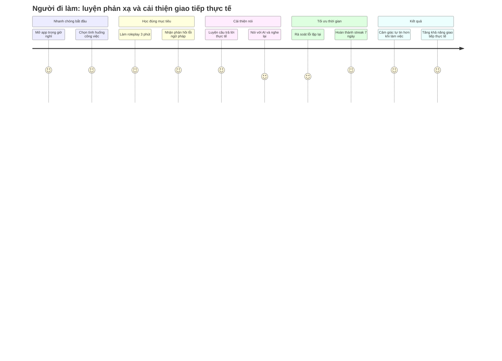

> **Liên kết ngữ cảnh:** [Market & Needs](../01-market-and-needs.md) | [Problem Statement](../02-problem-statement.md) | [Product Vision](../03-product-vision.md) | [Product Canvas](../04-product-canvas.md) | [Persona Student](./persona-01-student.md)

# Persona 02: Người đi làm 23–30 tuổi

## 1. Demographics
- Tuổi: 23–30
- Giới tính: Nam/Nữ, đa dạng
- Công việc: nhân viên văn phòng, hỗ trợ khách hàng, marketing, sales, quản lý dự án, startup, công việc đa nhiệm
- Thiết bị: Smartphone chủ yếu; laptop khi làm việc và check app lúc nghỉ ngắn hoặc trước khi ngủ
- Bối cảnh học: Học trong thời gian “ngắt quãng”, 10–15 phút mỗi ngày, đôi khi chỉ trong lúc chờ cuộc họp hoặc di chuyển
- Mục tiêu: giao tiếp tự tin trong công việc, email, cuộc họp, phỏng vấn, và các tình huống thực tế

## 2. Goals & Motivations
- Muốn nói tiếng Anh tự tin trong công việc, không cần học theo cách giáo trình xa rời thực tế.
- Muốn tiếp cận các mẫu câu cần dùng ngay trong môi trường làm việc: email, meeting, khách hàng, báo cáo ngắn.
- Muốn học ngắn gọn, có tính áp dụng thực tế và không mất thời gian vào những câu vô nghĩa.
- Muốn cải thiện “cảm giác nói” và kỹ năng phản xạ, không chỉ có kiến thức lý thuyết.
- Muốn thấy tiến bộ thể hiện qua khả năng nói câu đúng và tự nhiên hơn trong các tình huống cụ thể.

## 3. Habits
- Thường học trong các khoảng thời gian rảnh ngắn, không có lịch học cố định.
- Yêu thích nghi thức “làm xong một việc nhỏ” thay vì học dài trên một khung giờ.
- Tiếp cận nội dung theo mục tiêu công việc: email, lời mời, chốt deal, phỏng vấn, làm việc nhóm.
- Coi app học như một trợ lý hỗ trợ nếu dễ dùng và không cồng kềnh.
- Có xu hướng bỏ qua nội dung quá dài hoặc thiếu tính ứng dụng.

## 4. Pain Points
- Học nhiều từ vựng nhưng không biết nói như thế nào khi gặp tình huống thực tế.
- Không có thời gian cho khóa học dài và không muốn “học lại những thứ không cần thiết”.
- Khó có động lực nếu không thấy kết quả ngay trong giao tiếp.
- Học quá máy móc, thiếu phản xạ, dẫn đến thất bại khi nói với khách hàng hoặc đồng nghiệp.
- Bị nản khi các app không phân biệt rõ giữa tiếng Anh giao tiếp thực tế và tiếng Anh sách vở.

## 5. UI/UX Implications (Ánh xạ sang Design System)

### Từ Demographics, Personality và Pain Points, giao diện cần thiết kế như thế nào?
- Độ tuổi 23–30: giao diện cần tối ưu cho người đã quen dùng app, yêu cầu tối giản nhưng hiệu quả; không quá “sáng tạo kiểu trẻ con”.
- Tính cách: bận rộn, có định hướng rõ mục tiêu, thích sử dụng nhanh, đo lường hiệu quả qua kết quả.
- Pain points: mất thời gian, không muốn học vô nghĩa, cần câu trả lời chuyên nghiệp và áp dụng thực tiễn.

=> Vì vậy, design system nên có:
- Màu sắc: tông xanh navy, xanh dương đậm, xám trung tính, kèm accent xanh lá / cam để tạo cảm giác chuyên nghiệp nhưng vẫn động lực. Màu sắc không quá sặc sỡ, tránh cảm giác “dễ thương” quá mức.
- Bố cục: đường dẫn ngắn, tối giản, tập trung vào “mục tiêu công việc”, có các card như: “Email phản hồi”, “Meeting follow-up”, “Client conversation”, “Interview small talk”.
- Cỡ chữ: 15–16px cho body, 18–24px cho title, rõ ràng, dễ đọc trong thời gian ngắn, không chật chội, không quá nhiều segment.
- Components: task-based micro lessons, quick practice cards, “sound like a pro” suggestion, review summary by category, time-saving streak indicator.
- Tone giao diện: chuyên nghiệp, đánh giá công việc rõ ràng, có phần tự tin và hỗ trợ; không gây cảm giác “học từ sách giáo khoa quá khô”.

## 6. User Journey – Từ người bận rộn đến giao tiếp tự tin

## 7. Insight cốt lõi
Người đi làm muốn “học đúng thứ cần thiết trong thời gian ngắn” và không muốn đặt mình vào những bài học dài, vô nghĩa hoặc quá kết cấu. Sản phẩm cần tập trung vào giao tiếp thực tế, role-play, và giải thích lỗi trong ngữ cảnh job-related.

