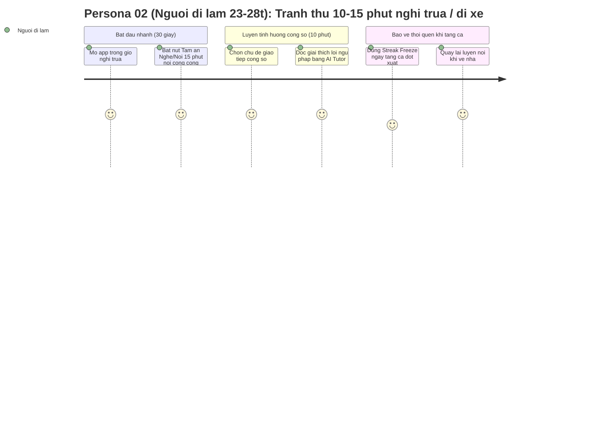

> **Liên kết ngữ cảnh:** [Skill Harness (SSOT)](../../00-ai-harness/skill.md) | [PO Kit](../../00-ai-harness/po-kit.md) | [Market & Needs](../01-market-and-needs.md) | [Problem Statement](../02-problem-statement.md) | [Persona Student](./persona-01-student.md) | [Product Vision](../03-product-vision.md) | [Product Canvas](../04-product-canvas.md)

# Persona 02: Người đi làm bận rộn (Nhân viên văn phòng trẻ 23–28 tuổi)

> **Vai trò trong Vault:** Đại diện phân khúc mở rộng bên cạnh nhóm sinh viên cốt lõi (**58,3%** năm 1 & **27,8%** năm 4), giúp sản phẩm phục vụ được người đi làm trẻ cần giao tiếp công sở trong khoảng thời gian ngắt quãng. *(Ghi chú chống Hallucination: Các số liệu % định lượng trong tài liệu này trích xuất từ khảo sát $N = 36$ sinh viên và bối cảnh EF EPI 2025; hành vi người đi làm được ánh xạ theo định nghĩa tại [skill.md](../../00-ai-harness/skill.md)).*

## 1. Thông tin nhân khẩu học (Demographics)
* **Tuổi:** 23–28 tuổi.
* **Giới tính:** Nam/Nữ.
* **Nghề nghiệp:** Nhân viên văn phòng trẻ (IT, marketing, kinh doanh, vận hành, hỗ trợ khách hàng) thường xuyên **tăng ca đột xuất** hoặc lịch trình dày đặc.
* **Trình độ & Mục tiêu:** Nền tảng mất gốc/trung bình (**A1–A2** lên giao tiếp thực tế), cần phản xạ nói trong bối cảnh công sở (chào hỏi đồng nghiệp, trao đổi tiến độ, họp ngắn, xử lý tình huống với khách hàng).
* **Thiết bị:** **Smartphone** là chính (sử dụng bằng 1 tay khi di chuyển, chờ thang máy, hoặc giờ nghỉ trưa tại văn phòng).

## 2. Mục tiêu & Động lực (Goals & Motivations)
* Tận dụng tối đa các khoảng trống **10–15 phút** trong ngày (nghỉ trưa, trên xe di chuyển) để học tiếng Anh thực dụng cho công việc.
* Cần tình huống giao tiếp gắn với **bối cảnh công sở thực tế** thay vì câu mẫu hàn lâm, sách giáo khoa.
* Không muốn bị mất chuỗi cố gắng (Streak) chỉ vì một ngày **tăng ca đột xuất** không kịp mở app.
* Cần chế độ học linh hoạt khi đang ở **nơi công cộng / văn phòng đông người** mà không tiện bật loa hoặc thu âm giọng nói.

## 3. Thói quen học tập (Habits)
* **Học theo khung thời gian ngắt quãng:** Chỉ có **10–15 phút** vào giờ nghỉ trưa hoặc lúc đi xe, dễ bị gián đoạn bất ngờ bởi tin nhắn công việc hay cuộc họp.
* **Thực dụng, thiếu kiên nhẫn với thao tác rườm rà:** Muốn vào học ngay trong 1–2 chạm, ghét quảng cáo dày hoặc quy trình tự tạo thẻ học tốn thời gian.
* **Nhạy cảm với không gian xung quanh:** Khi ngồi ở quán cà phê, văn phòng mở hay trên xe công cộng, không thể lúc nào cũng làm bài Nghe/Nói phát ra âm thanh.

## 4. Nỗi đau (Pain Points)
* **Không có thời gian theo lộ trình dài & hay tăng ca đột xuất:** Dễ mất động lực và đứt chuỗi Streak nếu ứng dụng phạt quá nặng khi nghỉ 1 ngày do bận việc.
* **Ngại nói nơi đông người & thiếu môi trường thực hành công sở:** Phản chiếu cùng nỗi đau phổ biến tại Việt Nam (trong khảo sát $N = 36$: **63,9%** sợ phát âm sai và **63,9%** thiếu môi trường luyện tập; điểm Nói EF EPI 2025 của Việt Nam chỉ đạt **461/800**).
* **Khó phân biệt lỗi sai trong ngữ cảnh công việc:** Các app thông thường chỉ chấm đúng/sai mà không giải thích vì sao cách diễn đạt đó thiếu tự nhiên hoặc sai cấu trúc ngữ pháp.

## 5. Ánh xạ sang Giao diện & Trải nghiệm (UI/UX Implications cho Design System)

Từ đặc điểm **23–28 tuổi, bận rộn (10–15 phút nghỉ trưa/đi xe), hay tăng ca đột xuất và thường học ở nơi công cộng**, giao diện Mobile App (React Native) trong `02-design-system/` cần thiết kế như sau:

* **Ánh xạ tính năng cốt lõi:**
  * Đặc thù công việc $\rightarrow$ Chủ đề **Tình huống giao tiếp công sở** (Micro-learning ngắn gọn, áp dụng ngay).
  * Hay tăng ca đột xuất $\rightarrow$ Tính năng **Đóng băng chuỗi (Streak Freeze)** (gắn với cửa hàng đổi thưởng, tương ứng **25,9%** nhu cầu khảo sát).
  * Học lúc đi xe / ở văn phòng đông người $\rightarrow$ Nút **"Tạm ẩn bài Nghe/Nói 15 phút"** giúp chuyển sang bài đọc/ngữ pháp im lặng ngay lập tức mà không làm gián đoạn phiên học.
  * Cần hiểu nhanh lỗi sai $\rightarrow$ **AI Tutor giải thích lỗi ngắn gọn bằng tiếng Việt** ngay trong popup phản hồi.
* **Màu sắc (Color Palette):**
  * Dùng chung nền tảng **Design System** thống nhất của **LingoCraft AI** (không tách ứng dụng riêng), giữ độ tương phản cao, màu trung tính sạch sẽ (Trắng/Xám nhạt hoặc Dark Mode gọn mắt) kết hợp màu nhấn chuyên nghiệp (Xanh dương đậm / Indigo) để không tạo cảm giác quá "trẻ con" hay rối mắt khi mở app tại văn phòng.
* **Bố cục (Layout):**
  * **Tối giản, ít thao tác chạm (Quick Resume):** Ngay tại màn hình chính có thẻ *"Tiếp tục bài 5 phút"* và công tắc bật/tắt nhanh chế độ **"Tạm ẩn Nghe/Nói 15 phút"** nằm ở vị trí dễ thấy trên thanh điều khiển bài học; hỗ trợ thao tác 1 tay khi đứng/ngồi trên xe.
* **Cỡ chữ & Kiểu chữ (Typography):**
  * Phông chữ sắc nét, dễ đọc nhanh trong điều kiện ánh sáng thay đổi (ngoài đường, văn phòng): Tiêu đề tình huống **18–20px**, nội dung câu thoại/câu hỏi **16–18px**, nút bấm & trạng thái ("Tạm ẩn Nghe/Nói 15p", "Streak Freeze") **14–15px** rõ ràng.
* **Components cốt lõi cần chuẩn hóa trong Design System:**
  * `MuteSpeakingToggle` (Nút/Banner **"Tạm ẩn bài Nghe/Nói 15 phút"**)
  * `StreakFreezeIndicator` (Trạng thái bảo vệ chuỗi khi tăng ca)
  * `WorkplaceScenarioCard` (Thẻ chọn tình huống giao tiếp công sở ngắn 5–10 phút)
  * `QuickResumeBanner` (Tiếp tục bài học dở trong 1 chạm)

## 6. Hành trình người dùng (User Journey — Mermaid)

