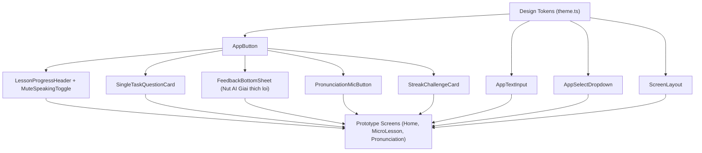

> **Liên kết ngữ cảnh:** [Skill UI/UX (React Native)](../00-ai-harness/ui-ux-skill.md) | [Design Tokens](./design-tokens.md) | [Prototype Screens](./prototype-screens.md) | [Product Backlog](../03-requirements/product-backlog.md) | [Persona Student](../01-discovery/personas/persona-01-student.md) | [Persona Working Pro](../01-discovery/personas/persona-02-working-pro.md)

# 🧩 Thư viện Component React Native (`LingoCraft AI Design System`)

Tài liệu này định nghĩa bộ mã nguồn chuẩn hóa các **Component cơ bản (Core Primitives)** và **Component nghiệp vụ (Domain Composites)** viết bằng **React Native (TypeScript)**. Khi sinh giao diện mới từ `03-requirements/`, AI Agent bắt buộc lắp ghép từ các component bên dưới (tuân thủ **Luật 1 & Luật 2** của [ui-ux-skill.md](../00-ai-harness/ui-ux-skill.md)).

---

## 1. Kiến trúc Phân tầng Component (Atomic Design Hierarchy)



---

## 2. Core UI Primitives (Các thành phần cơ bản nhất)

### 2.1 `AppButton` (Button chuẩn $\ge 48\text{dp}$)
* **Variants hỗ trợ:** `primary` (hành động chính), `secondary` (lựa chọn đáp án / nút phụ), `aiAccent` (nút *"✨ Giải thích lỗi sai bằng AI"*), `danger` (tiếp tục khi báo sai), `ghost` (nút phụ nhẹ).
* **States:** `default`, `selected`, `disabled`, `loading`.

```tsx
// src/components/primitives/AppButton.tsx
import React from 'react';
import {
  ActivityIndicator,
  Pressable,
  StyleSheet,
  Text,
  ViewStyle,
} from 'react-native';
import { tokens } from '../../theme/tokens';

export type AppButtonVariant = 'primary' | 'secondary' | 'aiAccent' | 'danger' | 'ghost';

export interface AppButtonProps {
  label: string;
  onPress: () => void;
  variant?: AppButtonVariant;
  selected?: boolean;
  disabled?: boolean;
  loading?: boolean;
  style?: ViewStyle;
}

export const AppButton: React.FC<AppButtonProps> = ({
  label,
  onPress,
  variant = 'primary',
  selected = false,
  disabled = false,
  loading = false,
  style,
}) => {
  const { colors, radius, spacing, typography, layout } = tokens;

  const getContainerStyle = (): ViewStyle => {
    if (disabled) {
      return { backgroundColor: colors.border, borderColor: colors.border };
    }
    if (variant === 'secondary') {
      return {
        backgroundColor: selected ? colors.primarySurface : colors.surface,
        borderColor: selected ? colors.primary : colors.border,
        borderWidth: 1.5,
      };
    }
    if (variant === 'aiAccent') {
      return { backgroundColor: colors.aiPrimary };
    }
    if (variant === 'danger') {
      return { backgroundColor: colors.error };
    }
    if (variant === 'ghost') {
      return { backgroundColor: 'transparent' };
    }
    return { backgroundColor: colors.primary };
  };

  const getTextColor = (): string => {
    if (disabled) return colors.textSecondary;
    if (variant === 'secondary') return selected ? colors.primary : colors.textPrimary;
    if (variant === 'ghost') return colors.primary;
    return colors.textOnPrimary;
  };

  return (
    <Pressable
      onPress={onPress}
      disabled={disabled || loading}
      accessibilityRole="button"
      style={({ pressed }) => [
        styles.base,
        {
          minHeight: layout.minTouchTarget,
          borderRadius: radius.md,
          paddingHorizontal: spacing.md,
          opacity: pressed ? 0.88 : 1,
        },
        getContainerStyle(),
        style,
      ]}
    >
      {loading ? (
        <ActivityIndicator color={getTextColor()} />
      ) : (
        <Text style={[typography.buttonLabel, { color: getTextColor(), textAlign: 'center' }]}>
          {label}
        </Text>
      )}
    </Pressable>
  );
};

const styles = StyleSheet.create({
  base: {
    justifyContent: 'center',
    alignItems: 'center',
  },
});
```

---

### 2.2 `AppTextInput` (Textbox nhập liệu & điền từ)
* **States hỗ trợ:** `default`, `focused`, `correct`, `error` kèm dòng thông báo lỗi tiếng Việt.

```tsx
// src/components/primitives/AppTextInput.tsx
import React, { useState } from 'react';
import { StyleSheet, Text, TextInput, TextInputProps, View } from 'react-native';
import { tokens } from '../../theme/tokens';

export interface AppTextInputProps extends TextInputProps {
  label?: string;
  errorMessage?: string;
  validationState?: 'default' | 'correct' | 'error';
}

export const AppTextInput: React.FC<AppTextInputProps> = ({
  label,
  errorMessage,
  validationState = 'default',
  style,
  ...rest
}) => {
  const [focused, setFocused] = useState(false);
  const { colors, radius, spacing, typography, layout } = tokens;

  const borderColor =
    validationState === 'error' || errorMessage
      ? colors.error
      : validationState === 'correct'
        ? colors.success
        : focused
          ? colors.primary
          : colors.border;

  return (
    <View style={{ marginBottom: spacing.md }}>
      {label ? (
        <Text style={[typography.caption, { color: colors.textSecondary, marginBottom: spacing.xs }]}>
          {label}
        </Text>
      ) : null}
      <TextInput
        onFocus={() => setFocused(true)}
        onBlur={() => setFocused(false)}
        placeholderTextColor={colors.textSecondary}
        style={[
          typography.body,
          styles.input,
          {
            minHeight: layout.minTouchTarget,
            backgroundColor: colors.surface,
            color: colors.textPrimary,
            borderColor,
            borderRadius: radius.md,
            paddingHorizontal: spacing.md,
          },
          style,
        ]}
        {...rest}
      />
      {errorMessage ? (
        <Text style={[typography.micro, { color: colors.error, marginTop: spacing.xs }]}>
          {errorMessage}
        </Text>
      ) : null}
    </View>
  );
};

const styles = StyleSheet.create({
  input: {
    borderWidth: 1.5,
  },
});
```

---

### 2.3 `AppSelectDropdown` (Combobox chọn Lộ trình / Chủ đề)
* **Công dụng:** Cho phép người học chọn nhanh lộ trình (`Mất gốc A1–A2`, `Ôn TOEIC/B1`, `Giao tiếp công sở`) hoặc chủ đề trong 5 chủ đề giao tiếp MVP.

```tsx
// src/components/primitives/AppSelectDropdown.tsx
import React, { useState } from 'react';
import { Pressable, StyleSheet, Text, View } from 'react-native';
import { tokens } from '../../theme/tokens';

export interface SelectOption {
  value: string;
  label: string;
}

export interface AppSelectDropdownProps {
  label?: string;
  options: SelectOption[];
  selectedValue: string;
  onSelect: (value: string) => void;
}

export const AppSelectDropdown: React.FC<AppSelectDropdownProps> = ({
  label,
  options,
  selectedValue,
  onSelect,
}) => {
  const [open, setOpen] = useState(false);
  const { colors, radius, spacing, typography, layout } = tokens;
  const current = options.find((opt) => opt.value === selectedValue);

  return (
    <View style={{ marginBottom: spacing.md }}>
      {label ? (
        <Text style={[typography.caption, { color: colors.textSecondary, marginBottom: spacing.xs }]}>
          {label}
        </Text>
      ) : null}
      <Pressable
        onPress={() => setOpen((prev) => !prev)}
        style={[
          styles.trigger,
          {
            minHeight: layout.minTouchTarget,
            backgroundColor: colors.surface,
            borderColor: open ? colors.primary : colors.border,
            borderRadius: radius.md,
            paddingHorizontal: spacing.md,
          },
        ]}
      >
        <Text style={[typography.body, { color: colors.textPrimary, fontWeight: '600' }]}>
          {current?.label ?? 'Chọn lộ trình'}
        </Text>
        <Text style={[typography.caption, { color: colors.textSecondary }]}>
          {open ? '▲' : '▼'}
        </Text>
      </Pressable>

      {open ? (
        <View
          style={[
            styles.menu,
            {
              backgroundColor: colors.surface,
              borderColor: colors.border,
              borderRadius: radius.md,
              marginTop: spacing.xs,
            },
          ]}
        >
          {options.map((opt) => {
            const isSelected = opt.value === selectedValue;
            return (
              <Pressable
                key={opt.value}
                onPress={() => {
                  onSelect(opt.value);
                  setOpen(false);
                }}
                style={[
                  styles.optionRow,
                  {
                    minHeight: layout.minTouchTarget,
                    paddingHorizontal: spacing.md,
                    backgroundColor: isSelected ? colors.primarySurface : 'transparent',
                  },
                ]}
              >
                <Text
                  style={[
                    typography.body,
                    { color: isSelected ? colors.primary : colors.textPrimary },
                  ]}
                >
                  {opt.label}
                </Text>
              </Pressable>
            );
          })}
        </View>
      ) : null}
    </View>
  );
};

const styles = StyleSheet.create({
  trigger: {
    borderWidth: 1.5,
    flexDirection: 'row',
    alignItems: 'center',
    justifyContent: 'space-between',
  },
  menu: {
    borderWidth: 1,
    overflow: 'hidden',
  },
  optionRow: {
    justifyContent: 'center',
  },
});
```

---

### 2.4 `ScreenLayout` (Bố cục Mobile-first 1 tay)
```tsx
// src/components/primitives/ScreenLayout.tsx
import React from 'react';
import { SafeAreaView, StyleSheet, View } from 'react-native';
import { tokens } from '../../theme/tokens';

export interface ScreenLayoutProps {
  header?: React.ReactNode;
  children: React.ReactNode;
  footer?: React.ReactNode;
}

export const ScreenLayout: React.FC<ScreenLayoutProps> = ({ header, children, footer }) => {
  const { colors, layout, spacing } = tokens;

  return (
    <SafeAreaView style={[styles.safe, { backgroundColor: colors.background }]}>
      {header ? <View style={{ paddingHorizontal: layout.screenPadding }}>{header}</View> : null}
      <View style={[styles.body, { paddingHorizontal: layout.screenPadding }]}>{children}</View>
      {footer ? (
        <View style={{ padding: layout.screenPadding, paddingBottom: spacing.lg }}>{footer}</View>
      ) : null}
    </SafeAreaView>
  );
};

const styles = StyleSheet.create({
  safe: { flex: 1 },
  body: { flex: 1 },
});
```

---

## 3. Domain Composite Components (Thành phần Nghiệp vụ Học ngoại ngữ)

### 3.1 `LessonProgressHeader` (Thanh tiến độ + Hearts + Streak + `MuteSpeakingToggle`)
```tsx
// src/components/composites/LessonProgressHeader.tsx
import React from 'react';
import { Pressable, StyleSheet, Text, View } from 'react-native';
import { tokens } from '../../theme/tokens';

export interface LessonProgressHeaderProps {
  currentStep: number;
  totalSteps: number;
  hearts: number;
  streak: number;
  isSpeakingMuted: boolean;
  onToggleSpeakingMute: () => void;
  onClose: () => void;
}

export const LessonProgressHeader: React.FC<LessonProgressHeaderProps> = ({
  currentStep,
  totalSteps,
  hearts,
  streak,
  isSpeakingMuted,
  onToggleSpeakingMute,
  onClose,
}) => {
  const { colors, radius, spacing, typography, layout } = tokens;
  const progressPercent = Math.min(100, Math.round((currentStep / Math.max(1, totalSteps)) * 100));

  return (
    <View style={{ paddingTop: spacing.sm, paddingBottom: spacing.md }}>
      <View style={styles.topRow}>
        <Pressable
          onPress={onClose}
          style={[styles.iconBtn, { minWidth: layout.minTouchTarget, minHeight: layout.minTouchTarget }]}
        >
          <Text style={[typography.headingMd, { color: colors.textSecondary }]}>✕</Text>
        </Pressable>

        <View style={[styles.track, { backgroundColor: colors.border, borderRadius: radius.full }]}>
          <View
            style={[
              styles.fill,
              {
                width: `${progressPercent}%`,
                backgroundColor: colors.primary,
                borderRadius: radius.full,
              },
            ]}
          />
        </View>

        <View style={styles.statsGroup}>
          <Text style={[typography.caption, { color: colors.streak, marginRight: spacing.sm }]}>
            🔥 {streak}
          </Text>
          <Text style={[typography.caption, { color: colors.heartCoral }]}>❤️ {hearts}</Text>
        </View>
      </View>

      {/* MuteSpeakingToggle — Phục vụ US-06 (Persona 02 nơi công cộng) */}
      <Pressable
        onPress={onToggleSpeakingMute}
        style={[
          styles.muteChip,
          {
            backgroundColor: isSpeakingMuted ? colors.warningSurface : colors.surface,
            borderColor: isSpeakingMuted ? colors.warning : colors.border,
            borderRadius: radius.full,
            paddingHorizontal: spacing.md,
            paddingVertical: spacing.xs,
            marginTop: spacing.xs,
          },
        ]}
      >
        <Text
          style={[
            typography.micro,
            { color: isSpeakingMuted ? colors.warning : colors.textSecondary },
          ]}
        >
          {isSpeakingMuted
            ? '🔇 Đang tạm ẩn Nghe/Nói 15 phút (Chạm để bật lại)'
            : '🔊 Đang bật Nghe/Nói • Chạm để tạm ẩn 15p'}
        </Text>
      </Pressable>
    </View>
  );
};

const styles = StyleSheet.create({
  topRow: { flexDirection: 'row', alignItems: 'center' },
  iconBtn: { justifyContent: 'center', alignItems: 'flex-start' },
  track: { flex: 1, height: 10, marginHorizontal: 8, overflow: 'hidden' },
  fill: { height: '100%' },
  statsGroup: { flexDirection: 'row', alignItems: 'center' },
  muteChip: { alignSelf: 'flex-start', borderWidth: 1 },
});
```

---

### 3.2 `SingleTaskQuestionCard` (Thẻ hiển thị 1 câu hỏi / 1 màn hình)
```tsx
// src/components/composites/SingleTaskQuestionCard.tsx
import React from 'react';
import { StyleSheet, Text, View } from 'react-native';
import { tokens } from '../../theme/tokens';

export interface SingleTaskQuestionCardProps {
  instruction: string;
  promptText: string;
  subHint?: string;
}

export const SingleTaskQuestionCard: React.FC<SingleTaskQuestionCardProps> = ({
  instruction,
  promptText,
  subHint,
}) => {
  const { colors, radius, spacing, typography } = tokens;

  return (
    <View
      style={[
        styles.card,
        {
          backgroundColor: colors.surface,
          borderColor: colors.border,
          borderRadius: radius.lg,
          padding: spacing.lg,
          marginBottom: spacing.lg,
        },
      ]}
    >
      <Text style={[typography.caption, { color: colors.primary, marginBottom: spacing.sm }]}>
        {instruction}
      </Text>
      <Text style={[typography.questionTitle, { color: colors.textPrimary }]}>{promptText}</Text>
      {subHint ? (
        <Text style={[typography.caption, { color: colors.textSecondary, marginTop: spacing.sm }]}>
          {subHint}
        </Text>
      ) : null}
    </View>
  );
};

const styles = StyleSheet.create({
  card: {
    borderWidth: 1,
  },
});
```

---

### 3.3 `FeedbackBottomSheet` (Popup Đúng/Sai + Nút *"Giải thích lỗi sai bằng AI"*)
```tsx
// src/components/composites/FeedbackBottomSheet.tsx
import React from 'react';
import { StyleSheet, Text, View } from 'react-native';
import { tokens } from '../../theme/tokens';
import { AppButton } from '../primitives/AppButton';

export interface FeedbackBottomSheetProps {
  visible: boolean;
  isCorrect: boolean;
  correctAnswer: string;
  aiExplanation?: string;
  isLoadingAi?: boolean;
  onRequestAiExplain: () => void;
  onContinue: () => void;
}

export const FeedbackBottomSheet: React.FC<FeedbackBottomSheetProps> = ({
  visible,
  isCorrect,
  correctAnswer,
  aiExplanation,
  isLoadingAi = false,
  onRequestAiExplain,
  onContinue,
}) => {
  if (!visible) return null;

  const { colors, radius, spacing, typography } = tokens;
  const bg = isCorrect ? colors.successSurface : colors.errorSurface;
  const titleColor = isCorrect ? colors.success : colors.error;

  return (
    <View
      style={[
        styles.container,
        {
          backgroundColor: bg,
          borderTopLeftRadius: radius.lg,
          borderTopRightRadius: radius.lg,
          padding: spacing.md,
          borderTopWidth: 1.5,
          borderColor: titleColor,
        },
      ]}
    >
      <Text style={[typography.headingMd, { color: titleColor, marginBottom: spacing.xs }]}>
        {isCorrect ? '✓ Chính xác! +10 XP' : '✕ Chưa chính xác'}
      </Text>

      {!isCorrect ? (
        <Text style={[typography.body, { color: colors.textPrimary, marginBottom: spacing.sm }]}>
          Đáp án đúng: <Text style={{ fontWeight: '700' }}>{correctAnswer}</Text>
        </Text>
      ) : null}

      {/* Khối giải thích tiếng Việt của AI Tutor (tối đa 3-4 dòng, cỡ chữ 15px) */}
      {!isCorrect && aiExplanation ? (
        <View
          style={{
            backgroundColor: colors.aiSurface,
            borderColor: colors.aiAccent,
            borderWidth: 1,
            borderRadius: radius.md,
            padding: spacing.md,
            marginBottom: spacing.md,
          }}
        >
          <Text style={[typography.caption, { color: colors.aiPrimary, marginBottom: spacing.xs }]}>
            ✨ AI Tutor giải thích nhanh:
          </Text>
          <Text style={[typography.aiBody, { color: colors.textPrimary }]} numberOfLines={4}>
            {aiExplanation}
          </Text>
        </View>
      ) : null}

      <View style={{ gap: spacing.sm }}>
        {!isCorrect && !aiExplanation ? (
          <AppButton
            label="✨ Giải thích lỗi sai bằng AI"
            variant="aiAccent"
            loading={isLoadingAi}
            onPress={onRequestAiExplain}
          />
        ) : null}
        <AppButton
          label="Tiếp tục"
          variant={isCorrect ? 'primary' : 'danger'}
          onPress={onContinue}
        />
      </View>
    </View>
  );
};

const styles = StyleSheet.create({
  container: {
    position: 'absolute',
    left: 0,
    right: 0,
    bottom: 0,
  },
});
```

---

### 3.4 `PronunciationMicButton` (Thu âm & Chấm phát âm AI)
```tsx
// src/components/composites/PronunciationMicButton.tsx
import React from 'react';
import { ActivityIndicator, Pressable, StyleSheet, Text, View } from 'react-native';
import { tokens } from '../../theme/tokens';

export interface PronunciationMicButtonProps {
  status: 'idle' | 'recording' | 'analyzing' | 'scored';
  scorePercent?: number;
  flaggedWords?: string[];
  onPressToggle: () => void;
}

export const PronunciationMicButton: React.FC<PronunciationMicButtonProps> = ({
  status,
  scorePercent,
  flaggedWords = [],
  onPressToggle,
}) => {
  const { colors, radius, spacing, typography } = tokens;

  return (
    <View style={[styles.wrapper, { marginVertical: spacing.md }]}>
      <Pressable
        onPress={onPressToggle}
        disabled={status === 'analyzing'}
        style={[
          styles.micCircle,
          {
            backgroundColor: status === 'recording' ? colors.error : colors.aiPrimary,
            borderRadius: radius.full,
          },
        ]}
      >
        {status === 'analyzing' ? (
          <ActivityIndicator color={colors.textOnPrimary} />
        ) : (
          <Text style={[typography.headingMd, { color: colors.textOnPrimary }]}>
            {status === 'recording' ? '■ Dừng' : '🎙️ Nhấn để nói'}
          </Text>
        )}
      </Pressable>

      {status === 'scored' && typeof scorePercent === 'number' ? (
        <View
          style={{
            marginTop: spacing.md,
            backgroundColor: scorePercent >= 70 ? colors.successSurface : colors.errorSurface,
            padding: spacing.md,
            borderRadius: radius.md,
            width: '100%',
          }}
        >
          <Text
            style={[
              typography.headingMd,
              { color: scorePercent >= 70 ? colors.success : colors.error, textAlign: 'center' },
            ]}
          >
            Điểm phát âm: {scorePercent}%
          </Text>
          {flaggedWords.length > 0 ? (
            <Text
              style={[
                typography.aiBody,
                { color: colors.textPrimary, textAlign: 'center', marginTop: spacing.xs },
              ]}
            >
              Từ cần chú ý âm cuối: {flaggedWords.join(', ')}
            </Text>
          ) : null}
        </View>
      ) : null}
    </View>
  );
};

const styles = StyleSheet.create({
  wrapper: { alignItems: 'center' },
  micCircle: {
    minWidth: 168,
    height: 64,
    paddingHorizontal: 24,
    justifyContent: 'center',
    alignItems: 'center',
  },
});
```

---

### 3.5 `StreakChallengeCard` (Streak, XP & Thách đấu bạn bè)
```tsx
// src/components/composites/StreakChallengeCard.tsx
import React from 'react';
import { StyleSheet, Text, View } from 'react-native';
import { tokens } from '../../theme/tokens';
import { AppButton } from '../primitives/AppButton';

export interface StreakChallengeCardProps {
  streakDays: number;
  todayXp: number;
  rankPosition: number;
  friendName: string;
  onQuickResume: () => void;
  onOpenChallenge: () => void;
}

export const StreakChallengeCard: React.FC<StreakChallengeCardProps> = ({
  streakDays,
  todayXp,
  rankPosition,
  friendName,
  onQuickResume,
  onOpenChallenge,
}) => {
  const { colors, radius, spacing, typography } = tokens;

  return (
    <View
      style={[
        styles.card,
        {
          backgroundColor: colors.surface,
          borderColor: colors.border,
          borderRadius: radius.lg,
          padding: spacing.md,
          marginBottom: spacing.md,
        },
      ]}
    >
      <View style={styles.row}>
        <Text style={[typography.headingMd, { color: colors.streak }]}>
          🔥 {streakDays} ngày Streak
        </Text>
        <Text style={[typography.caption, { color: colors.xpGold }]}>⚡ {todayXp} XP hôm nay</Text>
      </View>

      <Text style={[typography.caption, { color: colors.textSecondary, marginVertical: spacing.sm }]}>
        🏆 Hạng #{rankPosition} nhóm bạn • {friendName} vừa hoàn thành bài hôm nay
      </Text>

      <View style={{ flexDirection: 'row', gap: spacing.sm }}>
        <AppButton
          label="▶ Tiếp tục bài 5p"
          variant="primary"
          onPress={onQuickResume}
          style={{ flex: 1 }}
        />
        <AppButton
          label="Thách đấu"
          variant="secondary"
          onPress={onOpenChallenge}
          style={{ flex: 1 }}
        />
      </View>
    </View>
  );
};

const styles = StyleSheet.create({
  card: { borderWidth: 1 },
  row: { flexDirection: 'row', justifyContent: 'space-between', alignItems: 'center' },
});
```
