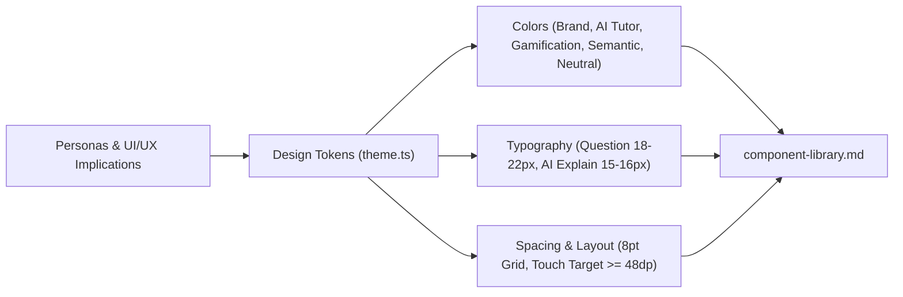

> **Liên kết ngữ cảnh:** [Skill UI/UX (React Native)](../00-ai-harness/ui-ux-skill.md) | [Persona Student](../01-discovery/personas/persona-01-student.md) | [Persona Working Pro](../01-discovery/personas/persona-02-working-pro.md) | [Component Library](./component-library.md) | [Prototype Screens](./prototype-screens.md) | [Product Backlog](../03-requirements/product-backlog.md)

# 🎨 Hệ thống Design Tokens Thống nhất (`LingoCraft AI`)

## 1. Nguyên lý Ánh xạ từ Personas sang Unified Design Tokens

Theo hướng dẫn của giảng viên và luật trong [ui-ux-skill.md](../00-ai-harness/ui-ux-skill.md), **LingoCraft AI** áp dụng **01 hệ thống Design Tokens thống nhất (Unified Design System)** cho toàn bộ ứng dụng **React Native**, hỗ trợ cả **Light Mode** (mặc định ban ngày, văn phòng, trên xe) và **Dark Mode** (dịu mắt cho sinh viên học buổi tối tại KTX/phòng trọ):

* **Từ Persona 01 (Sinh viên 19 tuổi — 58,3% năm 1, ở KTX/trọ, 69,4% nhanh chán, 66,7% quên kiến thức, 63,9% sợ nói sai):**
  * Tông màu **Brand Primary (`#4F46E5` Indigo / `#2563EB` Blue)** kết hợp nhấn **Gamification** rõ ràng (Vàng/Cam cho Streak & XP) để tạo cảm giác tiến bộ tức thì mỗi phiên học 5–10 phút.
  * Màu riêng **AI Tutor (`#7C3AED` Violet / `#06B6D4` Cyan)** giúp nút **"Giải thích lỗi sai bằng AI"** nổi bật ngay tại popup báo sai.
  * Màu báo sai dùng Đỏ dịu (`#EF4444` trên nền `#FEF2F2`), tránh cảm giác nặng nề hay phạt tâm lý gây bỏ cuộc.
* **Từ Persona 02 (Người đi làm 23–28 tuổi — học 10–15 phút nghỉ trưa/đi xe, dễ tăng ca đột xuất):**
  * Nền trung tính sạch sẽ (`#F8FAFC` / `#FFFFFF`), độ tương phản văn bản cao (`#0F172A`) để đọc rõ nét khi di chuyển ngoài trời hoặc trong văn phòng.
  * **8pt Grid & Touch Target $\ge 48\text{dp}$** giúp thao tác 1 tay bằng ngón cái chính xác trên xe buýt/giờ nghỉ.

---

## 2. Sơ đồ Cấu trúc Design Tokens (Mermaid)



---

## 3. Bảng Color Tokens (Light Mode & Dark Mode)

| Nhóm Token | Tên Token | Giá trị Light Mode | Giá trị Dark Mode | Mục đích sử dụng thực tế |
| :--- | :--- | :--- | :--- | :--- |
| **Brand** | `primary` | `#4F46E5` | `#6366F1` | Nút CTA chính (*Kiểm tra*, *Tiếp tục*, *Bắt đầu học*) |
| **Brand** | `primaryPressed` | `#4338CA` | `#4F46E5` | Trạng thái khi người dùng nhấn giữ nút chính |
| **Brand** | `primarySurface` | `#EEF2FF` | `#1E1B4B` | Nền thẻ bài học đang chọn / đáp án đang chọn |
| **AI Tutor** | `aiPrimary` | `#7C3AED` | `#8B5CF6` | Nút **"✨ Giải thích lỗi sai bằng AI"** & sóng Micro |
| **AI Tutor** | `aiAccent` | `#06B6D4` | `#22D3EE` | Điểm nhấn viền khung giải thích AI & huy hiệu AI |
| **AI Tutor** | `aiSurface` | `#F5F3FF` | `#2E1065` | Nền hộp thoại giải thích ngữ pháp tiếng Việt |
| **Gamification** | `streak` | `#F59E0B` | `#FBBF24` | Biểu tượng ngọn lửa Streak (**51,9%** động lực) |
| **Gamification** | `xpGold` | `#EAB308` | `#FACC15` | Huy hiệu điểm thưởng XP (**37,0%** động lực) |
| **Gamification** | `heartCoral` | `#F43F5E` | `#FB7185` | Biểu tượng Tim (Hearts) trên `LessonProgressHeader` |
| **Semantic** | `success` / `successSurface` | `#16A34A` / `#F0FDF4` | `#22C55E` / `#052E16` | Phản hồi đúng, từ phát âm đạt chuẩn ($\ge 70\%$) |
| **Semantic** | `error` / `errorSurface` | `#DC2626` / `#FEF2F2` | `#F87171` / `#450A0A` | Báo lỗi dịu nhẹ, viền input lỗi, từ phát âm sai |
| **Semantic** | `warning` / `warningSurface` | `#D97706` / `#FFFBEB` | `#FBBF24` / `#451A03` | Trạng thái chế độ *"Tạm ẩn Nghe/Nói 15 phút"* |
| **Neutral** | `background` | `#F8FAFC` | `#0F172A` | Màu nền tổng thể toàn màn hình (`ScreenLayout`) |
| **Neutral** | `surface` | `#FFFFFF` | `#1E293B` | Màu nền Card, BottomSheet, TextInput, Dropdown |
| **Neutral** | `border` | `#E2E8F0` | `#334155` | Đường viền thẻ, ô nhập liệu và đường phân cách |
| **Neutral** | `textPrimary` | `#0F172A` | `#F8FAFC` | Văn bản chính, câu hỏi bài học |
| **Neutral** | `textSecondary` | `#475569` | `#94A3B8` | Nhãn phụ, phiên âm, gợi ý tiếng Việt |

---

## 4. Bảng Typography, Spacing & Layout Tokens

### 4.1 Typography Scale (Tối ưu Đọc nhanh trên Smartphone)
| Tên Token | `fontSize` | `lineHeight` | `fontWeight` | Quy tắc áp dụng theo Persona 01 & 02 |
| :--- | :---: | :---: | :---: | :--- |
| `headingLg` | `24px` | `32px` | `700` | Tiêu đề màn hình, thông báo hoàn thành bài |
| `questionTitle` | `20px` | `28px` | `700` | **Câu hỏi chính / câu thoại luyện nói** (`18–22px`) |
| `headingMd` | `18px` | `26px` | `600` | Tiêu đề thẻ kỹ năng, tiêu đề BottomSheet |
| `aiBody` | `15px` | `23px` | `400` | **Lời giải thích lỗi sai bằng AI tiếng Việt** (`15–16px`, `lineHeight ~1.5`, tối đa 3–4 dòng) |
| `body` | `16px` | `24px` | `400` | Nội dung nút đáp án, input text |
| `buttonLabel` | `16px` | `20px` | `600` | Nhãn trên `AppButton` |
| `caption` | `14px` | `20px` | `500` | Nhãn chỉ số Streak, XP, Hearts, badge *"Tạm ẩn 15p"* |
| `micro` | `12px` | `16px` | `500` | Ghi chú phụ nhỏ (tỷ lệ tiến độ `2/6`) |

### 4.2 Spacing, Radius & Touch Target (8pt Grid)
| Nhóm | Token | Giá trị | Ghi chú |
| :--- | :--- | :---: | :--- |
| **Spacing** | `xs` / `sm` / `md` / `lg` / `xl` | `4` / `8` / `16` / `24` / `32` | Dùng thống nhất cho `padding`, `margin`, `gap` |
| **Radius** | `sm` / `md` / `lg` / `full` | `8` / `14` / `20` / `9999` | Bo góc thân thiện, hiện đại cho Card & Button |
| **Layout** | `minTouchTarget` | `48` | Chiều cao tối thiểu `48dp` cho mọi vùng chạm 1 tay |
| **Layout** | `screenPadding` | `16` | Lề trái/phải chuẩn trên màn hình điện thoại |

---

## 5. Mã nguồn `theme.ts` (React Native TypeScript)

```typescript
// src/theme/tokens.ts — Single Source of Truth cho toàn bộ Component & Prototype Screens

export const lightColors = {
  primary: '#4F46E5',
  primaryPressed: '#4338CA',
  primarySurface: '#EEF2FF',
  aiPrimary: '#7C3AED',
  aiAccent: '#06B6D4',
  aiSurface: '#F5F3FF',
  streak: '#F59E0B',
  xpGold: '#EAB308',
  heartCoral: '#F43F5E',
  success: '#16A34A',
  successSurface: '#F0FDF4',
  error: '#DC2626',
  errorSurface: '#FEF2F2',
  warning: '#D97706',
  warningSurface: '#FFFBEB',
  background: '#F8FAFC',
  surface: '#FFFFFF',
  border: '#E2E8F0',
  textPrimary: '#0F172A',
  textSecondary: '#475569',
  textOnPrimary: '#FFFFFF',
} as const;

export const darkColors: typeof lightColors = {
  primary: '#6366F1',
  primaryPressed: '#4F46E5',
  primarySurface: '#1E1B4B',
  aiPrimary: '#8B5CF6',
  aiAccent: '#22D3EE',
  aiSurface: '#2E1065',
  streak: '#FBBF24',
  xpGold: '#FACC15',
  heartCoral: '#FB7185',
  success: '#22C55E',
  successSurface: '#052E16',
  error: '#F87171',
  errorSurface: '#450A0A',
  warning: '#FBBF24',
  warningSurface: '#451A03',
  background: '#0F172A',
  surface: '#1E293B',
  border: '#334155',
  textPrimary: '#F8FAFC',
  textSecondary: '#94A3B8',
  textOnPrimary: '#FFFFFF',
};

export const typography = {
  headingLg: { fontSize: 24, lineHeight: 32, fontWeight: '700' as const },
  questionTitle: { fontSize: 20, lineHeight: 28, fontWeight: '700' as const },
  headingMd: { fontSize: 18, lineHeight: 26, fontWeight: '600' as const },
  body: { fontSize: 16, lineHeight: 24, fontWeight: '400' as const },
  aiBody: { fontSize: 15, lineHeight: 23, fontWeight: '400' as const },
  buttonLabel: { fontSize: 16, lineHeight: 20, fontWeight: '600' as const },
  caption: { fontSize: 14, lineHeight: 20, fontWeight: '500' as const },
  micro: { fontSize: 12, lineHeight: 16, fontWeight: '500' as const },
};

export const spacing = {
  xs: 4,
  sm: 8,
  md: 16,
  lg: 24,
  xl: 32,
} as const;

export const radius = {
  sm: 8,
  md: 14,
  lg: 20,
  full: 9999,
} as const;

export const layout = {
  minTouchTarget: 48,
  screenPadding: 16,
} as const;

export const createTheme = (mode: 'light' | 'dark' = 'light') => ({
  mode,
  colors: mode === 'dark' ? darkColors : lightColors,
  typography,
  spacing,
  radius,
  layout,
});

export const tokens = createTheme('light');
export type AppTheme = ReturnType<typeof createTheme>;
```
