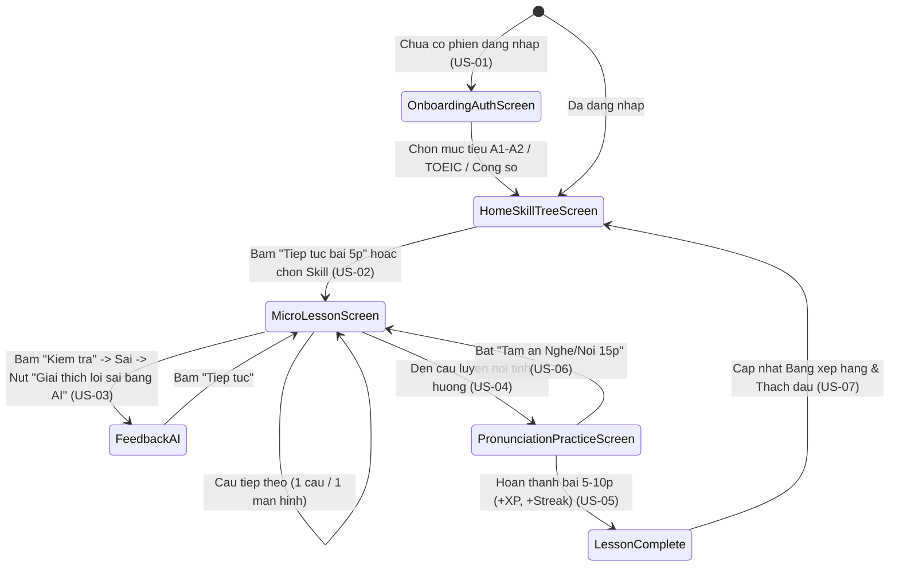

> **Liên kết ngữ cảnh:** [Skill UI/UX (React Native)](../00-ai-harness/ui-ux-skill.md) | [Design Tokens](./design-tokens.md) | [Component Library](./component-library.md) | [Product Backlog](../03-requirements/product-backlog.md) | [US-02 Micro-learning](../03-requirements/user-stories/us-02-micro-learning-skill-tree.md) | [US-03 AI Error](../03-requirements/user-stories/us-03-ai-error-explanation.md) | [US-04 Pronunciation](../03-requirements/user-stories/us-04-ai-pronunciation-practice.md)

# 📱 Màn hình Prototype React Native (`LingoCraft AI`)

Tài liệu này là đầu ra trực tiếp của quy trình làm việc mới: AI Agent đọc thẳng từ **PRD & User Stories (`03-requirements/`)** + **Design System (`design-tokens.md` & `component-library.md`)** để **generate code màn hình Prototype React Native (TypeScript)** chạy theo đúng luồng người dùng, không cần vẽ tay trên Figma.

---

## 1. Sơ đồ Luồng Màn hình Prototype (Prototype User Flow — Mermaid)



---

## 2. Ma trận Truy vết: Requirements $\rightarrow$ Design System $\rightarrow$ Prototype

| Màn hình Prototype | User Stories ánh xạ | Components tái sử dụng từ `component-library.md` | Tokens & Guardrails đã kiểm tra |
| :--- | :--- | :--- | :--- |
| **1. `HomeSkillTreeScreen.tsx`** | `US-01`, `US-02`, `US-05`, `US-07` | `ScreenLayout`, `AppSelectDropdown`, `StreakChallengeCard`, `AppButton` | Không hardcode màu (`tokens.colors.*`), có Quick Resume 5p cho Persona 02 & Thách đấu bạn bè (40,7%) cho Persona 01. |
| **2. `MicroLessonScreen.tsx`** | `US-02`, `US-03`, `US-05`, `US-06` | `ScreenLayout`, `LessonProgressHeader` (`MuteSpeakingToggle`), `SingleTaskQuestionCard`, `AppButton`, `FeedbackBottomSheet` | Đúng **1 câu / 1 màn hình**, giải thích AI tiếng Việt $\le 4$ dòng cỡ `15px`, nút chạm $\ge 48\text{dp}$. |
| **3. `PronunciationPracticeScreen.tsx`** | `US-04`, `US-06` | `ScreenLayout`, `LessonProgressHeader`, `SingleTaskQuestionCard`, `PronunciationMicButton`, `FeedbackBottomSheet`, `AppButton` | Có nút nghe mẫu, chấm điểm AI cơ bản và nút chuyển sang bài im lặng khi ở nơi công cộng. |

---

## 3. Mã nguồn Màn hình Prototype React Native (`.tsx`)

### 3.1 `HomeSkillTreeScreen.tsx` — Màn hình Chính & Cây Kỹ năng Micro-learning
```tsx
// src/screens/HomeSkillTreeScreen.tsx
import React, { useState } from 'react';
import { ScrollView, StyleSheet, Text, View } from 'react-native';
import { ScreenLayout } from '../components/primitives/ScreenLayout';
import { AppSelectDropdown } from '../components/primitives/AppSelectDropdown';
import { AppButton } from '../components/primitives/AppButton';
import { StreakChallengeCard } from '../components/composites/StreakChallengeCard';
import { tokens } from '../theme/tokens';

const TRACK_OPTIONS = [
  { value: 'a1-daily', label: 'Mất gốc A1–A2 (Giao tiếp đời sống)' },
  { value: 'toeic-b1', label: 'Ôn chuẩn đầu ra TOEIC / B1' },
  { value: 'office', label: 'Giao tiếp công sở (10 phút/ngày)' },
];

const SKILL_UNITS = [
  { id: 'u1', title: 'Bài 1: Chào hỏi & Giới thiệu bản thân (5p)', completed: true },
  { id: 'u2', title: 'Bài 2: Thì Hiện tại đơn & Sai lỗi "to" (6p)', completed: false, active: true },
  { id: 'u3', title: 'Bài 3: Hỏi đường & Đặt đồ ăn (7p)', completed: false },
  { id: 'u4', title: 'Bài 4: Xin nghỉ phép & Báo tiến độ công sở (6p)', completed: false },
];

export interface HomeSkillTreeScreenProps {
  onStartLesson: (unitId: string) => void;
  onOpenChallengeModal: () => void;
}

export const HomeSkillTreeScreen: React.FC<HomeSkillTreeScreenProps> = ({
  onStartLesson,
  onOpenChallengeModal,
}) => {
  const [selectedTrack, setSelectedTrack] = useState('a1-daily');
  const { colors, radius, spacing, typography } = tokens;

  return (
    <ScreenLayout>
      <ScrollView showsVerticalScrollIndicator={false} contentContainerStyle={{ paddingVertical: spacing.md }}>
        <View style={styles.headerRow}>
          <Text style={[typography.headingLg, { color: colors.textPrimary }]}>LingoCraft AI</Text>
          <Text style={[typography.caption, { color: colors.heartCoral }]}>❤️ 5 Tim</Text>
        </View>

        <AppSelectDropdown
          label="Lộ trình mục tiêu hiện tại"
          options={TRACK_OPTIONS}
          selectedValue={selectedTrack}
          onSelect={setSelectedTrack}
        />

        <StreakChallengeCard
          streakDays={5}
          todayXp={40}
          rankPosition={2}
          friendName="Minh Anh (KTX B1)"
          onQuickResume={() => onStartLesson('u2')}
          onOpenChallenge={onOpenChallengeModal}
        />

        <Text style={[typography.headingMd, { color: colors.textPrimary, marginBottom: spacing.sm }]}>
          Cây kỹ năng hôm nay (5–10 phút/bài)
        </Text>

        <View style={{ gap: spacing.sm }}>
          {SKILL_UNITS.map((unit) => (
            <View
              key={unit.id}
              style={{
                backgroundColor: unit.active ? colors.primarySurface : colors.surface,
                borderColor: unit.active ? colors.primary : colors.border,
                borderWidth: 1.5,
                borderRadius: radius.lg,
                padding: spacing.md,
              }}
            >
              <Text style={[typography.body, { color: colors.textPrimary, fontWeight: '600', marginBottom: spacing.sm }]}>
                {unit.completed ? '✅ ' : unit.active ? '🎯 ' : '🔒 '}
                {unit.title}
              </Text>
              <AppButton
                label={unit.completed ? 'Ôn lại nhanh' : unit.active ? 'Học ngay (6 phút)' : 'Mở bài học'}
                variant={unit.active ? 'primary' : 'secondary'}
                onPress={() => onStartLesson(unit.id)}
              />
            </View>
          ))}
        </View>
      </ScrollView>
    </ScreenLayout>
  );
};

const styles = StyleSheet.create({
  headerRow: {
    flexDirection: 'row',
    justifyContent: 'space-between',
    alignItems: 'center',
    marginBottom: 16,
  },
});
```

---

### 3.2 `MicroLessonScreen.tsx` — Màn hình 1 Câu / 1 Màn hình + AI Giải thích Lỗi sai
```tsx
// src/screens/MicroLessonScreen.tsx
import React, { useState } from 'react';
import { View } from 'react-native';
import { ScreenLayout } from '../components/primitives/ScreenLayout';
import { AppButton } from '../components/primitives/AppButton';
import { LessonProgressHeader } from '../components/composites/LessonProgressHeader';
import { SingleTaskQuestionCard } from '../components/composites/SingleTaskQuestionCard';
import { FeedbackBottomSheet } from '../components/composites/FeedbackBottomSheet';
import { tokens } from '../theme/tokens';

const SAMPLE_QUESTION = {
  instruction: 'Chọn câu đúng ngữ pháp (1 câu / màn hình)',
  promptText: 'Tôi muốn cải thiện kỹ năng nói tiếng Anh.',
  options: [
    'I want improve my English speaking.',
    'I want to improve my English speaking.',
    'I wanting to improve my English speaking.',
  ],
  correctOption: 'I want to improve my English speaking.',
  aiVietnameseExplanation:
    'Sau động từ "want", ta cần dùng "to + động từ nguyên mẫu" (want to improve). Bạn đã thiếu "to" giữa "want" và "improve". Mẹo nhớ: want + to V = muốn làm gì.',
};

export interface MicroLessonScreenProps {
  onExit: () => void;
  onGoToPronunciation: () => void;
}

export const MicroLessonScreen: React.FC<MicroLessonScreenProps> = ({
  onExit,
  onGoToPronunciation,
}) => {
  const [selectedOption, setSelectedOption] = useState<string | null>(null);
  const [hearts, setHearts] = useState(5);
  const [isSpeakingMuted, setIsSpeakingMuted] = useState(false);
  const [checked, setChecked] = useState(false);
  const [aiExplanation, setAiExplanation] = useState<string | undefined>(undefined);
  const [loadingAi, setLoadingAi] = useState(false);

  const isCorrect = selectedOption === SAMPLE_QUESTION.correctOption;

  const handleCheck = () => {
    if (!selectedOption) return;
    if (!isCorrect) {
      setHearts((prev) => Math.max(0, prev - 1));
    }
    setChecked(true);
  };

  const handleRequestAiExplain = () => {
    setLoadingAi(true);
    setTimeout(() => {
      setAiExplanation(SAMPLE_QUESTION.aiVietnameseExplanation);
      setLoadingAi(false);
    }, 350);
  };

  return (
    <ScreenLayout
      header={
        <LessonProgressHeader
          currentStep={2}
          totalSteps={6}
          hearts={hearts}
          streak={5}
          isSpeakingMuted={isSpeakingMuted}
          onToggleSpeakingMute={() => setIsSpeakingMuted((prev) => !prev)}
          onClose={onExit}
        />
      }
      footer={
        !checked ? (
          <AppButton
            label="Kiểm tra"
            variant="primary"
            disabled={!selectedOption}
            onPress={handleCheck}
          />
        ) : null
      }
    >
      <SingleTaskQuestionCard
        instruction={SAMPLE_QUESTION.instruction}
        promptText={SAMPLE_QUESTION.promptText}
        subHint="Gợi ý: chú ý cấu trúc đi sau động từ 'want'"
      />

      <View style={{ gap: tokens.spacing.sm }}>
        {SAMPLE_QUESTION.options.map((opt) => (
          <AppButton
            key={opt}
            label={opt}
            variant="secondary"
            selected={selectedOption === opt}
            disabled={checked}
            onPress={() => setSelectedOption(opt)}
          />
        ))}
      </View>

      <FeedbackBottomSheet
        visible={checked}
        isCorrect={isCorrect}
        correctAnswer={SAMPLE_QUESTION.correctOption}
        aiExplanation={aiExplanation}
        isLoadingAi={loadingAi}
        onRequestAiExplain={handleRequestAiExplain}
        onContinue={() => {
          setChecked(false);
          setAiExplanation(undefined);
          setSelectedOption(null);
          onGoToPronunciation();
        }}
      />
    </ScreenLayout>
  );
};
```

---

### 3.3 `PronunciationPracticeScreen.tsx` — Màn hình Luyện Phát âm AI Tình huống Thực tế
```tsx
// src/screens/PronunciationPracticeScreen.tsx
import React, { useState } from 'react';
import { Text, View } from 'react-native';
import { ScreenLayout } from '../components/primitives/ScreenLayout';
import { AppButton } from '../components/primitives/AppButton';
import { LessonProgressHeader } from '../components/composites/LessonProgressHeader';
import { SingleTaskQuestionCard } from '../components/composites/SingleTaskQuestionCard';
import { PronunciationMicButton } from '../components/composites/PronunciationMicButton';
import { tokens } from '../theme/tokens';

export interface PronunciationPracticeScreenProps {
  onExit: () => void;
  onSkipToSilentTask: () => void;
  onCompleteLesson: () => void;
}

export const PronunciationPracticeScreen: React.FC<PronunciationPracticeScreenProps> = ({
  onExit,
  onSkipToSilentTask,
  onCompleteLesson,
}) => {
  const [micStatus, setMicStatus] = useState<'idle' | 'recording' | 'analyzing' | 'scored'>('idle');
  const [score, setScore] = useState<number | undefined>(undefined);
  const [isSpeakingMuted, setIsSpeakingMuted] = useState(false);

  const handleToggleMic = () => {
    if (micStatus === 'idle' || micStatus === 'scored') {
      setMicStatus('recording');
      return;
    }
    if (micStatus === 'recording') {
      setMicStatus('analyzing');
      setTimeout(() => {
        setScore(65);
        setMicStatus('scored');
      }, 400);
    }
  };

  return (
    <ScreenLayout
      header={
        <LessonProgressHeader
          currentStep={5}
          totalSteps={6}
          hearts={4}
          streak={5}
          isSpeakingMuted={isSpeakingMuted}
          onToggleSpeakingMute={() => {
            setIsSpeakingMuted(true);
            onSkipToSilentTask();
          }}
          onClose={onExit}
        />
      }
      footer={
        <View style={{ gap: tokens.spacing.sm }}>
          <AppButton
            label="Hiện tại không thể nói (Chuyển bài im lặng 15p)"
            variant="ghost"
            onPress={onSkipToSilentTask}
          />
          <AppButton
            label="Hoàn thành bài học (+20 XP)"
            variant="primary"
            disabled={micStatus !== 'scored'}
            onPress={onCompleteLesson}
          />
        </View>
      }
    >
      <SingleTaskQuestionCard
        instruction="Luyện nói tình huống công sở / đời sống (A1–A2)"
        promptText="Could you please send me the report?"
        subHint="Nghĩa: Bạn vui lòng gửi giúp tôi bản báo cáo nhé?"
      />

      <AppButton label="🔊 Nghe giọng mẫu chuẩn" variant="secondary" onPress={() => {}} />

      <PronunciationMicButton
        status={micStatus}
        scorePercent={score}
        flaggedWords={score && score < 70 ? ['please (/z/)', 'report (/t/)'] : []}
        onPressToggle={handleToggleMic}
      />

      {micStatus === 'scored' ? (
        <Text
          style={[
            tokens.typography.aiBody,
            { color: tokens.colors.textSecondary, textAlign: 'center' },
          ]}
        >
          Mẹo người Việt: bật nhẹ âm cuối /t/ ở cuối chữ "report" để AI chấm trên 80% nhé!
        </Text>
      ) : null}
    </ScreenLayout>
  );
};
```
