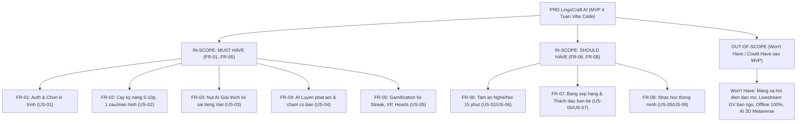

> **Liên kết ngữ cảnh:** [BA Skill (SSOT)](../00-ai-harness/ba-skill.md) | [PO Skill](../00-ai-harness/skill.md) | [UI/UX Skill](../00-ai-harness/ui-ux-skill.md) | [Product Vision & OKRs](../01-discovery/03-product-vision.md) | [Lean Canvas](../01-discovery/04-product-canvas.md) | [MVP MoSCoW](../01-discovery/05-mvp-moscow.md) | [Product Backlog](./product-backlog.md) | [Design Tokens](../02-design-system/design-tokens.md) | [Component Library](../02-design-system/component-library.md) | [Software Architecture](../04-architecture/software-architecture.md)

# 📄 Tài liệu Yêu cầu Sản phẩm — PRD (`LingoCraft AI`)

| Thuộc tính | Thông tin chuẩn hóa (Single Source of Truth) |
| :--- | :--- |
| **Tên sản phẩm** | **LingoCraft AI** |
| **Đội phát triển** | **SBTC (VKU)** |
| **Nền tảng mục tiêu** | Mobile App — **React Native (Expo / TypeScript)** |
| **Phạm vi phát hành** | **MVP — 4 tuần Vibe Code** (4 Sprints, 1 tuần/Sprint) |
| **Tài liệu nguồn đầu vào** | `01-discovery/` (Khảo sát $N = 36$ sinh viên & EF EPI 2025) + `02-design-system/` |

---

## 1. Tóm tắt Điều hành & Bối cảnh (Executive Summary)

**LingoCraft AI** là ứng dụng học tiếng Anh Gamification tích hợp AI dành cho người Việt bắt đầu từ gốc **A1–A2** và ôn chuẩn đầu ra **TOEIC/B1**. Theo báo cáo **EF EPI 2025**, Việt Nam đạt **500/800** điểm, trong đó **Nói (461)** và **Nghe (470)** là hai kỹ năng thấp nhất.

Khảo sát thực tế **$N = 36$ sinh viên** của nhóm chỉ ra 4 nỗi đau cốt lõi:
1. Nhanh chán, thiếu động lực, dễ bỏ giữa chừng: **69,4%** ($25/36$ SV).
2. Học trước quên sau, quên từ vựng nhanh: **66,7%** ($24/36$ SV).
3. Sợ nói/phát âm sai, ngại giao tiếp: **63,9%** ($23/36$ SV).
4. Thiếu môi trường thực hành giao tiếp: **63,9%** ($23/36$ SV).
5. Tỷ lệ rời bỏ app Gamification cũ có Streak/XP lên tới **66,7%** (**50,0%** tổng mẫu) chỉ sau vài ngày.

PRD này chuyển hóa toàn bộ insight từ `01-discovery/` và các chuẩn giao diện từ `02-design-system/` thành đặc tả yêu cầu cụ thể cho giai đoạn **Vibe Code 4 tuần**.

---

## 2. Mục tiêu Sản phẩm & Chỉ số Thành công (OKRs & Key Metrics)

### 2.1 Bảng OKRs 6 Tháng (Đồng bộ từ `03-product-vision.md`)
| Mã | Mức ưu tiên | Mục tiêu (Objective) | Chỉ số đo lường (Key Results - SMART) | Mốc |
| :--- | :---: | :--- | :--- | :---: |
| **O1** | **Must** | Kho nội dung thực dụng A1–A2 | **5 chủ đề giao tiếp**, **200+ bài học ngắn 5–10 phút**. | Tháng 5 |
| **O2** | **Must** | Vòng lặp MVP ổn định kỹ thuật | Hoàn thành vòng lặp MVP, **tỷ lệ hoàn thành bài $\ge 70\%$**, **crash $\le 2$**. | Tháng 3 |
| **O3** | **Must** | Hình thành thói quen học đều đặn | **$\ge 30\%$ user học $\ge 3$ ngày/tuần**, **Streak TB $\ge 5$ ngày**. | Tháng 5 |
| **O4** | **Should** | Thu hút Early Adopters | **1.000 người dùng thử**, **$\ge 50\%$ xong bài đầu trong 24h**. | Tháng 6 |
| **O5** | **Should** | Giữ chân & hài lòng | **Retention tuần 4 $\ge 25\%$**, **CSAT $\ge 4.0/5$**. | Tháng 6 |

### 2.2 Key Metrics vận hành (Lean Canvas)
* **DAU**, Tỷ lệ hoàn thành bài học **$> 65\%$**, Tỷ lệ sử dụng **AI Tutor $> 50\%$**.
* Retention: **$D1 > 45\%$**, **$D7 > 25\%$**, **$D30 > 12\text{–}35\%$**; Conversion gói Pro **$3\text{–}5\%$**.

---

## 3. Chân dung Người dùng & Ngữ cảnh Sử dụng (Target Personas)

| Persona | Đặc điểm cốt lõi | Ngữ cảnh & Quỹ thời gian | Yêu cầu sản phẩm tương ứng |
| :--- | :--- | :--- | :--- |
| **Persona 01: Sinh viên** | 19 tuổi (**58,3%** năm 1; **27,8%** năm 4), ở KTX/trọ, ngân sách thấp, mất gốc A1–A2 / ôn TOEIC-B1. | Học **15–30p/ngày** (**44,4%**) hoặc **< 15p/ngày** (**16,7%**); dùng smartphone 1 tay buổi tối. | Bài ngắn **5–10p** (**59,3%**), Streak (**51,9%**), Thách đấu bạn bè (**40,7%**), AI giải thích lỗi tiếng Việt, mở miễn phí vòng lặp cốt lõi 6 tháng đầu. |
| **Persona 02: Người đi làm trẻ** | 23–28 tuổi, nhân viên văn phòng, hay tăng ca đột xuất. | Chỉ có **10–15 phút** nghỉ trưa hoặc lúc đi xe nơi công cộng. | Quick Resume 1 chạm, chủ đề giao tiếp công sở, nút **"Tạm ẩn Nghe/Nói 15 phút"**, Streak Freeze (Could-Have sau MVP). |

---

## 4. Phạm vi Sản phẩm (Scope: In-Scope MVP vs. Out-of-Scope)

---

## 5. Yêu cầu Chức năng Chi tiết (Functional Requirements)

| Mã FR | Tên Yêu cầu | Mức ưu tiên | User Story | Mô tả hành vi hệ thống & Truy vết Pain Point |
| :--- | :--- | :---: | :---: | :--- |
| **FR-01** | Đăng ký / Đăng nhập & Chọn lộ trình mục tiêu | **Must** | [US-01](./user-stories/us-01-auth-and-onboarding.md) | Cho phép tạo tài khoản/đăng nhập, chọn 1 trong 3 lộ trình dựng sẵn (*A1–A2 Đời sống*, *TOEIC/B1*, *Công sở*), khởi tạo `Hearts=5, Streak=0, XP=0` và đồng bộ tiến độ đa phiên. |
| **FR-02** | Cây kỹ năng Micro-learning **5–10 phút** (**1 câu/màn hình**) | **Must** | [US-02](./user-stories/us-02-micro-learning-skill-tree.md) | Hiển thị cây kỹ năng theo chủ đề; mỗi bài gồm 5–8 câu; mỗi màn hình chỉ hiển thị đúng **01 câu hỏi** để chống quá tải nhận thức (giảm nỗi đau **69,4%** nhanh chán). |
| **FR-03** | Nút **'Giải thích lỗi sai bằng AI'** tại popup báo sai | **Must** | [US-03](./user-stories/us-03-ai-error-explanation.md) | Khi người học trả lời sai, `FeedbackBottomSheet` bật lên kèm nút `aiAccent`. Bấm vào sẽ gọi LLM giải thích nguyên nhân sai bằng **tiếng Việt súc tích ($\le 4$ dòng)** (giảm nỗi đau **66,7%** quên kiến thức). |
| **FR-04** | **AI luyện phát âm & chấm điểm cơ bản** | **Must** | [US-04](./user-stories/us-04-ai-pronunciation-practice.md) | Cho nghe giọng mẫu, thu âm qua `PronunciationMicButton`, chấm điểm thang `0–100%`, đánh dấu từ chưa chuẩn và gợi ý sửa âm cuối cho người Việt (giảm nỗi đau **63,9%** sợ nói sai). |
| **FR-05** | **Gamification lõi (Streak, XP, Hearts)** | **Must** | [US-05](./user-stories/us-05-gamification-streak-xp-hearts.md) | Cộng XP theo câu đúng, tăng Streak khi hoàn thành bài trong ngày, trừ 1 Heart khi sai. Khi `Hearts = 0`, đề xuất xem quảng cáo hồi Tim hoặc nâng cấp Pro (không làm treo app). |
| **FR-06** | Chế độ **'Tạm ẩn bài Nghe/Nói 15 phút'** | **Should** | [US-02](./user-stories/us-02-micro-learning-skill-tree.md) | Công tắc `MuteSpeakingToggle` trên `LessonProgressHeader` cho phép chuyển các câu thu âm/loa trong 15 phút sang câu đọc/ngữ pháp im lặng (phục vụ Persona 02 nơi công cộng & SV ở KTX). |
| **FR-07** | **Bảng xếp hạng & Thách đấu bạn bè** | **Should** | [US-05](./user-stories/us-05-gamification-streak-xp-hearts.md) | Hiển thị thứ hạng XP tuần trong nhóm bạn qua `StreakChallengeCard`, đáp ứng động lực **40,7%** khảo sát. |
| **FR-08** | **Nhắc học thông minh đúng giờ** | **Should** | [US-05](./user-stories/us-05-gamification-streak-xp-hearts.md) | Cho phép đặt khung giờ nhắc học (ví dụ `21:00` hoặc `12:15`) bằng thông báo cục bộ, đáp ứng động lực **37,0%** khảo sát. |

---

## 6. Yêu cầu Phi chức năng (Non-Functional Requirements)

1. **Độ ổn định (Stability — O2):** Số lỗi crash trên vòng lặp MVP chính **$\le 2$ lỗi**; khi mất mạng hoặc lỗi API AI không được làm treo màn hình bài học (phải có fallback thông báo thân thiện và cho phép bấm *"Tiếp tục"*).
2. **Hiệu năng phản hồi (Latency):**
   * Chuyển màn hình giữa các câu hỏi trong `MicroLessonScreen`: **$< 300\text{ms}$**.
   * Thời gian phản hồi giải thích lỗi AI (`FR-03`) và chấm phát âm (`FR-04`): **$\le 3$ giây** (hiển thị trạng thái `loading` rõ ràng).
3. **Khả năng sử dụng trên Di động (Mobile Usability & A11y):**
   * Hỗ trợ thao tác 1 tay trên Smartphone (vùng chạm mọi nút $\ge 48\text{dp}$).
   * Cỡ chữ câu hỏi `18–22px`, giải thích AI `15–16px`, hỗ trợ Light Mode & Dark Mode qua `theme.ts`.
4. **Bảo mật & Quyền riêng tư:** Dữ liệu giọng nói thu âm phục vụ chấm phát âm chỉ dùng cho phiên chấm điểm tức thì, không lưu trữ công khai trái phép; mật khẩu người dùng bắt buộc mã hóa (hash) ở tầng Backend.

---

## 7. Quy tắc Nghiệp vụ & Kiếm tiền (Business & Monetization Rules)

* **BR-01 (Mở miễn phí vòng lặp cốt lõi 6 tháng đầu):** Toàn bộ bài học Micro-learning, Streak, XP và các lượt hỏi AI cơ bản được mở miễn phí trong 6 tháng đầu để đạt mục tiêu **O4** ($1.000$ người dùng thử).
* **BR-02 (Freemium Ads Recovery):** Người dùng hết Tim (`Hearts = 0`) hoặc hết lượt hỏi AI nâng cao có thể chọn **xem quảng cáo ngắn** để hồi Tim / nhận thêm lượt hỏi ngay lập tức.
* **BR-03 (Gói thuê bao sinh viên *LingoCraft Pro*):** Mức giá **`39.000đ – 59.000đ/tháng`** mở khóa không giới hạn Tim, không quảng cáo và giải thích AI không giới hạn.
* **BR-04 (Affiliate):** Tích hợp liên kết giới thiệu ôn thi/lệ phí chứng chỉ **TOEIC / IELTS** cho nhóm người dùng mục tiêu đầu ra.

---

## 8. Ràng buộc Giao diện & Kiến trúc (Design System & Tech Constraints)

* **Ràng buộc UI/UX:** Tuân thủ 100% [ui-ux-skill.md](../00-ai-harness/ui-ux-skill.md). Mọi màn hình phải dùng token từ [design-tokens.md](../02-design-system/design-tokens.md) và tái sử dụng các component trong [component-library.md](../02-design-system/component-library.md).
* **Cầu nối Kiến trúc (Giai đoạn tiếp theo — Vibe Code):** Toàn bộ mô hình dữ liệu và API của 8 FR trên được đặc tả chi tiết tại [software-architecture.md](../04-architecture/software-architecture.md) và [db-schema.md](../04-architecture/db-schema.md).
