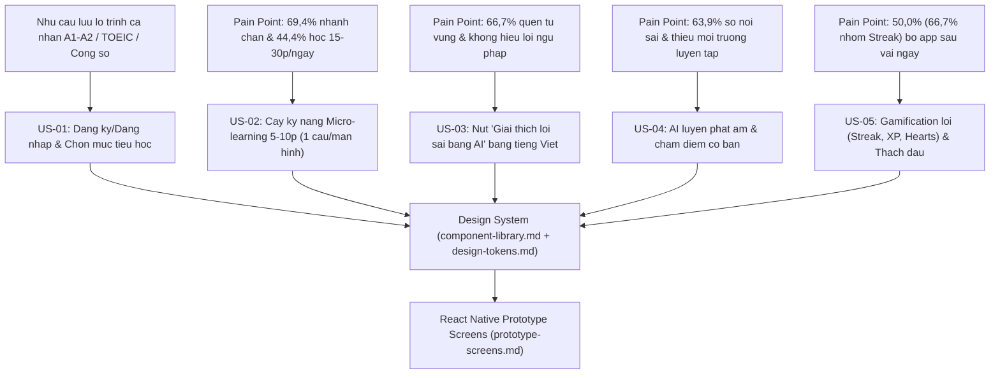

> **Liên kết ngữ cảnh:** [Skill BA (PRD & User Stories)](../00-ai-harness/ba-skill.md) | [PRD Chính thức](./prd.md) | [Skill Discovery (PO)](../00-ai-harness/skill.md) | [Skill UI/UX (React Native)](../00-ai-harness/ui-ux-skill.md) | [MVP MoSCoW](../01-discovery/05-mvp-moscow.md) | [Design Tokens](../02-design-system/design-tokens.md) | [Component Library](../02-design-system/component-library.md) | [Prototype Screens](../02-design-system/prototype-screens.md) | [US-01](./user-stories/us-01-auth-and-onboarding.md) | [US-02](./user-stories/us-02-micro-learning-skill-tree.md) | [US-03](./user-stories/us-03-ai-error-explanation.md) | [US-04](./user-stories/us-04-ai-pronunciation-practice.md) | [US-05](./user-stories/us-05-gamification-streak-xp-hearts.md)

# 📋 Product Backlog (`LingoCraft AI`)

## 1. Tổng quan & Quy trình Scrum (Scrum Cadence & Guardrails)

Tài liệu này chuyển hóa trực tiếp đặc tả tại [prd.md](./prd.md) và phạm vi MVP tại [05-mvp-moscow.md](../01-discovery/05-mvp-moscow.md) (theo chuẩn [ba-skill.md](../00-ai-harness/ba-skill.md)) thành **Product Backlog** và **User Stories** chi tiết để UI/UX Agent & Dev Team thực thi trong **4 tuần Vibe Code**.

* **Sản phẩm:** **LingoCraft AI** — Ứng dụng học tiếng Anh Gamification tích hợp AI (Mobile App — React Native / Expo TypeScript) dành cho người Việt mất gốc **A1–A2** và ôn chuẩn đầu ra **TOEIC/B1**.
* **Cơ sở dữ liệu khóa cứng:** Khảo sát thực tế **$N = 36$ sinh viên** (**58,3%** năm 1; **27,8%** năm 4) & bối cảnh **EF EPI 2025** (Việt Nam đạt **500/800**, Nói **461**, Nghe **470**).
* **Nhịp độ Scrum của đội SBTC (VKU):**
  * **Timebox tổng thể:** **4 tuần Vibe Code** (chia thành **4 Sprints**, mỗi Sprint **1 tuần**, báo cáo tiến độ vào cuối tuần).
  * **Daily Meeting:** **3 ngày/lần** — mỗi buổi họp bắt buộc chốt thành **Action Plan** cụ thể cho từng thành viên.
  * **Definition of Done (DoD) cho mỗi User Story:**
    1. Đạt đủ Acceptance Criteria (Gherkin `Given / When / Then`).
    2. Giao diện lắp đúng Component từ [component-library.md](../02-design-system/component-library.md) và dùng token từ [design-tokens.md](../02-design-system/design-tokens.md).
    3. Không phát sinh tính năng ngoài nhóm Must/Should Have; lỗi crash trong vòng lặp MVP $\le 2$ (theo **O2**).

---

## 2. Sơ đồ Luồng Truy vết (Pain Points $\rightarrow$ Backlog $\rightarrow$ UI Prototype)

---

## 3. Master Product Backlog (MVP 4 Tuần Vibe Code)

| Mã US | Tên Tính năng / User Story | MoSCoW | Story Points | Sprint | Persona mục tiêu | Components React Native sử dụng | Chi tiết |
| :--- | :--- | :--- | :---: | :---: | :--- | :--- | :--- |
| **US-01** | Đăng ký / Đăng nhập, chọn lộ trình mục tiêu & lưu tiến độ học tập | **Must Have** | 3 | Sprint 1 | Persona 01 & 02 | `ScreenLayout`, `AppTextInput`, `AppSelectDropdown`, `AppButton` | [us-01](./user-stories/us-01-auth-and-onboarding.md) |
| **US-02** | Cây kỹ năng Micro-learning **5–10 phút** (1 câu/màn hình) & chế độ Quick Resume | **Must Have** | 8 | Sprint 2 | Persona 01 & 02 | `LessonProgressHeader`, `SingleTaskQuestionCard`, `AppButton`, `AppSelectDropdown` | [us-02](./user-stories/us-02-micro-learning-skill-tree.md) |
| **US-03** | Nút **'Giải thích lỗi sai bằng AI'** bằng tiếng Việt ngay tại popup báo sai | **Must Have** | 5 | Sprint 2 | Persona 01 & 02 | `FeedbackBottomSheet`, `AppButton` (`aiAccent`) | [us-03](./user-stories/us-03-ai-error-explanation.md) |
| **US-04** | **AI luyện phát âm & chấm điểm cơ bản** theo tình huống đời sống / công sở | **Must Have** | 8 | Sprint 3 | Persona 01 & 02 | `LessonProgressHeader`, `PronunciationMicButton`, `FeedbackBottomSheet`, `AppButton` | [us-04](./user-stories/us-04-ai-pronunciation-practice.md) |
| **US-05** | **Gamification lõi** (Streak, XP, Hearts + hồi Tim / quảng cáo) & lưu chuỗi | **Must Have** | 5 | Sprint 3 | Persona 01 & 02 | `LessonProgressHeader`, `StreakChallengeCard`, `FeedbackBottomSheet` | [us-05](./user-stories/us-05-gamification-streak-xp-hearts.md) |
| **US-06** | **Chế độ *'Tạm ẩn bài Nghe/Nói 15 phút'*** khi học ở nơi công cộng | **Should Have** | 3 | Sprint 4 | Persona 02 (Đi làm) | `MuteSpeakingToggle` (gắn trong `LessonProgressHeader`) | [us-02](./user-stories/us-02-micro-learning-skill-tree.md) |
| **US-07** | **Bảng xếp hạng & Thách đấu bạn bè** (động lực **40,7%**) | **Should Have** | 5 | Sprint 4 | Persona 01 (SV) | `StreakChallengeCard`, `AppButton` | [us-05](./user-stories/us-05-gamification-streak-xp-hearts.md) |
| **US-08** | **Nhắc học thông minh đúng giờ** (động lực **37,0%**) | **Should Have** | 3 | Sprint 4 | Persona 01 & 02 | Local Notification Service + Toggle trong Profile (`AppButton`) | [us-05](./user-stories/us-05-gamification-streak-xp-hearts.md) |

> **Lưu ý chống Scope Creep (`Luật 2` trong `skill.md`):** Các tính năng *AI Roleplay hội thoại đa lượt*, *Cửa hàng đổi Streak Freeze / Voucher (25,9%)* thuộc nhóm **Could Have** (làm sau MVP); các hạng mục *Mạng xã hội diễn đàn mở*, *Livestream giáo viên bản ngữ*, *Học Offline 100%*, *AI 3D Metaverse* nằm trong nhóm **Won't Have** và tuyệt đối không đưa vào Sprint nào của 4 tuần MVP.

---

## 4. Kế hoạch Phân bổ 4 Sprint (Timebox: 1 Tuần / Sprint)

| Sprint | Trọng tâm Mục tiêu (Sprint Goal) | Hạng mục giao nộp (Deliverables) |
| :--- | :--- | :--- |
| **Sprint 1 (Tuần 1)** | Chốt Discovery Vault, Design System & Luồng xác thực (`US-01`) | `01-discovery/` đồng bộ SSOT; `ui-ux-skill.md`; `design-tokens.md`; `component-library.md`; `prototype-screens.md`; màn hình Login & Onboarding (`US-01`). |
| **Sprint 2 (Tuần 2)** | Hoàn thiện Vòng lặp Học & AI Giải thích lỗi (`US-02`, `US-03`) | Cây kỹ năng 5 chủ đề đầu tiên, bài học 5–10p (1 câu/màn hình), tích hợp LLM popup giải thích lỗi sai bằng tiếng Việt. |
| **Sprint 3 (Tuần 3)** | Hoàn thiện Luyện phát âm AI & Gamification lõi (`US-04`, `US-05`) | Tích hợp Speech-to-Text chấm phát âm cơ bản, hoàn chỉnh Streak / XP / Hearts và đạt **O2** (tỷ lệ hoàn thành bài $\ge 70\%$, crash $\le 2$). |
| **Sprint 4 (Tuần 4)** | Hoàn thiện các tính năng Should-Have (`US-06`, `US-07`, `US-08`) & Đóng gói báo cáo | Bảng xếp hạng thách đấu bạn bè, nút *Tạm ẩn Nghe/Nói 15 phút*, nhắc học thông minh, kiểm thử nội bộ & chuẩn bị dữ liệu thử nghiệm **O4/O5**. |
