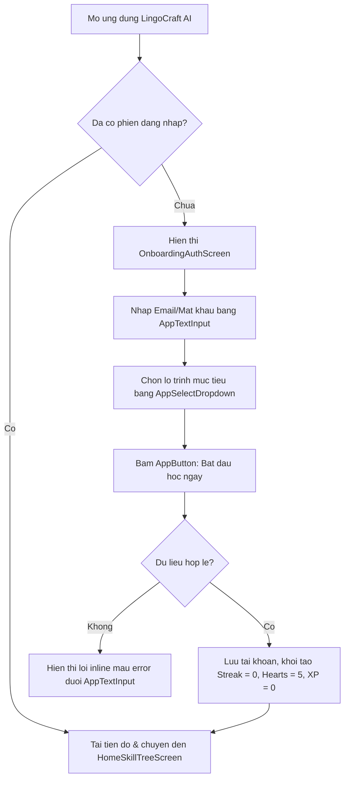

> **Liên kết ngữ cảnh:** [Product Backlog](../product-backlog.md) | [Skill UI/UX](../../00-ai-harness/ui-ux-skill.md) | [MVP MoSCoW](../../01-discovery/05-mvp-moscow.md) | [Persona Student](../../01-discovery/personas/persona-01-student.md) | [Persona Working Pro](../../01-discovery/personas/persona-02-working-pro.md) | [Design Tokens](../../02-design-system/design-tokens.md) | [Component Library](../../02-design-system/component-library.md)

# US-01: Đăng ký / Đăng nhập, Chọn Mục tiêu Học & Lưu Tiến độ (Must Have)

## 1. Tuyên bố User Story (User Story Statement)
* **Là một (As a):** Người học tiếng Anh Việt Nam (**Persona 01:** Sinh viên năm 1 mất gốc A1–A2 ôn TOEIC/B1; hoặc **Persona 02:** Người đi làm trẻ cần giao tiếp công sở).
* **Tôi muốn (I want to):** Đăng ký/đăng nhập nhanh chóng, chọn lộ trình mục tiêu phù hợp ngay từ lần đầu mở ứng dụng và đồng bộ tiến độ học tập.
* **Để (So that):** Tôi có thể vào học ngay bài học ngắn **5–10 phút** dựng sẵn mà không phải tự tạo thẻ học như Quizlet, đồng thời không bị mất chuỗi Streak hay lịch sử điểm XP khi đổi thiết bị.

---

## 2. Đặc tả Giao diện cho AI UI/UX Generator
* **Mã màn hình mục tiêu:** `OnboardingAuthScreen` (sử dụng ngay khi user chưa có session).
* **Components bắt buộc lấy từ `02-design-system/component-library.md`:**
  * `ScreenLayout` (bố cục 1 cột tối giản, chừa vùng ngón tay cái phía dưới).
  * `AppTextInput` (nhập Email và Mật khẩu; hỗ trợ trạng thái `default`, `focused`, `error`).
  * `AppSelectDropdown` (Combobox chọn mục tiêu học tập: `"Mất gốc A1–A2 (Đời sống)"`, `"Ôn chuẩn đầu ra TOEIC / B1"`, `"Giao tiếp công sở 10 phút/ngày"`).
  * `AppButton` (`primary` cho nút *Đăng nhập / Bắt đầu học ngay*, `ghost` cho chuyển đổi *Đăng ký / Đăng nhập*).
* **Design Tokens áp dụng:** Màu nền `tokens.colors.background`, nút chính `tokens.colors.primary`, thông báo lỗi `tokens.colors.error`, vùng chạm tối thiểu `tokens.layout.minTouchTarget` ($\ge 48\text{dp}$).

---

## 3. Sơ đồ Luồng Tương tác (Interaction Flow — Mermaid)

---

## 4. Tiêu chí Nghiệm thu (Acceptance Criteria — Gherkin)

### AC-01: Đăng ký tài khoản mới và chọn lộ trình dựng sẵn
* **Given (Cho rằng):** Người dùng mở ứng dụng lần đầu ở màn hình `OnboardingAuthScreen` và đang ở chế độ *Đăng ký*.
* **When (Khi):** Người dùng nhập Email hợp lệ, Mật khẩu $\ge 6$ ký tự vào `AppTextInput`, chọn `"Mất gốc A1–A2 (Đời sống)"` trong `AppSelectDropdown` và bấm `AppButton` *"Bắt đầu học ngay"*.
* **Then (Thì):** Hệ thống tạo tài khoản thành công, khởi tạo trạng thái mặc định (`Hearts = 5`, `Streak = 0`, `XP = 0`), lưu mục tiêu học và điều hướng thẳng tới `HomeSkillTreeScreen` trong $\le 2$ giây.

### AC-02: Xử lý lỗi nhập liệu rõ ràng bằng tiếng Việt
* **Given (Cho rằng):** Người dùng đang nhập thông tin tại màn hình đăng nhập/đăng ký.
* **When (Khi):** Người dùng để trống Email hoặc nhập sai định dạng Email rồi nhấn nút xác nhận.
* **Then (Thì):** Component `AppTextInput` chuyển viền sang màu `tokens.colors.error` và hiển thị thông báo lỗi tiếng Việt ngắn gọn ngay dưới ô nhập (không crash ứng dụng).

### AC-03: Lưu và khôi phục tiến độ học tập (O2 Persistence)
* **Given (Cho rằng):** Người dùng đã hoàn thành ít nhất 1 bài học và có `XP = 20`, `Streak = 1`.
* **When (Khi):** Người dùng đóng ứng dụng và mở lại hoặc đăng nhập trên thiết bị khác.
* **Then (Thì):** Hệ thống khôi phục chính xác `XP = 20`, `Streak = 1`, số Tim hiện tại và vị trí bài học tiếp theo trên cây kỹ năng.
