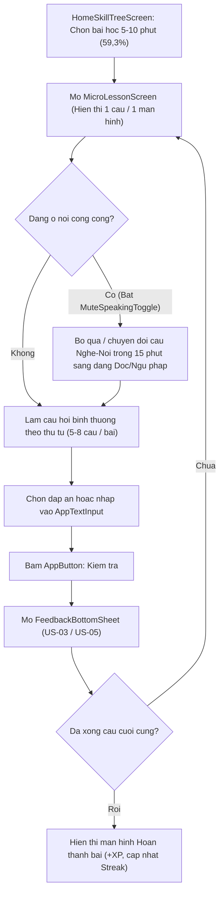

> **Liên kết ngữ cảnh:** [Product Backlog](../product-backlog.md) | [Skill UI/UX](../../00-ai-harness/ui-ux-skill.md) | [MVP MoSCoW](../../01-discovery/05-mvp-moscow.md) | [Persona Student](../../01-discovery/personas/persona-01-student.md) | [Persona Working Pro](../../01-discovery/personas/persona-02-working-pro.md) | [Design Tokens](../../02-design-system/design-tokens.md) | [Component Library](../../02-design-system/component-library.md) | [Prototype Screens](../../02-design-system/prototype-screens.md)

# US-02: Cây Kỹ năng Micro-learning 5–10 Phút & Chế độ Học Linh hoạt (Must Have + US-06 Should Have)

## 1. Tuyên bố User Story (User Story Statement)
* **Là một (As a):** Sinh viên có quỹ thời gian hạn chế (**44,4%** học 15–30p/ngày; **16,7%** < 15p/ngày) hoặc người đi làm bận rộn chỉ rảnh **10–15 phút** nghỉ trưa / đi xe.
* **Tôi muốn (I want to):** Học theo cây kỹ năng dựng sẵn chia thành các bài **5–10 phút** với thiết kế **1 câu / 1 màn hình**, kèm tùy chọn **"Tạm ẩn bài Nghe/Nói 15 phút"** khi ở nơi công cộng.
* **Để (So that):** Tôi không cảm thấy choáng ngợp hay nhanh chán (**69,4%** nỗi đau khảo sát), có thể hoàn thành nhanh một phiên học trên điện thoại bằng 1 tay và tiếp tục học im lặng khi không tiện bật loa.

---

## 2. Đặc tả Giao diện cho AI UI/UX Generator
* **Mã màn hình mục tiêu:** `HomeSkillTreeScreen` & `MicroLessonScreen` (chi tiết code tại `02-design-system/prototype-screens.md`).
* **Components bắt buộc lấy từ `02-design-system/component-library.md`:**
  * **Trên `HomeSkillTreeScreen`:**
    * `ScreenLayout`
    * `AppSelectDropdown` (chọn nhanh chủ đề / lộ trình trong 5 chủ đề giao tiếp MVP — đáp ứng **O1**).
    * `StreakChallengeCard` (hiển thị nhanh trạng thái Streak & nút *Tiếp tục bài 5 phút* — Quick Resume cho Persona 02).
    * Danh sách nút bài học theo cây kỹ năng dùng `AppButton`.
  * **Trên `MicroLessonScreen`:**
    * `LessonProgressHeader` (thanh tiến độ, đếm Tim, nút đóng `X`, và tích hợp công tắc `MuteSpeakingToggle` *"Tạm ẩn Nghe/Nói 15 phút"* thuộc **US-06**).
    * `SingleTaskQuestionCard` (chỉ hiển thị **duy nhất 01 câu hỏi** trên màn hình; cỡ chữ câu hỏi `18–22px`).
    * `AppTextInput` (dành cho câu điền từ/sửa câu) hoặc nhóm lựa chọn đáp án (`AppButton` secondary/outline).
    * `AppButton` (`primary`) đặt cố định dưới cùng vùng ngón cái cho hành động *"Kiểm tra"*.

---

## 3. Sơ đồ Luồng Tương tác (Interaction Flow — Mermaid)

---

## 4. Tiêu chí Nghiệm thu (Acceptance Criteria — Gherkin)

### AC-01: Giới hạn tải nhận thức (1 Câu / 1 Màn hình)
* **Given (Cho rằng):** Người dùng bắt đầu một bài học trên `MicroLessonScreen`.
* **When (Khi):** Màn hình hiển thị câu hỏi hiện tại trong `SingleTaskQuestionCard`.
* **Then (Thì):** Màn hình chỉ hiển thị **đúng 01 câu hỏi**, thanh tiến độ `LessonProgressHeader` hiển thị tỷ lệ câu đã qua (ví dụ `2/6`), cỡ chữ câu hỏi đạt `18–22px` và nút *"Kiểm tra"* nằm trong vùng chạm thuận tiện phía dưới với chiều cao $\ge 48\text{dp}$.

### AC-02: Nhịp bài học Micro-learning 5–10 phút
* **Given (Cho rằng):** Một bài học thuộc cây kỹ năng A1–A2 được khởi tạo.
* **When (Khi):** Người dùng học tuần tự từ câu 1 đến câu cuối.
* **Then (Thì):** Mỗi bài gồm **5 đến 8 câu hỏi ngắn** (thời gian hoàn thành trung bình **5–10 phút**), đáp ứng yếu tố tạo động lực quay lại được **59,3%** sinh viên lựa chọn.

### AC-03: Bật chế độ 'Tạm ẩn bài Nghe/Nói 15 phút' (US-06 — Should Have)
* **Given (Cho rằng):** Người dùng đang học trên xe buýt hoặc văn phòng và nhìn thấy nút `MuteSpeakingToggle` trên `LessonProgressHeader`.
* **When (Khi):** Người dùng bật chế độ *"Tạm ẩn Nghe/Nói 15 phút"*.
* **Then (Thì):** Hệ thống tự động bỏ qua hoặc thay thế tạm thời các câu yêu cầu bật mic/loa trong **15 phút** sang bài tập chọn đáp án/ngữ pháp im lặng mà không làm mất tiến độ hay trừ Tim.
