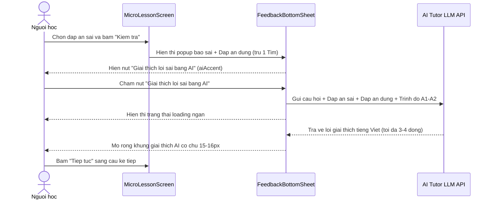

> **Liên kết ngữ cảnh:** [Product Backlog](../product-backlog.md) | [Skill UI/UX](../../00-ai-harness/ui-ux-skill.md) | [MVP MoSCoW](../../01-discovery/05-mvp-moscow.md) | [Market & Needs](../../01-discovery/01-market-and-needs.md) | [Persona Student](../../01-discovery/personas/persona-01-student.md) | [Design Tokens](../../02-design-system/design-tokens.md) | [Component Library](../../02-design-system/component-library.md) | [Prototype Screens](../../02-design-system/prototype-screens.md)

# US-03: Nút 'Giải thích Lỗi sai bằng AI' Ngay tại Popup Báo sai (Must Have)

## 1. Tuyên bố User Story (User Story Statement)
* **Là một (As a):** Người học tiếng Anh từ gốc A1–A2 thường xuyên gặp tình trạng học trước quên sau (**66,7%** khảo sát $N=36$) và từng bỏ các app cũ vì báo sai nhưng không giải thích ngữ pháp.
* **Tôi muốn (I want to):** Bấm nút **"Giải thích lỗi sai bằng AI"** ngay trên popup báo sai để xem lời giải thích ngắn gọn bằng tiếng Việt theo ngữ cảnh câu tôi vừa làm sai.
* **Để (So that):** Tôi hiểu rõ bản chất lỗi (sai thì, thiếu "to", nhầm mạo từ, sai cấu trúc...) thay vì chọn đại để giữ streak ảo.

---

## 2. Đặc tả Giao diện cho AI UI/UX Generator
* **Vị trí hiển thị:** Nằm bên trong `FeedbackBottomSheet` (xuất hiện ngay phía dưới màn hình `MicroLessonScreen` sau khi người dùng bấm *"Kiểm tra"* và trả lời sai).
* **Components bắt buộc lấy từ `02-design-system/component-library.md`:**
  * `FeedbackBottomSheet` (gồm trạng thái `error`, `loading_ai`, `ai_explained`).
  * `AppButton` với variant `aiAccent` cho nút **"✨ Giải thích lỗi sai bằng AI"** (chiều cao $\ge 48\text{dp}$).
  * `AppButton` với variant `danger` hoặc `primary` cho nút **"Tiếp tục"** (luôn hiển thị để người dùng đi tiếp câu kế theo).
* **Ràng buộc UI/UX từ `ui-ux-skill.md` (Luật 3):**
  * Nội dung giải thích tiếng Việt của AI phải trình bày súc tích **tối đa 3–4 dòng** (cấu trúc: *1. Lỗi ở đâu $\rightarrow$ 2. Vì sao sai $\rightarrow$ 3. Cách nhớ nhanh*).
  * Cỡ chữ phần giải thích AI là **`15–16px`** với `lineHeight` thoáng (`22–24px`), dùng màu `tokens.colors.aiSurface` và viền `tokens.colors.aiPrimary`.

---

## 3. Sơ đồ Luồng Tương tác (Sequence Diagram — Mermaid)

---

## 4. Tiêu chí Nghiệm thu (Acceptance Criteria — Gherkin)

### AC-01: Hiển thị nút AI Tutor ngay khi làm sai
* **Given (Cho rằng):** Người dùng đang làm câu hỏi trên `MicroLessonScreen`.
* **When (Khi):** Người dùng gửi đáp án sai.
* **Then (Thì):** `FeedbackBottomSheet` bật lên với màu cảnh báo dịu (`tokens.colors.errorSurface`), hiển thị đáp án đúng và có ngay nút **"Giải thích lỗi sai bằng AI"** (variant `aiAccent`).

### AC-02: Định dạng giải thích tiếng Việt ngắn gọn và dễ hiểu
* **Given (Cho rằng):** Người dùng vừa bấm nút **"Giải thích lỗi sai bằng AI"** tại popup báo sai.
* **When (Khi):** Hệ thống AI trả về phản hồi giải thích lỗi.
* **Then (Thì):** Phần giải thích hiển thị hoàn toàn bằng **tiếng Việt**, giải thích đúng lỗi giữa đáp án người dùng chọn và đáp án chuẩn trong độ dài ngắn gọn ($\le 4$ dòng), sử dụng cỡ chữ `15–16px` rõ ràng.

### AC-03: Kiểm soát giới hạn lượt hỏi AI theo mô hình Freemium
* **Given (Cho rằng):** Người dùng đang sử dụng gói Miễn phí (Freemium).
* **When (Khi):** Người dùng dùng hết số lượt hỏi AI miễn phí trong ngày (nếu có áp giới hạn sau 6 tháng đầu) hoặc gặp lỗi mạng khi gọi API LLM.
* **Then (Thì):** Hệ thống hiển thị thông báo thân thiện gợi ý xem quảng cáo ngắn để nhận thêm lượt hỏi AI hoặc bấm *"Tiếp tục"* học bình thường, không làm treo màn hình bài học.
