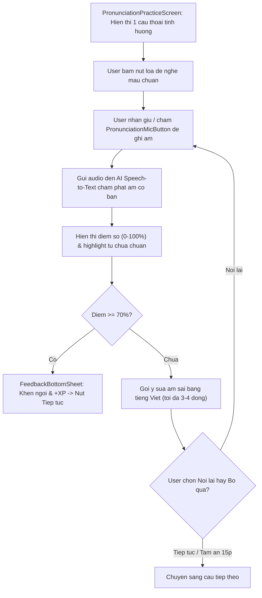

> **Liên kết ngữ cảnh:** [Product Backlog](../product-backlog.md) | [Skill UI/UX](../../00-ai-harness/ui-ux-skill.md) | [MVP MoSCoW](../../01-discovery/05-mvp-moscow.md) | [Persona Student](../../01-discovery/personas/persona-01-student.md) | [Design Tokens](../../02-design-system/design-tokens.md) | [Component Library](../../02-design-system/component-library.md) | [Prototype Screens](../../02-design-system/prototype-screens.md)

# US-04: AI Luyện Phát âm & Chấm điểm Cơ bản (Must Have)

## 1. Tuyên bố User Story (User Story Statement)
* **Là một (As a):** Người học Việt Nam sợ nói/phát âm sai (**63,9%**) và thiếu môi trường thực hành giao tiếp (**63,9%**) — khiến điểm Nói theo EF EPI 2025 của Việt Nam chỉ đạt **461/800**.
* **Tôi muốn (I want to):** Nghe mẫu chuẩn, bấm ghi âm đọc lại câu giao tiếp tình huống đời sống (A1–A2) hoặc công sở và nhận điểm chấm phát âm cơ bản cùng gợi ý sửa từ sai từ AI.
* **Để (So that):** Tôi tự tin tập nói trong không gian riêng tư không ngại bị người khác chê cười và cải thiện phản xạ phát âm mỗi ngày.

---

## 2. Đặc tả Giao diện cho AI UI/UX Generator
* **Mã màn hình mục tiêu:** `PronunciationPracticeScreen` (chi tiết code tại `02-design-system/prototype-screens.md`).
* **Components bắt buộc lấy từ `02-design-system/component-library.md`:**
  * `LessonProgressHeader` (thanh tiến độ, Tim, Streak và nút `MuteSpeakingToggle` để chuyển sang bài không thu âm nếu người dùng đang ở nơi ồn ào).
  * `SingleTaskQuestionCard` (hiển thị **01 câu thoại tình huống** tiếng Anh `20–22px`, phiên âm/gợi ý nghĩa tiếng Việt và nút loa nghe mẫu).
  * `PronunciationMicButton` (nút thu âm lớn ở trung tâm vùng dưới, có trạng thái `idle`, `recording`, `analyzing`, `scored` hiển thị điểm % và highlight màu đỏ các từ phát âm chưa chuẩn).
  * `FeedbackBottomSheet` (hiển thị nhận xét khích lệ bằng tiếng Việt khi đạt ngưỡng, hoặc gợi ý cách đặt khẩu hình/âm cuối tiếng Việt nếu phát âm thiếu âm đuôi).
  * `AppButton` (`secondary` cho *"Nói lại"*, `primary` cho *"Tiếp tục"*).

---

## 3. Sơ đồ Luồng Tương tác (Interaction Flow — Mermaid)

---

## 4. Tiêu chí Nghiệm thu (Acceptance Criteria — Gherkin)

### AC-01: Thu âm và chấm điểm phát âm cơ bản
* **Given (Cho rằng):** Người dùng đang ở màn hình `PronunciationPracticeScreen` và đã cấp quyền Micro cho ứng dụng.
* **When (Khi):** Người dùng chạm `PronunciationMicButton`, đọc câu mẫu hiển thị trên `SingleTaskQuestionCard` rồi dừng ghi âm.
* **Then (Thì):** Hệ thống gửi âm thanh tới dịch vụ chấm phát âm và trả về điểm tổng quan (thang `0–100%`) kèm đánh dấu trực quan các từ đạt chuẩn (xanh lá) và chưa đạt (đỏ dịu) trong $\le 3$ giây.

### AC-02: Gợi ý sửa lỗi phát âm bản địa hóa cho người Việt
* **Given (Cho rằng):** Người dùng phát âm đạt `< 70%` hoặc bỏ sót âm cuối (ending sound như `/s/`, `/t/`, `/d/`).
* **When (Khi):** Kết quả chấm điểm hiển thị.
* **Then (Thì):** `FeedbackBottomSheet` hiển thị lời khích lệ tích cực kèm hướng dẫn sửa âm sai ngắn gọn bằng tiếng Việt (tối đa 3–4 dòng) và cho phép bấm *"Thử nói lại"* không giới hạn mà không bị trừ Tim quá gắt.

### AC-03: Hỗ trợ người học khi không tiện nói tại nơi công cộng
* **Given (Cho rằng):** Người dùng không thể bật micro (đang ở lớp học, văn phòng, trên xe buýt) hoặc thiết bị từ chối quyền Micro.
* **When (Khi):** Người dùng bấm *"Hiện tại không thể nói"* hoặc bật `MuteSpeakingToggle` (*"Tạm ẩn Nghe/Nói 15 phút"*).
* **Then (Thì):** Ứng dụng chuyển mượt mà sang câu hỏi chọn từ / đọc hiểu thay thế để không gián đoạn vòng lặp bài học 5–10 phút.
