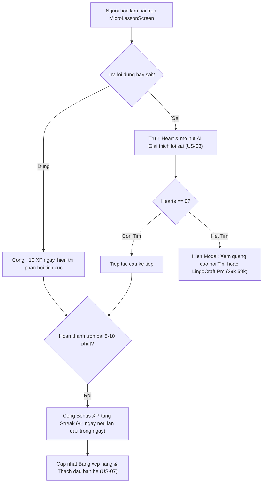

> **Liên kết ngữ cảnh:** [Product Backlog](../product-backlog.md) | [Skill UI/UX](../../00-ai-harness/ui-ux-skill.md) | [MVP MoSCoW](../../01-discovery/05-mvp-moscow.md) | [Persona Student](../../01-discovery/personas/persona-01-student.md) | [Persona Working Pro](../../01-discovery/personas/persona-02-working-pro.md) | [Design Tokens](../../02-design-system/design-tokens.md) | [Component Library](../../02-design-system/component-library.md)

# US-05: Gamification Lõi (Streak, XP, Hearts) & Thách đấu Bạn bè (Must Have + US-07/US-08 Should Have)

## 1. Tuyên bố User Story (User Story Statement)
* **Là một (As a):** Sinh viên dễ mất động lực (**69,4%** khảo sát $N=36$) từng bỏ cuộc sau vài ngày (**50,0%** tổng mẫu / **66,7%** nhóm dùng app Streak cũ).
* **Tôi muốn (I want to):** Nhận điểm **XP**, duy trì chuỗi **Streak**, quản lý **Hearts (Tim)** hợp lý (có thể xem quảng cáo hồi Tim chứ không ép trả tiền ngay) và thi đua **Bảng xếp hạng / Thách đấu bạn bè**.
* **Để (So that):** Tôi duy trì động lực quay lại học tối thiểu 3 ngày/tuần (hướng tới mục tiêu **O3:** Streak TB $\ge 5$ ngày) nhưng vẫn gắn với việc hiểu bài thật chứ không phải "cày streak ảo".

---

## 2. Đặc tả Giao diện cho AI UI/UX Generator
* **Vị trí hiển thị:**
  * Thanh trạng thái đầu màn hình `HomeSkillTreeScreen` và `MicroLessonScreen` (`LessonProgressHeader`).
  * Khối `StreakChallengeCard` trên `HomeSkillTreeScreen` (hiển thị Streak hiện tại, XP hôm nay và top bạn bè thách đấu — động lực **40,7%**).
  * Popup `FeedbackBottomSheet` hoặc modal hồi Tim khi `Hearts === 0`.
* **Components bắt buộc lấy từ `02-design-system/component-library.md`:**
  * `LessonProgressHeader` (icon ngọn lửa Streak màu `tokens.colors.streak`, điểm XP màu `tokens.colors.xpGold`, số Tim `tokens.colors.heartCoral`).
  * `StreakChallengeCard` (hiển thị chuỗi ngày liên tục, thanh tiến độ mục tiêu tuần và nút *"Thách đấu bạn bè"* thuộc **US-07**).
  * `AppButton` (`primary` cho *"Xem quảng cáo hồi +1 Tim"*, `aiAccent` cho *"Nâng cấp Pro (39.000đ/tháng)"*, `secondary` cho *"Quay lại trang chủ"*).

---

## 3. Sơ đồ Luồng Tương tác (Interaction Flow — Mermaid)

---

## 4. Tiêu chí Nghiệm thu (Acceptance Criteria — Gherkin)

### AC-01: Cộng XP và cập nhật chuỗi Streak khi hoàn thành bài học thật
* **Given (Cho rằng):** Người dùng có `Streak = 2`, `XP = 100` và hôm nay chưa hoàn thành bài học nào.
* **When (Khi):** Người dùng hoàn thành trọn vẹn một bài học Micro-learning 5–10 phút.
* **Then (Thì):** Hệ thống cộng thêm điểm XP tương ứng số câu đúng, tăng `Streak` lên `3` và cập nhật ngay lên `LessonProgressHeader` cũng như `StreakChallengeCard`.

### AC-02: Xử lý cơ chế Hearts không gây ức chế ngắt quãng cứng nhắc
* **Given (Cho rằng):** Người dùng làm sai liên tiếp khiến số Tim giảm về `0` (`Hearts = 0`).
* **When (Khi):** Trạng thái `Hearts = 0` được kích hoạt.
* **Then (Thì):** Ứng dụng mở modal đề xuất hai lựa chọn rõ ràng theo mô hình Freemium: (1) **"Xem quảng cáo ngắn để hồi Tim miễn phí"** hoặc (2) **"Mở khóa không giới hạn Tim với LingoCraft Pro (39.000đ – 59.000đ/tháng)"**, tuyệt đối không treo app hoặc mất dữ liệu bài đang làm.

### AC-03: Bảng xếp hạng & Thách đấu bạn bè (US-07) + Nhắc học thông minh (US-08)
* **Given (Cho rằng):** Người dùng đang ở `HomeSkillTreeScreen` (tương ứng động lực **40,7%** thách đấu bạn bè và **37,0%** nhắc học đúng giờ).
* **When (Khi):** Người dùng xem `StreakChallengeCard` hoặc bật cài đặt nhắc học theo khung giờ cố định (ví dụ `21:00` buổi tối ở KTX hoặc `12:15` giờ nghỉ trưa).
* **Then (Thì):** Thẻ hiển thị chính xác thứ hạng XP tuần cùng danh sách bạn bè đang học, và hệ thống lên lịch thông báo nhắc học đúng giờ đã chọn để bảo vệ chuỗi Streak.
