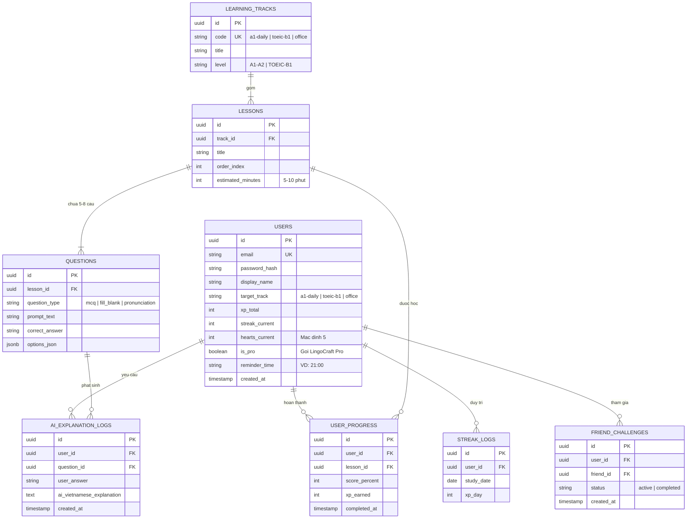

> **Liên kết ngữ cảnh:** [Software Architecture](./software-architecture.md) | [PRD Chính thức](../03-requirements/prd.md) | [Product Backlog](../03-requirements/product-backlog.md) | [US-01](../03-requirements/user-stories/us-01-auth-and-onboarding.md) | [US-05](../03-requirements/user-stories/us-05-gamification-streak-xp-hearts.md)

# 🗄️ Lược đồ Cơ sở Dữ liệu (Database Schema — `LingoCraft AI`)

> **Mục tiêu:** Thiết kế lược đồ PostgreSQL tinh gọn phục vụ đầy đủ các yêu cầu MVP (`US-01`..`US-05` và `US-06`..`US-08`) trong **4 tuần Vibe Code**.

---

## 1. Sơ đồ Quan hệ Thực thể (Entity Relationship Diagram — Mermaid)

---

## 2. Giải thích Các Bảng Cốt lõi theo Nghiệp vụ

1. **`USERS`:** Lưu thông tin đăng nhập, lộ trình mục tiêu (`FR-01`), trạng thái Gamification cốt lõi (`xp_total`, `streak_current`, `hearts_current` mặc định `5`), cờ gói thuê bao `is_pro` (**LingoCraft Pro `39.000đ–59.000đ/tháng`**) và giờ nhắc học `reminder_time` (**US-08**).
2. **`LEARNING_TRACKS` $\rightarrow$ `LESSONS` $\rightarrow$ `QUESTIONS`:** Tổ chức sẵn lộ trình từ gốc A1–A2 (5 chủ đề giao tiếp, hướng tới **200+ bài học 5–10 phút** theo **O1**). Mỗi câu hỏi có `question_type` (`mcq`, `fill_blank`, `pronunciation`) để khi người dùng bật **"Tạm ẩn Nghe/Nói 15 phút"** (`FR-06`), ứng dụng dễ dàng lọc/thay thế các câu `pronunciation`.
3. **`USER_PROGRESS` & `STREAK_LOGS`:** Ghi nhận lịch sử hoàn thành bài để tính **tỷ lệ hoàn thành bài ($\ge 70\%$)**, **Retention D1/D7/D30** và duy trì chuỗi Streak thực chất.
4. **`AI_EXPLANATION_LOGS`:** Lưu lại câu trả lời sai và giải thích tiếng Việt của AI Tutor (`FR-03`) để có thể tái sử dụng (cache) giảm biến phí LLM API và theo dõi lỗi lặp lại của người học.
5. **`FRIEND_CHALLENGES`:** Phục vụ **Bảng xếp hạng & Thách đấu bạn bè** (`FR-07`, động lực **40,7%** khảo sát).
