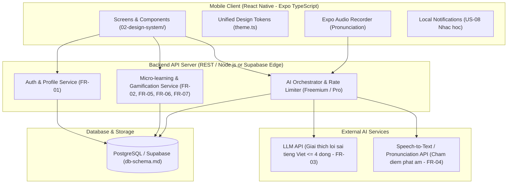

> **Liên kết ngữ cảnh:** [PRD Chính thức](../03-requirements/prd.md) | [Product Backlog](../03-requirements/product-backlog.md) | [DB Schema](./db-schema.md) | [Skill BA](../00-ai-harness/ba-skill.md) | [Skill UI/UX](../00-ai-harness/ui-ux-skill.md) | [Prototype Screens](../02-design-system/prototype-screens.md)

# 🏗️ Kiến trúc Hệ thống (Software Architecture — `LingoCraft AI`)

> **Mục tiêu:** Thiết kế kiến trúc gọn nhẹ, thực dụng cho **4 tuần Vibe Code** (Mobile App React Native + Backend API + Dịch vụ AI), đáp ứng đầy đủ các yêu cầu `FR-01`..`FR-08` và mục tiêu ổn định **O2** (tỷ lệ hoàn thành bài $\ge 70\%$, lỗi crash $\le 2$).

---

## 1. Sơ đồ Kiến trúc Tổng thể (System Architecture — Mermaid)

---

## 2. Phân tách Tầng Hệ thống (Tech Stack & Responsibilities)

| Tầng (Layer) | Công nghệ đề xuất (4 tuần Vibe Code) | Trách nhiệm chính |
| :--- | :--- | :--- |
| **Mobile App** | **React Native (Expo / TypeScript)** | Hiển thị màn hình 1 câu/màn hình (`MicroLessonScreen`), quản lý state chế độ *"Tạm ẩn Nghe/Nói 15 phút"*, thu âm giọng nói (`expo-av`) và nhắc học cục bộ (`expo-notifications`). |
| **Backend & Auth** | **Node.js (Express/Fastify) hoặc Supabase** | Xác thực người dùng (`JWT`), lưu tiến độ học tập, tính toán `XP`, `Streak`, `Hearts`, xếp hạng thách đấu bạn bè và kiểm soát hạn mức Freemium. |
| **Database** | **PostgreSQL (Supabase)** | Lưu trữ dữ liệu quan hệ (chi tiết tại [db-schema.md](./db-schema.md)). |
| **AI Tutor (Text)** | **LLM API** (Prompt khóa ngữ cảnh tiếng Việt) | Nhận câu hỏi + đáp án sai + đáp án đúng $\rightarrow$ trả về lời giải thích bản địa hóa cho người Việt ($\le 4$ dòng, **$\le 3$ giây**). |
| **AI Speaking** | **Speech-to-Text / Pronunciation Scoring API** | Nhận file audio ngắn từ `PronunciationMicButton` $\rightarrow$ trả về điểm `0–100%` và danh sách từ sai âm cuối. |

---

## 3. Ánh xạ API Endpoints theo Functional Requirements (`prd.md`)

| Mã FR | Endpoint (REST) | Method | Mục đích |
| :--- | :--- | :---: | :--- |
| **FR-01** | `/api/v1/auth/register`, `/api/v1/auth/login`, `/api/v1/users/me/track` | `POST` / `PATCH` | Đăng ký, đăng nhập và lưu lộ trình mục tiêu (`a1-daily`, `toeic-b1`, `office`). |
| **FR-02, FR-06** | `/api/v1/tracks/:trackId/lessons`, `/api/v1/lessons/:lessonId/questions` | `GET` | Lấy cây kỹ năng 5–10p; client lọc/chuyển đổi câu Nghe-Nói khi bật `isSpeakingMuted`. |
| **FR-03** | `/api/v1/ai/explain-error` | `POST` | Gửi `{ questionId, userAnswer, correctAnswer }` $\rightarrow$ nhận giải thích tiếng Việt ($\le 4$ dòng). |
| **FR-04** | `/api/v1/ai/score-pronunciation` | `POST` | Gửi audio + câu mẫu $\rightarrow$ nhận `{ scorePercent, flaggedWords, vietnameseTip }`. |
| **FR-05** | `/api/v1/progress/complete-lesson`, `/api/v1/hearts/recover` | `POST` | Cập nhật `XP`, `Streak`, trừ/hồi `Hearts` (sau khi xem quảng cáo hoặc gói Pro). |
| **FR-07** | `/api/v1/leaderboard/friends` | `GET` | Lấy bảng xếp hạng XP tuần giữa nhóm bạn thách đấu. |
